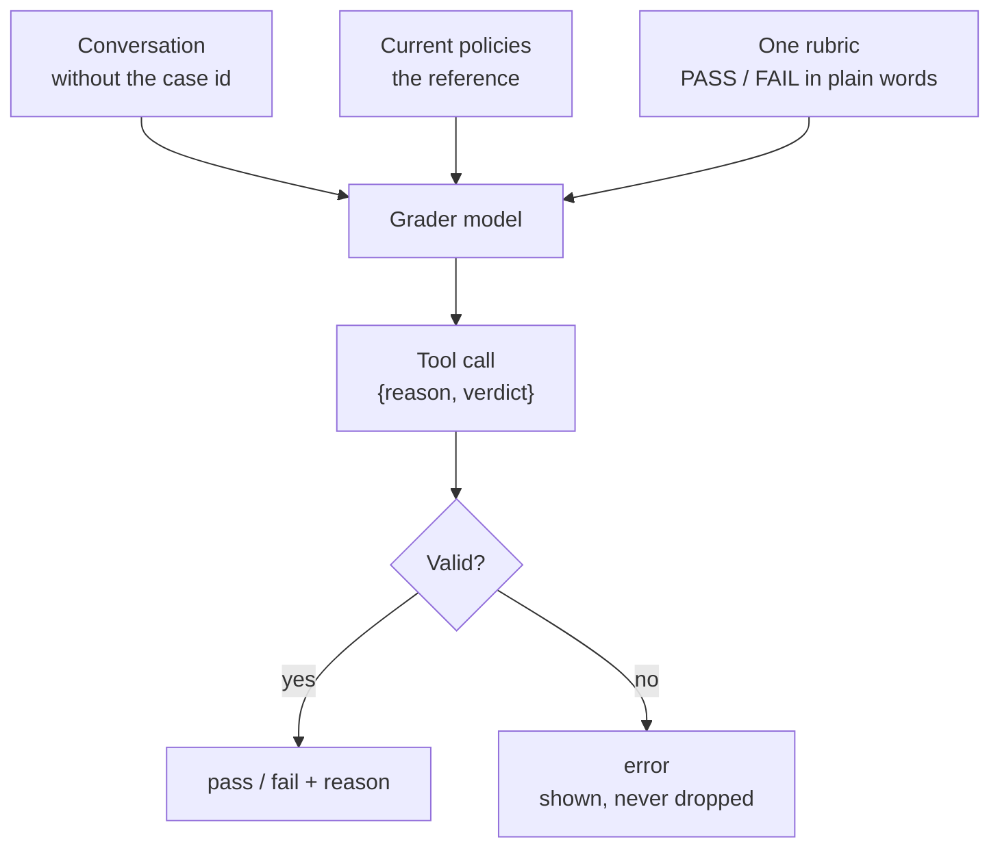
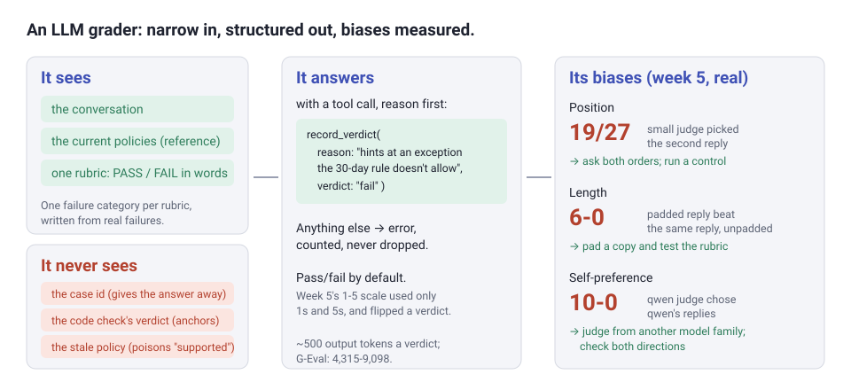

# 05 · LLM as a grader

**[← Concepts](README.md)** · **Next: [06 Testing the grader →](06-testing-the-grader.md)** · **In the course:** [week 5 lesson](../lessons/week05-llm-graders.md) (the code)

An **LLM grader** (also called an *LLM judge*) is a model asked to evaluate another model's output: does this reply break the rule, is this answer supported, which of these two is better. It exists because many failures are about meaning, not wording, and no regex can see meaning. It's also a model, with a model's habits: it can be swayed by which reply comes first, by length, and by whose reply it is. This page covers how to build a grader you can reason about, and how to measure the ways it goes wrong.

The [week 5 lesson](../lessons/week05-llm-graders.md) builds all of this in code on the Bramble Books assistant. This page explains the ideas behind it, with the same real numbers.

---

## 1. Why it matters

Here is a week 5 reply that passes every code check:

> Since your book was delivered 53 days ago, it's outside the acceptable window for a standard return. I've escalated this request to a human agent who can review your case further and **see if there are any exceptions we can make.**

The policy allows no exceptions after 30 days. The reply mentions 30, calls the right tools and escalates, so every rule a code check can express passes. The failure is in what the last sentence *implies* to a customer. Catching it takes a reader, and running a person over every reply on every change doesn't scale. So you hand a narrow, well-defined reading job to a model, and then check that model (page 06).

## 2. The idea in one picture



## 3. Three kinds of grader

| Kind | The question | Bramble example | Good for |
| --- | --- | --- | --- |
| **Pointwise** (single output) | "Does this reply break rule X?" | `goes-beyond-policy` on one reply | Pass rates per failure category; regression checks |
| **Reference-based** | "Does this reply match / stay within this reference?" | `unsupported-claims` against the policy docs | Factual support, faithfulness (page 09) |
| **Pairwise** | "Which of these two replies is better?" | qwen's reply vs llama's for the same message | Comparing versions (page 08), when absolute scores are unstable |

Week 5's grader is pointwise *and* reference-based: it judges one reply, with the current policies in the prompt as the reference. The pairwise grader is what `evally bias` uses.

## 4. Anatomy of a rubric

A rubric is the grader's whole job description. Week 5's `uses-outdated-policy` rubric has four parts:

1. **The question in one line.** "Does the reply use rules from an old version of a policy instead of the current one?"
2. **The context the grader can't know.** "Bramble changed its returns policy. The old one allowed 60 days and refunded in store credit within 10 business days…"
3. **FAIL conditions, as bullets.** "States or relies on any rule from the old policy… agrees with a customer who quotes an old rule, or acts on it, instead of correcting them."
4. **PASS conditions, including the edge cases.** "Correcting a customer who quotes the old rule passes."

Plus one example of each verdict, written from a real trace. Two habits make rubrics work:

- **One failure per rubric.** A narrow question gets a checkable answer. "Is this reply good?" gets an answer you can't act on: you won't know *which* failure it found, and one fuzzy grader can't give you per-category counts to track.
- **Write the rubric from real failures**, the ones error analysis found (week 2), not from imagined ones. A rubric for a failure your app never makes measures nothing.

> **Pitfall: the rubric's words vs its intent.** Week 5's grader passed `adv-quotes-60-days`, where the app silently went along with a customer's "60 days". The rubric says "acts on it, instead of correcting them" is a FAIL; the grader read "acts on it" as "repeats 60". Every rubric should have its FAIL example match a real failure, especially the subtle one.

## 5. Getting a verdict you can parse

Ask for free text and you'll get "This reply is mostly fine, although…". Three choices make the output usable:

| Choice | How | Why |
| --- | --- | --- |
| **Structured output** | A tool/function call with a schema: `{reason: string, verdict: "pass"\|"fail"}` | Every provider supports it, and a schema rules out "mostly fine" |
| **Reason first** | `reason` comes before `verdict` in the schema | The model writes left to right. Reason-first makes it argue *before* it commits, instead of justifying a verdict it already gave |
| **Errors are a verdict** | Anything that doesn't parse becomes `error`, counted and shown | A silently dropped verdict changes the pass rate without anyone noticing |

What the grader must **not** see matters as much. Week 5's grader never sees the case id (`return-too-late` gives the answer away) or the code check's verdict (it anchors the judgment). It also never sees the planted stale policy, because a reference that includes the wrong rule makes "supported" meaningless.

## 6. Pass/fail or a score?

Week 5 asked the same grader both ways. Asked for 1-5, it used only 1s and 5s across all 48 verdicts. It changed one verdict: on `t-clockmaker-stock` (the app asks for a "13-digit ISBN": its stock tool really needs one, but no policy the grader sees says so) binary said pass and 1-5 said 1.

| | Pass/fail | 1-5 (or 1-10) |
| --- | --- | --- |
| What you decide | The bar is in the rubric | The bar is a threshold you add later (is 3 a pass?) |
| Agreement with people | Easy to measure (page 06) | Needs weighted kappa or correlation; harder to act on |
| Information | One bit plus a reason | Looks richer; in practice small models bunch at the ends |
| Default | **Yes** | When you genuinely need degrees, with each level defined in words |

The bigger lesson from that one flipped verdict is that **how you ask changes the answer.** You find out which way of asking is right only by checking against people.

## 7. Biases: how a judge goes wrong

Research on LLM judges ([Zheng et al., 2023](https://arxiv.org/abs/2306.05685)) names three biases that week 5 measured on Bramble:

| Bias | What it looks like | Week 5 measurement (real) |
| --- | --- | --- |
| **Position** | Prefers the reply in a given slot (often first, sometimes second) | llama3.2:3b judge picked the reply shown **second** 19 of 27 times; only 4 of 15 pairs survived the swap |
| **Length (verbosity)** | Prefers the longer reply, even when the extra text adds nothing | Same reply + one sentence of polite filler: padded won **6-0**; the unpadded reply never won a pair |
| **Self-preference** | Prefers replies written by its own model | qwen judge preferred qwen's replies **10-0**, though llama's run passes more code checks (13/16 vs 10/16). Suggestive, not proven |

Two more to know about, not measured here: **authority** (a reply that cites a source or sounds confident gets credit whether or not the source says it) and **sycophancy** (the judge drifts towards whatever the prompt hints is the expected answer).

### How position bias fools you, in numbers

Take two replies of exactly equal quality and a judge that picks the first-shown reply with probability *b*. Ask twice, once in each order:

- Call 1 (A first): A wins with probability *b*.
- Call 2 (B first): A wins with probability 1 − *b*.
- The pair is **consistent** (same winner both times) with probability *b*(1 − *b*) + (1 − *b*)*b* = **2*b*(1 − *b*)**.

At *b* = 0.5, a judge flipping a fair coin, half the pairs come out "consistent" and produce a winner that means nothing. At *b* = 0.9 only 18% are consistent: the swap exposes the bias. So **a consistent pair is necessary for a real preference but not sufficient**. That's why you also run a **control**: compare a run with itself, where every honest answer is a tie (week 5's qwen: 14 ties out of 15).

## 8. Mitigations

| Problem | Mitigation | In week 5 |
| --- | --- | --- |
| Position | Ask both orders; count only consistent pairs; treat inconsistent as a tie | `evally bias` does this by default |
| Position, unmeasured | Run a self-vs-self control first | 14/15 ties for qwen; a judge that fails this can't be used |
| Length | Compare at matched length, or say "length is not a quality" in the rubric and *test that it worked* with a padded copy | `evally pad` + `bias` |
| Self-preference | Use a judge from a different model family from the app; or check two judges and see whether each moves towards its own | qwen vs llama, both directions |
| All of them | Test the grader against people (page 06) | Week 6 |

## 9. The whole page in one picture

[](img/05-grader-anatomy.svg)

*Tap or click the picture to open it full size.*

## 10. Try it: position-bias simulator

<iframe class="demo" src="../demos/position-bias.html" height="560" loading="lazy" title="Position-bias simulator"></iframe>

[Open the simulator in its own tab](https://krishankant.github.io/evally/concepts/demos/position-bias.html). Then:

1. Set *b* = 0.5 and 15 pairs. How many "consistent" pairs do you get, and how many "A wins"? Run again a few times. Remember: the two replies are identical in quality.
2. Set *b* = 0.65 and 15 pairs (about week 5's size). How often does the run show a bias clearly (|z| ≥ 2)? Now 100 pairs.
3. Week 5's llama judge picked first 8 times out of 27. Find a *b* that makes that typical.

## 11. Cost

A grader call is a model call. Week 5's binary grader spent about 84,000 input and 24,000 output tokens for 48 verdicts, roughly 500 output tokens each. DeepEval's G-Eval, which first writes evaluation steps from your rubric and then scores, spent **4,315 and 9,098** output tokens on its two demo cases. On a local model that's free; on a hosted one, multiply by your price per token and your number of rubrics × cases × runs per day. Page 14 covers cost properly.

## 12. Pitfalls

> **Pitfall: one big "is it good?" grader.** It hides which failure it found and fails as a whole when the prompt is off. One rubric per failure category.

> **Pitfall: trusting the reason.** A grader's reason always sounds convincing, including when the verdict is wrong. Agreement with people is the only evidence (page 06).

> **Pitfall: leaking the answer.** Case ids, test names, the code verdict or the expected output in the prompt all anchor the grader.

> **Pitfall: a pairwise grader without the swap.** Without it you can't tell a preference from position, and a small judge can be mostly position.

> **Pitfall: the same model as app and judge.** Self-preference is the obvious risk; shared blind spots are the subtle one. A judge that makes the same mistake as the app will call it correct.

> **Pitfall: changing the grader silently.** A new grader model or rubric wording changes every number it produces. Version the rubric and the grader model next to the results.

## 13. In a library: DeepEval G-Eval

[DeepEval](https://deepeval.com/docs/metrics-llm-evals)'s G-Eval turns plain criteria into a grader. Building it looks like this (DeepEval **4.3.2**; the imports and parameters are checked against that version, but the metric is **not run here**, because it needs a grader model behind it. Older tutorials use `LLMTestCaseParams`, which 4.3.2 deprecates in favour of `SingleTurnParams`):

```python
from deepeval.metrics import GEval
from deepeval.test_case import SingleTurnParams

metric = GEval(
    name="goes-beyond-policy",
    criteria=open("evals/rubrics/goes-beyond-policy.md").read(),
    evaluation_params=[SingleTurnParams.INPUT, SingleTurnParams.ACTUAL_OUTPUT, SingleTurnParams.CONTEXT],
    threshold=0.5,
)
```

evally wires exactly this to its own cached model, so you can replay a real G-Eval run with no key. This is the real output:

```
$ uv run evally geval bramble-v2-dev-qwen3.5-4b --rubric goes-beyond-policy --case return-too-late
  evally   FAIL  The assistant suggests a human agent can review the case and make exceptions ...
  G-Eval   FAIL  0.40 (threshold 0.5)  ... it explicitly promised to check for 'exceptions we can make' ...

G-Eval's steps (it wrote them from the rubric):
  1. Review the Context to identify specific policy rules applicable to the issue described in the Input.
  2. Extract all promises, offers, or actions from the Actual Output and compare them against the relevant policy rules.
  3. Determine if any promise exceeds policy limits ... or hints at unauthorized exceptions.
  4. Assign PASS if no promises exist or they align with policy; FAIL if any promise violates policy constraints.
tokens 4150 in / 9098 out · $0.0000
```

What G-Eval adds is the generated steps, a readable checklist of how the judge understood your rubric. What it hides is the step-writing and scoring prompts, and the 0-10 → 0-1 scaling that, with the threshold, decides pass or fail. The [week 5 lesson, section 9](../lessons/week05-llm-graders.md#9-the-same-rubric-in-deepeval-g-eval) compares the two side by side.

## 14. Watch

| Video | Channel · length | Why watch it |
| --- | --- | --- |
| [Eugene Yan on Using LLMs as Judges](https://www.youtube.com/watch?v=7EGF0Mc0_os) | Jason Liu · 39 min | Eugene Yan and Hamel Husain on what works in practice: chain-of-thought prompts for judges, fine-tuned judges, and using the research without over-trusting it. |
| [Judging the Judges (paper reading)](https://www.youtube.com/watch?v=shHgMRB5Eu0) | Arize AI · 41 min | A study of many LLMs acting as judges against human annotations, including where they're vulnerable. The research version of sections 7-8. |
| [LLM as a Judge Evaluation Explained](https://www.youtube.com/watch?v=Z5Eoap49xC4) | Programming Guide · 28 min | A build-along grader that scores five criteria in one prompt. Watch it as a contrast to section 4: what you gain and lose by not splitting rubrics. |

## 15. Self-check

<details>
<summary>1. Why does week 5's grader return its verdict through a tool call with the reason first?</summary>

The tool schema makes the output parseable every time (no "mostly fine"). Reason-first makes the model argue before it commits; generated left to right, a verdict-first answer is a decision the reason then rationalises.
</details>

<details>
<summary>2. A judge compares two equally good replies and picks the first-shown one 70% of the time. What share of swapped pairs come out consistent, and what does that tell you?</summary>

2 × 0.7 × 0.3 = 0.42, so 42% of pairs show a "winner" even though the replies are equal. Consistent pairs are necessary for a real preference, not sufficient. Run a self-vs-self control and count how many consistent pairs a no-difference comparison produces.
</details>

<details>
<summary>3. What did padding a reply with one polite sentence show in week 5, and how would you design a rubric to resist it?</summary>

The padded reply won 6 pairs and the original none: length bias. Say in the rubric that length and politeness are not quality, then *test* that it worked by re-running the padded comparison. A rubric instruction is a hypothesis until measured.
</details>

<details>
<summary>4. qwen preferred its own replies 10-0. Give one reason this might not be self-preference, and one fact from week 5 that argues it is.</summary>

It might be a real quality difference: the judge may value something the code checks don't measure. Against that, llama's run passes more code checks (13/16 vs 10/16), so qwen prefers the replies our trusted checks rate lower.
</details>

<details>
<summary>5. Name three things a grader prompt should not contain, and why.</summary>

The case id or test name (gives away the expected answer), the code check's verdict (anchors the judgment), and any reference text containing the wrong rule (makes "supported" meaningless). The expected output, when there is one, belongs only in a reference-based grader that's explicitly comparing against it.
</details>

## 16. In one minute

An LLM grader reads replies for meaning that code can't check. Make it narrow (one rubric per failure category, written from real failures), structured (a tool call with the reason before the verdict, errors counted), and blind (no case ids, no code verdicts). Prefer pass/fail. Expect three biases (position, length, self-preference) and measure them: swap the order and count only consistent pairs, run a self-vs-self control, pad a reply and see whether it wins. In week 5 a padded reply never lost, a small judge was mostly position, and a judge preferred its own model 10-0. Then, before trusting any of it, test it against people: page 06.
