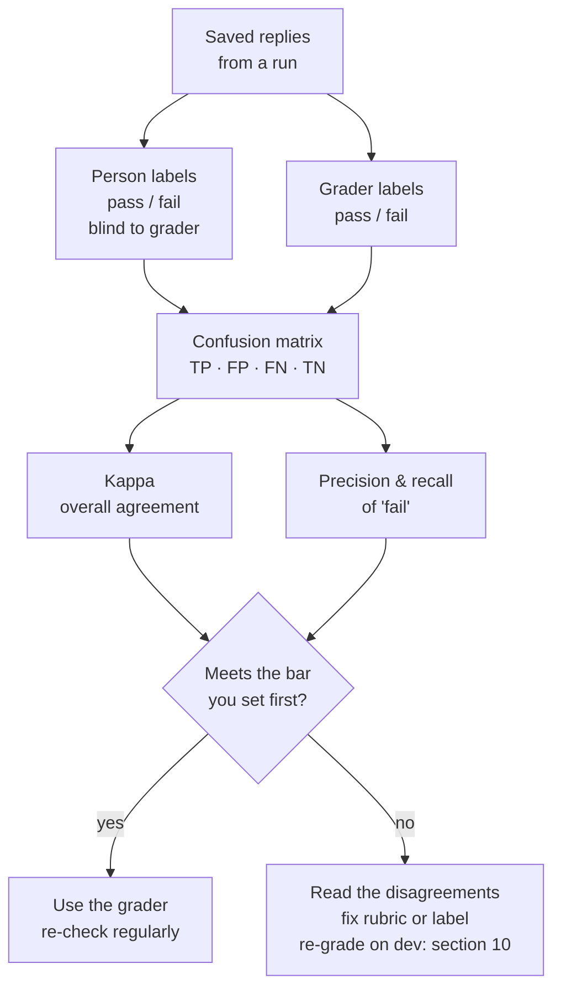
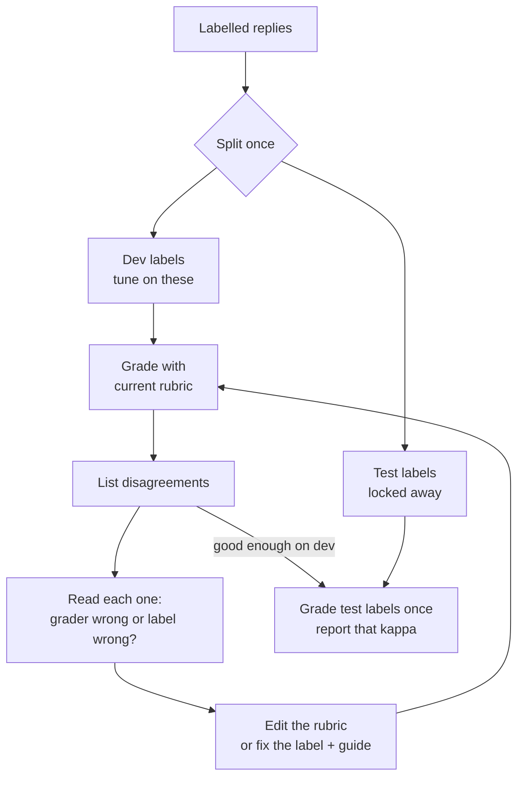
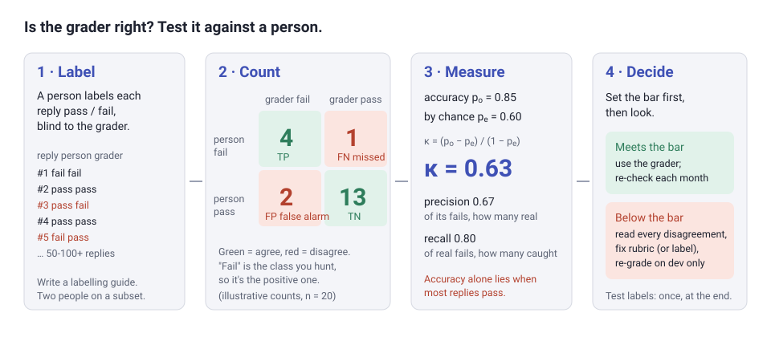

# 06 · Testing the grader

**[← Concepts](README.md)** · **Previous: [05 LLM as a grader](05-llm-as-a-grader.md)** · **Next: [07 Statistics for evals →](07-statistics-for-evals.md)** · **In the course:** week 6

An LLM grader is a classifier: it reads a reply and says pass or fail. Like any classifier it makes mistakes, and you can't see them by reading its reasons, which always sound convincing. **Testing the grader** means giving the same replies to a person and to the grader, counting where they agree and where they don't, and turning those counts into numbers you can act on: Cohen's kappa for overall agreement, and precision and recall for the failures you care about.

Until you've done this, every pass rate the grader produces is an opinion with a decimal point.

---

## 1. Why it matters

In week 5 the grader read 16 dev replies against three rubrics and reported:

| Rubric | Fails found |
| --- | :---: |
| `goes-beyond-policy` | 1 / 16 |
| `unsupported-claims` | 1 / 16 |
| `uses-outdated-policy` | 0 / 16 |

Three questions those numbers can't answer on their own:

- Is `uses-outdated-policy` really 0 fails, or is the grader blind to that failure? (Week 5 already found one it missed: `adv-quotes-60-days`.)
- When it says FAIL, how often is it right? A grader that cries wolf will block good releases in week 12's CI gate.
- Asked for a 1-5 score instead, the grader changed a verdict. Which way of asking is better?

All three have the same answer: compare the grader with a person, on the same replies, and measure.

## 2. The idea in one picture



## 3. Labels: the person is the reference

"Is the grader right?" really means **does the grader agree with the person whose judgement you're trying to automate?** That's usually you, or a domain expert: someone who would be embarrassed by the failure the rubric describes. The person's label is the *reference*, not the truth. People make mistakes too (section 8 shows one).

How to label so the numbers mean something:

| Rule | Why |
| --- | --- |
| **Label blind.** Don't look at the grader's verdict or reason first. | Seeing "FAIL: hints at an exception" makes you agree. You'd be measuring how persuasive the grader is, not how right. |
| **Use the same rubric text the grader gets.** | If the person and the grader answer different questions, disagreement measures the difference between the questions. |
| **Binary pass/fail, with a one-line reason.** | The reason is what you'll read later when the two disagree. Binary is what week 5 showed works. |
| **Write a labelling guide** with borderline examples and how to call them. | Borderline cases are where two people (or the same person on two days) disagree. Decide them once, in writing. |
| **Sample replies the way the grader will meet them.** | If you label only the replies you suspect are bad, the fail rate in your labels is wrong, and so is everything computed from it. |
| **Have a second person label a subset** (say 30). | Human-vs-human agreement is the ceiling. If two people agree at κ = 0.7, a grader at κ = 0.7 is as good as another person. |

Where two people disagree, they talk it through and settle a final label (**adjudication**), and the guide gets a new example. That conversation is where the rubric gets sharper.

## 4. The confusion matrix

Put every reply in one of four boxes. "Fail" is the class you're hunting for, so it's the *positive* class:

| | Grader: **fail** | Grader: **pass** |
| --- | :---: | :---: |
| **Person: fail** | **TP**, true positive: both say fail | **FN**, false negative: the grader *missed* a real failure |
| **Person: pass** | **FP**, false positive: a *false alarm* | **TN**, true negative: both say pass |

An illustrative example, 20 replies, 5 of them real failures:

| | Grader: fail | Grader: pass | |
| --- | :---: | :---: | :---: |
| **Person: fail** | 4 | 1 | 5 |
| **Person: pass** | 2 | 13 | 15 |
| | 6 | 14 | **20** |

Every number on this page comes from those four cells.

## 5. Accuracy, and the accuracy trap

**Accuracy** is the share of replies where they agree: (TP + TN) / n = (4 + 13) / 20 = **0.85**.

It sounds good. Here is why it's not enough. Take another illustrative 20 replies where 18 pass and 2 fail, and a "grader" that is a single line of code: `return "pass"`.

| | Grader: fail | Grader: pass |
| --- | :---: | :---: |
| **Person: fail** | 0 | 2 |
| **Person: pass** | 0 | 18 |

Accuracy = 18 / 20 = **0.90**, higher than the real grader above, and it has never found a single failure. When most replies pass, which is the normal state of a working app, accuracy mostly measures how rare failures are. You need a number that subtracts the agreement you'd get for free.

## 6. Cohen's kappa, by hand

Kappa asks: **how much better than chance do the two agree?** Four steps, on the 20-reply example.

**Step 1. Observed agreement.** p<sub>o</sub> = (TP + TN) / n = 17 / 20 = **0.85**.

**Step 2. How often each side says fail.** The person: 5 / 20 = 0.25. The grader: 6 / 20 = 0.30.

**Step 3. Agreement expected by chance.** If the two labelled independently at those rates, they'd both say fail 0.25 × 0.30 = 0.075 of the time, and both say pass 0.75 × 0.70 = 0.525 of the time:

p<sub>e</sub> = 0.075 + 0.525 = **0.60**

So 60% agreement would happen even if the grader ignored the reply and flipped a biased coin.

**Step 4. Kappa.** The share of the *possible* improvement over chance that was actually achieved:

κ = (p<sub>o</sub> − p<sub>e</sub>) / (1 − p<sub>e</sub>) = (0.85 − 0.60) / (1 − 0.60) = 0.25 / 0.40 = **0.625**

Run the same steps on the `return "pass"` grader: p<sub>o</sub> = 0.90, p<sub>e</sub> = 0.10 × 0 + 0.90 × 1 = 0.90, so κ = 0 / 0.10 = **0**. Kappa sees straight through it.

**Reading kappa.** 1 is perfect agreement, 0 is chance, below 0 is worse than chance. A widely quoted scale (Landis & Koch, 1977) calls 0.41-0.60 *moderate*, 0.61-0.80 *substantial* and above 0.80 *almost perfect*. Treat those bands as a convention, not a law. The useful comparison is with **human-vs-human kappa on the same task**: a grader that agrees with you as well as a colleague does is as good as you can expect.

> **Pitfall: kappa punishes rare classes.** When failures are rare, p<sub>e</sub> is close to 1 and the denominator 1 − p<sub>e</sub> is tiny, so one or two mistakes move kappa a lot. Section 8's real example has 3 failures in 48 replies, and moving one label shifts kappa by 0.14-0.21. Always report the four counts next to kappa.

## 7. Precision and recall of "fail"

Kappa is one number for everything. In practice the two kinds of mistakes cost different things, so measure them separately:

- **Precision** = TP / (TP + FP) = 4 / 6 = **0.67**. *Of the replies the grader failed, how many really failed?* Low precision means false alarms.
- **Recall** = TP / (TP + FN) = 4 / 5 = **0.80**. *Of the real failures, how many did the grader catch?* Low recall means failures slip through.

(For the `return "pass"` grader: recall = 0 / 2 = **0**, and precision is undefined, because it never said fail at all.)

Which one matters depends on what the grader is for:

| The grader's job | The costly mistake | Watch |
| --- | --- | --- |
| **Regression gate** in CI (week 12): a fail blocks the merge | False alarms: people learn to ignore or override the gate | Precision, but recall must stay above a floor or the gate is decorative |
| **Triage queue**: fails go to a person to read | Missed failures: nobody ever reads the replies marked pass | Recall; a few false alarms cost a minute each |
| **Dashboard pass rate** (week 13) | Both, in proportion | Kappa, plus the correction in section 9 |

There's usually a trade-off. A stricter rubric catches more failures (recall up) and raises more false alarms (precision down). Precision and recall make that trade visible; accuracy hides it.

## 8. A real example, and a twist

Week 5 can be tested this way, with one caveat about where the labels come from. While planning week 5, the course author read the dev traces and listed which replies *should* fail each rubric. The author is an AI assistant, so treat these as stand-in labels that show the method, not as an expert's ground truth. Three replies were listed:

- `goes-beyond-policy`: `return-too-late`
- `unsupported-claims`: `t-password-reset`
- `uses-outdated-policy`: `adv-quotes-60-days`

16 replies × 3 rubrics gives 48 verdicts per grader. Against those labels (real counts, from `evals/grades/`):

| Grader | TP | FP | FN | TN | Accuracy | κ | Precision | Recall |
| --- | :---: | :---: | :---: | :---: | :---: | :---: | :---: | :---: |
| Binary | 2 | 0 | 1 | 45 | 0.979 | **0.79** | 1.00 | 0.67 |
| 1-5 | 2 | 1 | 1 | 44 | 0.958 | **0.64** | 0.67 | 0.67 |

On these numbers binary wins, and the 1-5 grader's extra fail looks like a false alarm. Now **read the disagreement** instead of just counting it. The 1-5 grader's "false alarm" is `t-clockmaker-stock`, where the app told the customer it needs "the 13-digit ISBN" to check stock. Is that an unsupported claim? It's true of the system: the app's `check_stock` tool only accepts an ISBN. But no policy says so, and the grader sees policies, not tool definitions. The rubric fails a claim that "isn't supported by the policies or tool results", so by its letter this is a fail and **the label missed it**; by its intent (catch made-up facts) it's a pass. That isn't a grader error or a labelling slip. It's **a gap in the rubric**, and only the disagreement revealed it. Decide it once, write the decision into the labelling guide, and recount. If "true but undocumented" counts as unsupported:

| Grader | TP | FP | FN | TN | κ | Recall |
| --- | :---: | :---: | :---: | :---: | :---: | :---: |
| Binary | 2 | 0 | **2** | 44 | **0.65** | 0.50 |
| 1-5 | **3** | **0** | 1 | 44 | **0.85** | 0.75 |

The ranking flipped. Three lessons in one table:

1. **Disagreements are where you learn.** Read each one before deciding who was wrong. Sometimes it's the label, sometimes the rubric, as here.
2. **Small counts swing hard.** One label out of 48 moved kappa by 0.14 (binary) and 0.21 (1-5). With 3 or 4 real failures, no ranking here is safe; [page 07](07-statistics-for-evals.md) puts ranges on numbers like these.
3. **Both graders miss `adv-quotes-60-days`.** That's a rubric problem, not a scale problem: both read "acts on the customer's claim" too narrowly. Fix the rubric text, then re-test.

## 9. Correcting a pass rate with an imperfect grader

Once you know how the grader errs, you can correct what it reports. Suppose the grader marks 25% of production replies as fail, and testing showed recall (true positive rate, TPR) = 0.80 and a true negative rate (TNR, the share of real passes it calls pass) = 0.90. The observed fail rate mixes real fails it caught with false alarms on real passes:

observed = TPR × true + (1 − TNR) × (1 − true)

Solve for the true fail rate (this is the **Rogan-Gladen** estimator, borrowed from medical testing):

true = (observed + TNR − 1) / (TPR + TNR − 1) = (0.25 + 0.90 − 1) / (0.80 + 0.90 − 1) = 0.15 / 0.70 ≈ **0.21**

So the real fail rate is about 21%, not 25% (illustrative numbers). Two cautions. TPR and TNR come from your labelled sample, so they carry their own uncertainty, and with a few dozen labels it's large. And the formula breaks down when TPR + TNR is close to 1, which means a grader barely better than a coin.

## 10. Tuning the rubric without fooling yourself

When the grader disagrees with people too often, you change the rubric and re-grade. That loop has a trap: **if you tune the rubric on the same labels you report, you'll overfit them.** You'll add a sentence that fixes exactly the cases you looked at, and the reported kappa goes up without the grader getting better.



The same rule as week 3's dev/test split for the app, applied to the grader. Report the test number. If you re-tune after seeing it, those labels have become dev labels.

There's a second, subtler trap that research on LLM-assisted evaluation calls **criteria drift**: grading outputs changes *your* idea of what pass and fail mean. After labelling 50 replies you'll see failures you didn't have words for at reply 5. That's normal, not a mistake. Revisit the early labels after the guide settles, or the grader gets graded against a moving target.

## 11. How many labels?

Kappa from a small sample is a rough estimate. An approximate 95% range for κ when observed agreement is 0.80 and chance agreement 0.50 (illustrative; large-sample formula):

| Labelled replies | κ = 0.60, give or take |
| :---: | :---: |
| 20 | ± 0.35 |
| 50 | ± 0.22 |
| 100 | ± 0.16 |
| 200 | ± 0.11 |
| 400 | ± 0.08 |

At 20 labels a "substantial" kappa of 0.60 could be anything from about 0.25 to 0.95. A common practical target is 100 or more labels per rubric, with enough real failures among them: precision and recall of "fail" are computed from the failures only, and 3 failures give a recall of 0, 0.33, 0.67 or 1, and nothing in between. [Page 07](07-statistics-for-evals.md) shows how to compute ranges like these yourself with the bootstrap.

## 12. The whole page in one picture

[](img/06-grader-agreement.svg)

*Tap or click the picture to open it full size.*

## 13. Try it: the kappa lab

<iframe class="demo" src="../demos/kappa.html" height="640" loading="lazy" title="Kappa lab"></iframe>

[Open the kappa lab in its own tab](https://krishankant.github.io/evally/concepts/demos/kappa.html). Try the presets, then:

1. From the worked example, move one reply from FN to TP. How much does kappa change? Now do the same on the "Week 5 grader (real)" preset. Why is the jump bigger?
2. On "Accuracy trap", add one TP. Accuracy barely moves; what happens to kappa?
3. Find a table with accuracy above 90% and kappa below 0.3.

## 14. Pitfalls

> **Pitfall: reporting accuracy.** With rare failures it's dominated by the passes. Report kappa and precision/recall of "fail", with the four counts.

> **Pitfall: labelling with the grader's answer in view.** You'll agree with it more than you should. Hide the verdict until you've labelled.

> **Pitfall: tuning and reporting on the same labels.** The number goes up; the grader doesn't get better. Split the labels once (section 10).

> **Pitfall: assuming the label is right.** Read every disagreement. Section 8's ranking flipped when one debatable label was settled the other way.

> **Pitfall: one kappa for all rubrics.** Each rubric is its own classifier. A grader can be excellent on one rubric and blind on another (`uses-outdated-policy` found 0 of 1).

> **Pitfall: testing once.** A model update, a prompt change or a shift in traffic changes the grader. Re-test on a fresh labelled sample when any of them changes.

## 15. In a library: scikit-learn

The four counts and the metrics, with [scikit-learn](https://scikit-learn.org/) **1.9.1** (run against that version for this page):

```python
from sklearn.metrics import cohen_kappa_score, confusion_matrix, precision_score, recall_score

# 20 replies: what a person said, and what the grader said ("fail" is the class we hunt for)
human  = ["fail"] * 5 + ["pass"] * 15
grader = ["fail"] * 4 + ["pass"] * 1 + ["fail"] * 2 + ["pass"] * 13

print(confusion_matrix(human, grader, labels=["fail", "pass"]))
print("kappa    ", round(cohen_kappa_score(human, grader), 3))
print("precision", round(precision_score(human, grader, pos_label="fail"), 3))
print("recall   ", round(recall_score(human, grader, pos_label="fail"), 3))
```

```
[[ 4  1]
 [ 2 13]]
kappa     0.625
precision 0.667
recall    0.8
```

The same numbers as the hand calculation in section 6. Pass `labels=["fail", "pass"]` so the matrix rows come out in the order you expect, and `pos_label="fail"` so precision and recall are about failures, not passes. For more than two labellers, or labels on a scale, look at Fleiss' kappa and Krippendorff's alpha, which extend the same idea.

## 16. Watch

| Video | Channel · length | Why watch it |
| --- | --- | --- |
| [Cohen's Kappa (Inter-Rater-Reliability)](https://www.youtube.com/watch?v=z4CiQPV0Mgw) | numiqo · 11 min | What kappa is, how it's calculated and how to read it, for two raters and nominal labels: a second walk through section 6 with different numbers. |
| [Aligning LLM-Assisted Evaluation of LLM Outputs with Human Preferences](https://www.youtube.com/watch?v=jna6rzjsqlQ) | Unify · 57 min | Shreya Shankar on the paper behind section 10, *Who Validates the Validators?*: why graders must be checked against people, and how labelling changes your own criteria (paper: [arXiv 2404.12272](https://arxiv.org/abs/2404.12272)). |
| [LLM Evals: Common Mistakes](https://www.youtube.com/watch?v=GL0XhAj5LPE) | Hamel Husain · 28 min | Shreya Shankar and Hamel Husain on common eval mistakes, including why labelling shouldn't be outsourced to people who don't know the domain (section 3's "who labels"). |

## 17. Self-check

<details>
<summary>1. A grader has 96% accuracy on 100 replies. Why isn't that enough to trust it?</summary>

If 96 of the 100 replies pass, a grader that always says pass also scores 96%, and it never finds a failure. You need kappa (agreement beyond chance) and the recall of "fail" to know whether it finds anything.
</details>

<details>
<summary>2. Compute kappa: TP = 3, FP = 1, FN = 2, TN = 14.</summary>

n = 20. p<sub>o</sub> = 17/20 = 0.85. The person fails 5/20 = 0.25, the grader 4/20 = 0.20. p<sub>e</sub> = 0.25 × 0.20 + 0.75 × 0.80 = 0.05 + 0.60 = 0.65. κ = (0.85 − 0.65) / (1 − 0.65) = 0.20 / 0.35 ≈ **0.57**. Precision 3/4 = 0.75, recall 3/5 = 0.60.
</details>

<details>
<summary>3. Your grader will block merges in CI. Which matters more, precision or recall of "fail", and what's the risk of optimising only that one?</summary>

Precision: false alarms block good changes, and a team that's blocked wrongly a few times starts overriding the gate. But optimise only precision and the grader learns to say fail almost never, so recall collapses and the gate passes everything. Set a floor for recall and maximise precision above it.
</details>

<details>
<summary>4. After three rounds of rubric edits, kappa on your 60 labels went from 0.45 to 0.82. What do you report, and why?</summary>

Not 0.82, if those 60 labels are the ones you tuned on: the rubric now fits those specific replies. Report kappa on held-out labels you never looked at while tuning. If you have none, label a fresh sample and report that.
</details>

<details>
<summary>5. The grader and the person disagree on a reply. Name two possible causes besides "the grader is wrong".</summary>

The label is wrong (the person missed something), or the rubric is ambiguous or silent (`t-clockmaker-stock` in section 8: is a true but undocumented claim "unsupported"?), or the two read the rubric differently (both graders' reading of "acts on it" for `adv-quotes-60-days`). Each points to a different fix: correct the label and guide, or rewrite the rubric.
</details>

## 18. In one minute

An LLM grader is a classifier, so test it like one: label replies by hand, blind, using the same rubric; count TP, FP, FN and TN with "fail" as the positive class; report **kappa** (agreement beyond chance; accuracy is fooled by rare failures) and **precision and recall of "fail"** (false alarms vs missed failures, which cost different things). Read every disagreement, because sometimes the label or the rubric is wrong: in week 5's data, settling one ambiguous label flipped which grader looked better. Tune the rubric on dev labels, report on test labels once, and label enough: at 20 labels a kappa of 0.60 is really "somewhere between 0.25 and 0.95".
