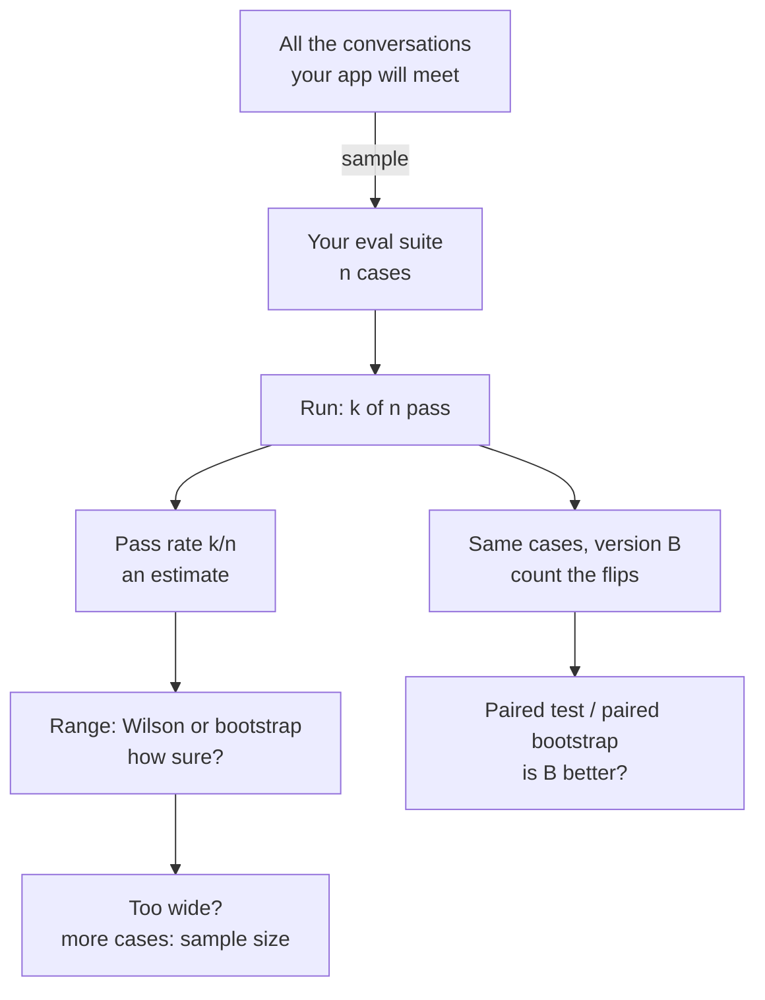
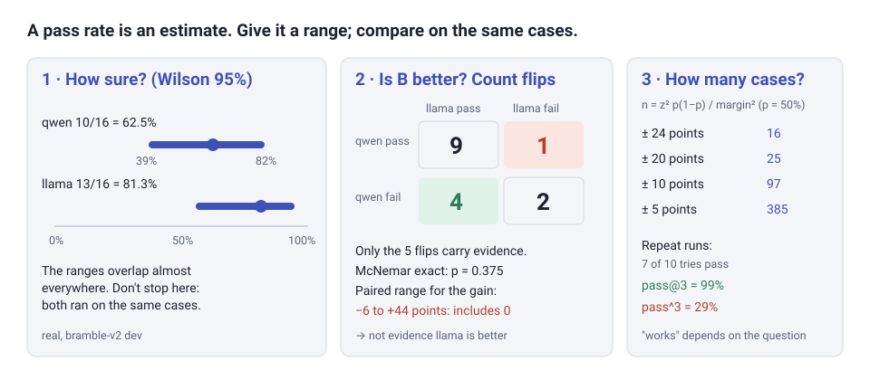

# 07 · Statistics for evals

**[← Concepts](README.md)** · **Previous: [06 Testing the grader](06-testing-the-grader.md)** · **Next: [08 Side-by-side comparison →](08-side-by-side.md)** · **In the course:** week 7

A pass rate from an eval suite is an **estimate**. Your 16 or 100 cases are a sample of the conversations your app will meet, and a different sample would give a different number. Statistics for evals is the small toolkit that answers three questions: *how sure is this number* (a range), *is version B really better than A* (a paired comparison), and *how many cases do I need* (sample size). With 16 cases the honest answers are often "not very", "can't tell" and "more". Knowing that is the point.

---

## 1. Why it matters

On the 16-case Bramble dev set (real, `uv run evally run --suite bramble-v2-dev`):

| App model | Passed | Pass rate |
| --- | :---: | :---: |
| qwen3.5:4b | 10 / 16 | 62.5% |
| llama3.2:3b | 13 / 16 | 81.3% |

That's 19 points higher. Is llama the better app model? By the end of this page you'll compute that the data can't tell: the 95% range for the difference runs from −6 to +44 points, and an exact test gives p = 0.375. Shipping llama on this evidence would be a coin toss dressed up as a decision.

## 2. The idea in one picture



## 3. Sampling error: why the number wobbles

Each case passes or fails, so the number of passes behaves like coin flips with an unknown pass probability *p*. The **standard error** (SE) of the pass rate measures how much it wobbles from sample to sample:

SE = √( *p*(1 − *p*) / *n* )

For qwen: *p* = 10/16 = 0.625, so SE = √(0.625 × 0.375 / 16) = √0.01465 = **0.121**, about 12 points. Two habits follow:

- **The wobble shrinks with √n, not n.** Four times the cases halves the SE. Going from 16 to 64 cases takes ±24 points down to ±12.
- **It's widest at 50%.** *p*(1 − *p*) peaks at 0.25. A suite where almost everything passes wobbles less, but then you learn less too.

> **Pitfall: "the suite is the population".** Your 16 cases aren't the thing you care about; the conversations they stand for are. The suite's pass rate is exact *about the suite* and an estimate *about the app*.

## 4. A range for a pass rate

### The normal approximation, and where it breaks

The textbook 95% range is *p* ± 1.96 × SE = 0.625 ± 0.237 = **0.388 to 0.862**. It assumes the wobble is bell-shaped, which is reasonable for large *n* and *p* away from 0 and 1. At small *n* it breaks in visible ways: 16/16 gives SE = 0 and a range of "100% to 100%", and 1/16 gives a lower end below zero. A 2025 position paper puts it bluntly: [don't use the CLT (this normal approximation) in LLM evals with fewer than a few hundred datapoints](https://arxiv.org/abs/2503.01747). It produces ranges that are too narrow, which is the dangerous direction.

### The Wilson interval

The Wilson interval fixes both problems and is the one to use for a single pass rate. With *z* = 1.96:

centre = ( *p* + *z*² / 2*n* ) / ( 1 + *z*² / *n* )

half-width = *z* √( *p*(1 − *p*)/*n* + *z*² / 4*n*² ) / ( 1 + *z*² / *n* )

For qwen (*p* = 0.625, *n* = 16): 1 + *z*²/*n* = 1.240; centre = (0.625 + 0.120) / 1.240 = **0.601**; half-width = 1.96 × √(0.01465 + 0.00375) / 1.240 = **0.214**. The range is **0.386 to 0.815**. It's pulled towards 50%, never leaves [0, 1], and doesn't collapse at 16/16. (scipy agrees to three decimals; section 13.)

So "qwen passes 62.5%" really means "**somewhere between about 39% and 82%**". llama's 13/16 is 57% to 93%. The two ranges overlap over most of their length.

## 5. The bootstrap, by hand

The bootstrap gets a range for *any* number you can compute from your cases (a pass rate, a kappa from page 06, a median latency, a difference between two versions) without a formula. The idea is to treat your sample as a stand-in for the population and resample it:

1. You have *n* case results, e.g. qwen's sixteen 1s and 0s.
2. Draw *n* cases **with replacement** from them. Some cases appear twice, some not at all. Compute the pass rate of this resampled suite.
3. Repeat thousands of times. You now have thousands of pass rates.
4. The middle 95% of them (the 2.5th to 97.5th percentile) is the range.

A tiny version: results [1, 1, 0, 1, 0]. One resample might be cases 2, 2, 5, 1, 3 → [1, 1, 0, 1, 0] → 60%; another 3, 5, 5, 4, 3 → [0, 0, 0, 1, 0] → 20%. Do that 10,000 times and look at the spread.

For qwen's 16 cases, scipy's bootstrap gives **0.375 to 0.875** (real; section 13). That's wider and coarser than Wilson's, because with 16 cases a resampled pass rate can only take 17 values (0/16, 1/16, …). At small *n*, use Wilson for a single pass rate and keep the bootstrap for things without a formula.

## 6. Is B better than A? Compare on the same cases

### The wrong way: compare two ranges

qwen's range is 39-82%, llama's 57-93%. They overlap, so "no difference"? That method throws away information. Both versions ran on **the same 16 cases**, and most cases are equally easy or hard for both. A paired comparison uses that.

### The right way: count the flips

Line the two runs up case by case (real):

| | llama pass | llama fail |
| --- | :---: | :---: |
| **qwen pass** | 9 | **1** |
| **qwen fail** | **4** | 2 |

The 11 cases where both agree say nothing about which is better. All the evidence is in the **5 flipped cases**: 4 got better (`short-answer`, `t-password-reset`, `t-clockmaker-stock`, `gen-fa79bb81`), 1 got worse (`return-window`).

**McNemar's exact test** asks: if the two were equally good, each flip would go either way with probability ½. How surprising is a 4-1 split or more extreme?

P(a split at least as lopsided as 4-1 in 5 fair flips) = 2 × P(≤ 1 of 5 go one way) = 2 × (C(5,0) + C(5,1)) / 2⁵ = 2 × 6 / 32 = **0.375**

A 4-1 split happens more than a third of the time with *no* real difference. Not evidence.

**The paired bootstrap** (both are built into `evally compare`, section 13) gives the size of the difference with a range: resample *cases* (keeping each case's qwen result and llama result together), compute llama's pass rate minus qwen's each time. The observed difference is +18.8 points, and the 95% range is **−6 to +44 points** (real, from the demo below). It includes zero.

> **Pitfall: a 19-point jump on 16 cases.** Four flips decided it. A paired test on the flips is the honest reading. To see a real 10-point difference reliably you need many more cases, and above all many more *flips*.

## 7. How many cases?

Turn the SE formula around. For a pass rate quoted to ±*m* with 95% confidence:

*n* = *z*² × *p*(1 − *p*) / *m*²

| Margin you want | *n* at *p* = 50% | *n* at *p* = 90% |
| :---: | :---: | :---: |
| ± 20 points | 25 | 9 |
| ± 10 points | 97 | 35 |
| ± 5 points | 385 | 139 |
| ± 2 points | 2,401 | 865 |

(Normal approximation, which is fine for planning.) Bramble's 16 dev cases buy about ±24 points. That's enough to spot a broken release, not to tell two decent ones apart. Comparisons need more than ranges: what matters is the number of *flipped* cases, and when two versions are close, most cases don't flip.

This is why the course says suites stay small "and lessons say plainly when numbers are too small to prove much". A small suite is fine for finding failures (weeks 2-4). It's weak for measuring improvements.

### How many cases to tell two versions apart?

The table above is about one pass rate. Comparing two versions on the same cases is a different question: what matters is how many cases **flip** (section 6). That depends on two shares, *p*<sub>better</sub> (cases that go from fail to pass) and *p*<sub>worse</sub> (pass to fail). For McNemar's test at the 5% level with an 80% chance of detecting a real gain, a standard approximation (Connor, 1987) is:

*n* = [ 1.96 √*p*<sub>d</sub> + 0.84 √(*p*<sub>d</sub> − Δ²) ]² / Δ²  where *p*<sub>d</sub> = *p*<sub>better</sub> + *p*<sub>worse</sub> and Δ = *p*<sub>better</sub> − *p*<sub>worse</sub>

**Worked.** A new prompt fixes 10% of cases and breaks 5%: a real gain of Δ = 5 points, *p*<sub>d</sub> = 0.15.
*n* = (1.96 × 0.387 + 0.84 × 0.384)² / 0.05² = (0.759 + 0.323)² / 0.0025 = 1.172 / 0.0025 ≈ **469 cases**. (A simulation with the exact test finds the gain 78% of the time at 469, close to the 80% target.)

| Flip to pass | Flip to fail | Real gain | Cases needed |
| :---: | :---: | :---: | :---: |
| 15% | 5% | 10 points | 155 |
| 10% | 5% | 5 points | 469 |
| 6% | 1% | 5 points | 218 |
| 25% | 20% | 5 points | 1,411 |

Two lessons hide in that table:

- **Churn is expensive.** The same 5-point gain needs 218 cases when only 7% of cases flip, and 1,411 when 45% do. A change that fixes many cases and breaks many others is much harder to prove than a clean fix.
- **Pairing saves a lot.** Comparing 70% against 75% on two *separate* sets of cases needs about **1,251 cases per version** (a two-proportion test); the paired design above needs 469 for the same gain.

Week 5's qwen → llama flips (4 of 16 better, 1 of 16 worse) would need about **68 cases** to be detected reliably, if those rates held. Bramble's 16 can only confirm very large changes. The planner demo below has this calculator.

## 8. Repeat runs: the same case, many times

LLM output varies between runs (sampling temperature, provider-side changes), so one run of a case is itself a sample. Run each case *n* times and record how many of the tries passed (*c*). Then two different questions have two different answers:

- **pass@k**: if you try *k* times, what's the chance **at least one** passes? Good for "can it ever do this?" (code generation with a test to pick the winner).
- **pass^k**: what's the chance **all *k*** pass? Good for "will every customer get it right?" Popularised for agents by [τ-bench](https://arxiv.org/abs/2406.12045), because a support bot doesn't get to try again.

With *n* tries of which *c* passed, the unbiased estimators ([Chen et al., 2021](https://arxiv.org/abs/2107.03374) for pass@k) are:

pass@k = 1 − C(*n* − *c*, *k*) / C(*n*, *k*)  pass^k = C(*c*, *k*) / C(*n*, *k*)

Worked, with *n* = 10 tries and *c* = 7 passed (illustrative):

| *k* | pass@k | pass^k |
| :---: | :---: | :---: |
| 1 | 70% | 70% |
| 3 | 1 − C(3,3)/C(10,3) = 1 − 1/120 = **99.2%** | C(7,3)/C(10,3) = 35/120 = **29.2%** |

The same case "works 70% of the time". That's 99% at "eventually" and 29% at "three customers in a row". Pick the one that matches what failure costs you.

## 9. Many comparisons at once

Compare two versions on 20 rubrics or 20 categories at the 5% level and you should expect about one "significant" difference by chance alone. Two defences:

- **Decide the comparison before looking.** Name the metric that decides the release up front; treat the rest as exploration.
- **Correct for the number of tests** when you must test many: the simplest is Bonferroni, which divides the 5% by the number of tests.

## 10. The whole page in one picture

[](img/07-ranges.svg)

*Tap or click the picture to open it full size.*

## 11. Try it

**Bootstrap lab:** resample a suite and watch the range, then the real qwen-vs-llama paired comparison.

<iframe class="demo" src="../demos/bootstrap.html" height="760" loading="lazy" title="Bootstrap lab"></iframe>

[Open the bootstrap lab in its own tab](https://krishankant.github.io/evally/concepts/demos/bootstrap.html).

**Planning a run:** cases needed for a margin, and pass@k vs pass^k.

<iframe class="demo" src="../demos/sample-size.html" height="520" loading="lazy" title="Planning a run"></iframe>

[Open the planner in its own tab](https://krishankant.github.io/evally/concepts/demos/sample-size.html). Try:

1. In the bootstrap lab, keep the rate at 62.5% and raise the cases from 16 to 100. How much narrower is the range? Is that the √n you expected?
2. Press "resample again" a few times at 16 cases. Which end of the range moves most?
3. In the planner, set 10 tries and 9 passes. At what *k* does pass^k drop below 50%?

## 12. Pitfalls

> **Pitfall: a pass rate with no range.** "81%" on 16 cases means 57-93%. Always report *n*, and a range when you compare.

> **Pitfall: comparing overlapping ranges instead of pairing.** If both versions ran on the same cases, count the flips. It's more sensitive and it's the right question.

> **Pitfall: ±1.96 × SE on small suites.** It's too narrow and breaks at 0% and 100%. Use Wilson.

> **Pitfall: one run of a nondeterministic app.** A case that passes once may pass 6 times in 10. If decisions hang on single cases, repeat them.

> **Pitfall: tuning on the suite you report.** Same trap as page 06: every prompt tweak that "fixes" a dev case is fitted to that case. Report on held-out cases (week 3's test split), once.

> **Pitfall: significance is not size.** A tiny difference can be "significant" on 10,000 cases and useless in practice. Report the difference *and* its range, not just p.

## 13. In evally, and in scipy

**In evally.** `evally compare` runs this page's paired comparison on two saved runs:

```
$ uv run evally compare bramble-v2-dev-qwen3.5-4b bramble-v2-dev-llama3.2-3b
A = bramble-v2-dev-qwen3.5-4b
B = bramble-v2-dev-llama3.2-3b
shared cases: 16

  A  10/16 = 62.5%   Wilson 95%: 38.6% - 81.5%
  B  13/16 = 81.2%   Wilson 95%: 57.0% - 93.4%

  better in B (4): gen-fa79bb81, short-answer, t-clockmaker-stock, t-password-reset
  worse in B (1): return-window

difference B - A: +18.8%   paired bootstrap 95%: -6.2% to 43.8%
McNemar exact test on the 5 flipped cases: p = 0.375
reading: the range for the difference includes 0: not evidence of a difference
```

It compares only the cases both runs share and warns about the rest. The bootstrap uses a fixed seed, so the same runs always print the same range.

**In scipy.** 
The page's numbers, with [scipy](https://scipy.org/) **1.18.1** and numpy **2.5.5** (run against those versions for this page):

```python
import numpy as np
from scipy import stats

# bramble-v2 dev, 16 cases: 1 = pass (real, from evals/runs/)
qwen  = np.array([1,1,1,1,1,1,1,0,0,0,0,0,1,1,0,1])
llama = np.array([0,1,1,1,1,1,1,1,0,1,1,1,1,1,0,1])

for name, x in [("qwen", qwen), ("llama", llama)]:
    ci = stats.binomtest(int(x.sum()), len(x)).proportion_ci(method="wilson")
    print(f"{name:5} {x.sum()}/{len(x)} = {x.mean():.3f}  Wilson 95%: {ci.low:.3f}-{ci.high:.3f}")

boot = stats.bootstrap((qwen,), np.mean, method="percentile", n_resamples=10_000, random_state=0)
print(f"qwen bootstrap 95%: {boot.confidence_interval.low:.3f}-{boot.confidence_interval.high:.3f}")

# paired: only the cases that flipped carry information (McNemar's exact test)
b = int(((qwen == 1) & (llama == 0)).sum())   # qwen pass, llama fail
c = int(((qwen == 0) & (llama == 1)).sum())   # qwen fail, llama pass
print(f"flipped: {b} one way, {c} the other; McNemar exact p = {stats.binomtest(b, b + c).pvalue:.3f}")
```

```
qwen  10/16 = 0.625  Wilson 95%: 0.386-0.815
llama 13/16 = 0.812  Wilson 95%: 0.570-0.934
qwen bootstrap 95%: 0.375-0.875
flipped: 1 one way, 4 the other; McNemar exact p = 0.375
```

The same numbers as sections 4-6 and as `evally compare`. `binomtest(...).proportion_ci(method="wilson")` is the Wilson interval; McNemar's exact test is a binomial test on the flips.

## 14. Read and watch

| | Source · length | Why |
| --- | --- | --- |
| [Bootstrapping Main Ideas!!!](https://www.youtube.com/watch?v=Xz0x-8-cgaQ) | StatQuest with Josh Starmer · 9 min | Section 5's resampling idea, drawn step by step. |
| [Confidence Intervals, Clearly Explained!!!](https://www.youtube.com/watch?v=TqOeMYtOc1w) | StatQuest with Josh Starmer · 7 min | What a 95% range does and doesn't mean, built from the bootstrap. |
| [Adding Error Bars to Evals](https://arxiv.org/abs/2411.00640) | Evan Miller, 2024 (paper) | The case for reporting ranges on every eval, and for paired tests when two models answer the same questions. |
| [Don't Use the CLT in LLM Evals With Fewer Than a Few Hundred Datapoints](https://arxiv.org/abs/2503.01747) | Bowyer, Aitchison & Ivanova, 2025 (paper) | Why ±1.96 × SE is too narrow on small suites, the situation every course-sized eval is in. |

## 15. Self-check

<details>
<summary>1. A suite of 25 cases passes 20. Give the normal-approximation range and say why you'd rather use Wilson.</summary>

*p* = 0.8, SE = √(0.8 × 0.2 / 25) = 0.08, range 0.8 ± 0.157 = 0.64-0.96. With 25 cases and *p* near 1, the normal approximation is too narrow and can run past 100% at higher rates; Wilson stays inside [0, 1] and is better calibrated at small *n* (here about 0.61-0.91).
</details>

<details>
<summary>2. Version B passes 3 more cases than A on the same 40-case suite: 5 cases got better, 2 got worse. Is that evidence?</summary>

McNemar on the 7 flips: 2 × P(≤ 2 of 7) = 2 × (1 + 7 + 21) / 128 = 0.45. No: a 5-2 split is common when there's no difference.
</details>

<details>
<summary>3. Why is comparing on the same cases more powerful than comparing two separate pass rates?</summary>

Most of the variation in pass rates comes from which cases are in the suite (easy or hard). On the same cases that variation is shared and cancels out; only the flips remain, and they're what the comparison is about.
</details>

<details>
<summary>4. You want a pass rate to ±5 points and expect about 80% to pass. Roughly how many cases?</summary>

*n* = 1.96² × 0.8 × 0.2 / 0.05² = 3.84 × 0.16 / 0.0025 ≈ **246** cases.
</details>

<details>
<summary>5. A case passes 8 of 10 tries. What are pass@1 and pass^3, and which matters for a support bot?</summary>

pass@1 = 0.8. pass^3 = C(8,3)/C(10,3) = 56/120 ≈ 0.47. For a support bot, pass^k: every customer gets one try, so "works 80% of the time" means fewer than half of three customers in a row all get a right answer.
</details>

## 16. In one minute

A pass rate is an estimate from a sample, so give it a range: Wilson for a single rate (±1.96 × SE is too narrow on small suites), the bootstrap for anything without a formula. To compare two versions, run them on the same cases and look only at the cases that flipped: McNemar's test or a paired bootstrap. On Bramble's 16 dev cases, llama's 13/16 vs qwen's 10/16 comes down to 4 flips against 1: p = 0.375, difference −6 to +44 points, not evidence. Plan sample size from the margin you need (±10 points needs about 100 cases), repeat nondeterministic cases, choose pass@k or pass^k by what failure costs, and decide your comparison before you look.
