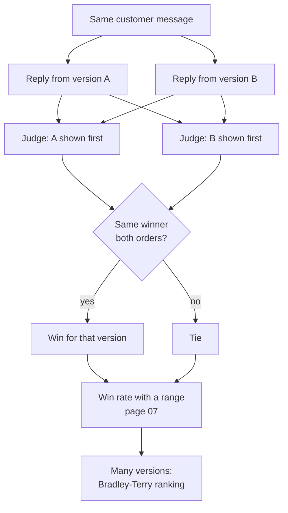
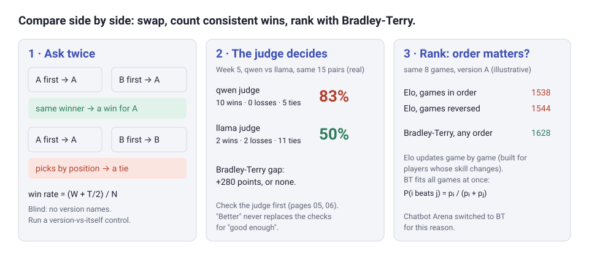

# 08 · Side-by-side comparison

**[← Concepts](README.md)** · **Previous: [07 Statistics for evals](07-statistics-for-evals.md)** · **Next: 09 RAG checks →** *(coming)* · **In the course:** week 8

**Side-by-side** (pairwise) evaluation shows a judge two replies to the same message and asks *which is better?*, instead of scoring each one alone. It's how you compare a new prompt with the old one, two models, or ten versions at once, and it's how public leaderboards like Chatbot Arena rank models. This page covers the protocol (swap the order, count only consistent verdicts), the win rate and its uncertainty, and the two ways to turn many pairwise results into a ranking: **Elo**, which depends on the order of the games, and **Bradley-Terry**, which doesn't.

---

## 1. Why it matters

Absolute scores are hard to keep steady. Week 5's grader, asked for 1-5, used only 1s and 5s, and a judge's sense of "a 4" drifts between prompts and models. *Which of these two is better?* is an easier question for people and for models, and it's the question you actually ask when deciding whether to ship version B.

Week 5 already ran a side-by-side: qwen's replies against llama's on the same 15 single-turn dev messages, judged in both orders (real, `uv run evally bias bramble-v2-dev-qwen3.5-4b bramble-v2-dev-llama3.2-3b`):

| Judge | qwen wins | llama wins | Ties / inconsistent |
| --- | :---: | :---: | :---: |
| qwen3.5:4b | 10 | 0 | 5 |
| llama3.2:3b | 2 | 2 | 11 |

Two judges, two different answers. This page shows how to turn results like these into a win rate and a ranking, and how far to trust either.

## 2. The idea in one picture



## 3. When to compare instead of score

| Compare side by side when… | Score each reply when… |
| --- | --- |
| You're choosing between versions (prompts, models, settings) | You need an absolute bar: "does it break the returns rule?" |
| The quality is about degree ("clearer", "more helpful") | The failure is yes/no and you have a rubric for it (page 05) |
| Scores drift between runs or judges | You must track one version over time |
| You have more than two candidates to rank | You have one version and a release gate (page 12) |

The big limitation: **"better" isn't "good enough".** If both versions break the returns policy, the better one still breaks it. Pair every side-by-side with the pointwise checks that guard the must-not-fail rules.

## 4. The protocol

1. **Same input, two outputs.** Each pair is two versions' replies to the same message, with the same tools and documents available.
2. **Blind.** The judge never sees which version wrote which reply, or anything that gives it away (model names, version tags, formatting quirks you could strip).
3. **Both orders.** Ask once with A first and once with B first.
4. **Count only consistent verdicts.** A pair is a win only if the same version wins in both orders. Anything else is a tie. Page 05 showed why: a judge biased towards the first slot produces "consistent" wins on equal replies 2*b*(1 − *b*) of the time, so you also run a control (a version against itself).
5. **Allow ties.** Forcing a choice between two equally good replies turns judge noise into fake wins.

> **Pitfall: one order only.** Week 5's llama judge picked the reply shown second 19 times out of 27. In one order only, that would look like a strong preference for whichever version you happened to put second.

## 5. The win rate, and how sure it is

With W wins, L losses and T ties out of N pairs, the usual **win rate counts a tie as half**:

win rate = (W + T/2) / N

Week 5 (real), qwen as A:

- qwen judge: (10 + 5/2) / 15 = **83%**
- llama judge: (2 + 11/2) / 15 = **50%**

15 pairs is small. Without ties, the Wilson range from page 07 for 10 wins out of 15 would already run from about 42% to 85%, and two judges that disagree this much mean the judge matters more than the sample size here. The bootstrap from page 07 works directly: resample the *pairs* and recompute the win rate.

> **Pitfall: dropping ties.** "qwen won 10 of 10 decided pairs" is a 100% win rate; with ties counted it's 83%. Both are arithmetically true, but only one tells you how often the judge could tell them apart.

## 6. From many pairs to a ranking: Elo

With more than two versions you want a single ranking. **Elo**, invented for chess, gives each version a rating and updates it after every game.

**Expected score.** If A is rated *R<sub>A</sub>* and B *R<sub>B</sub>*, the chance A wins is

*E<sub>A</sub>* = 1 / (1 + 10<sup>(*R<sub>B</sub>* − *R<sub>A</sub>*)/400</sup>)

400 points means 10-to-1 odds; equal ratings mean 50%.

**Update.** After the game, with *S<sub>A</sub>* = 1 for a win, ½ for a tie and 0 for a loss:

*R<sub>A</sub>* ← *R<sub>A</sub>* + *K* (*S<sub>A</sub>* − *E<sub>A</sub>*)

**Worked**, both starting at 1500 with *K* = 32. A wins: *E<sub>A</sub>* = 0.5, so A gains 32 × 0.5 = 16 → **1516**, and B drops to **1484**. A wins again: now *E<sub>A</sub>* = 1 / (1 + 10<sup>−32/400</sup>) = 0.546, so A gains only 32 × 0.454 = 14.5. Winning an expected game moves you less.

**The problem for evals:** Elo is *online*. It processes games one at a time, so **the order of the games changes the final ratings**. It was built for players whose skill changes over time, and recent games should count more for them. A model version's quality doesn't change between your comparisons. Take 8 illustrative games among three versions: in one order, version A ends at **1538**; replay the same games in reverse and A ends at **1544** (the demo below reproduces both). Same evidence, different numbers.

## 7. Bradley-Terry: the order-free version

**Bradley-Terry** (BT) uses the same idea, a strength per version and a logistic chance of winning, but fits all games at once:

P(*i* beats *j*) = *p<sub>i</sub>* / (*p<sub>i</sub>* + *p<sub>j</sub>*)

It finds the strengths that make the observed results most likely (maximum likelihood). On an Elo-like scale, 1500 + 400 log₁₀ *p*, it reads like Elo, and the expected-score formula is the same curve. Because the fit sees all games together, **order doesn't matter**.

**Worked, two versions.** A beat B 3 times and lost once. Maximum likelihood sets P(A beats B) = 3/4, so *p<sub>A</sub>* / (*p<sub>A</sub>* + *p<sub>B</sub>*) = 0.75 and *p<sub>A</sub>* = 3 *p<sub>B</sub>*: about **191 points** apart on the Elo-like scale (400 log₁₀ 3).

**Worked, three versions** (the same 8 illustrative games as section 6): BT gives A **1628**, C **1464**, B **1408**, in any order of games. With more than two versions there's no closed form. The fit is a simple repeated update (Hunter's MM algorithm): each version's new strength is its wins divided by Σ over opponents of games / (*p<sub>i</sub>* + *p<sub>j</sub>*). Section 13 runs it in ten lines of numpy.

**Chatbot Arena switched from online Elo to Bradley-Terry** for exactly these reasons: order independence, more stable ratings, and better confidence intervals from bootstrapping the games ([LMSYS, Dec 2023](https://lmsys.org/blog/2023-12-07-leaderboard/)).

> **Pitfall: a version that never lost (or never won).** Its BT strength runs off to infinity: no finite number explains a perfect record. Week 5's qwen judge gave llama 0 consistent wins; only the ties (counted as half) keep the fit finite. A perfect record on 15 pairs says "needs more comparisons", not "infinitely better".

## 8. Week 5 as a ranking

Counting ties as half, the qwen judge's 10-0-5 fits to qwen **1640**, llama **1360** on the Elo-like scale (P(qwen wins) = 83%). The llama judge's 2-2-11 fits to **1500 vs 1500**. A 280-point gap or none, depending on who judged. **A ranking is only as good as its judge**: before believing one, run the checks from page 05 (control, swap, padding) and page 06 (agreement with people) on that judge.

## 9. When not to trust a ranking

- **Too few comparisons.** Each version needs many games against several opponents. Bootstrap the games to get a range on every rating, and look at overlaps.
- **Intransitive preferences.** A > B, B > C, C > A happens with real judges and real users. BT forces a single line and averages the cycle away; look at the head-to-head results too.
- **Judge bias.** Length, position and self-preference (page 05) all move rankings. A judge from the same family as one of the versions is a conflict of interest.
- **Style over substance.** Longer, more formatted replies win more often with people and models alike. Chatbot Arena now reports a "style-controlled" ranking that adjusts for this.
- **Different traffic.** A ranking on Bramble's dev messages says nothing about a version's quality on messages unlike them.

## 10. The whole page in one picture

[](img/08-pairwise.svg)

*Tap or click the picture to open it full size.*

## 11. Try it: Elo playground

<iframe class="demo" src="../demos/elo.html" height="600" loading="lazy" title="Elo playground"></iframe>

[Open the Elo playground in its own tab](https://krishankant.github.io/evally/concepts/demos/elo.html). Try:

1. Press "Shuffle the order" several times. Watch the Elo column move and the Bradley-Terry column stay put.
2. Set K to 4, then 64, and shuffle again. Which K makes the order matter more?
3. Load "Week 5". Change one tie to `llama > qwen`. How much does the gap shrink?
4. Delete all the ties from the week 5 games. What happens to Bradley-Terry, and why?

## 12. Pitfalls

> **Pitfall: "B wins more" without "B is good".** Pair side-by-side results with the pointwise checks that guard hard rules.

> **Pitfall: online Elo for versions that don't change.** Use Bradley-Terry, or at least average Elo over many shuffled orders.

> **Pitfall: a ranking with no ranges.** Bootstrap the games (page 07) and show each rating's range. Overlapping ranges mean "can't separate these".

> **Pitfall: unblinded comparisons.** Version names, model tags or a telltale formatting habit in the prompt let the judge (or a person) pick a favourite.

> **Pitfall: one judge.** Two judges disagreed completely in week 5. If the decision matters, use two judges from different families, or check the judge against people.

## 13. In code: Bradley-Terry with numpy

No special library is needed. This is the MM fit on the page's 8 illustrative games (numpy **2.5.5**, run for this page):

```python
import numpy as np

# 8 illustrative judged games: (a, b, score for a) with 1 = a wins, 0.5 = tie
games = [("A","B",1), ("A","B",1), ("B","C",1), ("A","C",1),
         ("C","A",1), ("B","A",0.5), ("C","B",1), ("A","C",1)]
names = sorted({p for a, b, _ in games for p in (a, b)})
idx = {p: i for i, p in enumerate(names)}
n = np.zeros((3, 3)); wins = np.zeros(3)
for a, b, s in games:
    i, j = idx[a], idx[b]
    n[i, j] += 1; n[j, i] += 1
    wins[i] += s; wins[j] += 1 - s

p = np.ones(3)
for _ in range(2000):                       # Hunter's MM algorithm for Bradley-Terry
    p = wins / (n / (p[:, None] + p[None, :])).sum(axis=1)
    p /= np.exp(np.log(p).mean())          # fix the scale: geometric mean 1

for name, s in zip(names, p):
    print(f"{name}  strength {s:.3f}  Elo-scale {1500 + 400 * np.log10(s):.0f}")
print(f"P(A beats B) = {p[0] / (p[0] + p[1]):.3f}")
```

```
A  strength 2.089  Elo-scale 1628
B  strength 0.589  Elo-scale 1408
C  strength 0.813  Elo-scale 1464
P(A beats B) = 0.780
```

The same strengths as the demo, which implements the same algorithm in JavaScript. For production use with ranges, bootstrap the `games` list (page 07) and refit each time.

## 14. Read and watch

| | Source · length | Why |
| --- | --- | --- |
| [How Elo Ratings Are Calculated](https://www.youtube.com/watch?v=GTaAWtuLHuo) | Spirit Of The Law · 9 min | Section 6's expected-score and update formulas, with game examples. |
| [Ranking Systems: Elo, TrueSkill and Your Own](https://www.youtube.com/watch?v=VnOVLBbYlU0) | GDC Festival of Gaming · 38 min | A deeper look at the maths behind rating systems and how to design your own, from a Twitch engineer. |
| [In the Arena: How LMSys changed LLM Benchmarking Forever](https://www.youtube.com/watch?v=vBlhoAIb0iE) | Latent Space · 41 min | The Chatbot Arena team on pairwise human votes, dynamic evaluation, and adjusting for style (section 9). |
| [Chatbot Arena: An Open Platform for Evaluating LLMs by Human Preference](https://arxiv.org/abs/2403.04132) | Chiang et al., 2024 (paper) | The full method: pairwise votes, Bradley-Terry, bootstrapped ranges. |
| [Chatbot Arena: New models & Elo system update](https://lmsys.org/blog/2023-12-07-leaderboard/) | LMSYS blog, 2023 | Why they moved from online Elo to Bradley-Terry, in their own words. |

## 15. Self-check

<details>
<summary>1. A judge gives version B 6 wins, 2 losses and 7 ties against A. What's B's win rate, and why does the tie rule matter?</summary>

(6 + 7/2) / 15 = 9.5 / 15 ≈ 63%. Dropping ties gives 6/8 = 75%, which hides that the judge couldn't separate the versions on almost half the pairs.
</details>

<details>
<summary>2. Two versions at 1500 and 1700. What's the lower-rated one's expected score, and how much does it gain with K = 32 if it wins?</summary>

*E* = 1 / (1 + 10<sup>200/400</sup>) = 1 / (1 + 3.16) ≈ 0.24. Gain = 32 × (1 − 0.24) ≈ 24 points.
</details>

<details>
<summary>3. Why is online Elo a poor fit for ranking model versions, and what replaces it?</summary>

Elo processes games in sequence, so their order changes the ratings, a design meant for players whose skill changes over time. Model versions don't change between comparisons. Bradley-Terry fits all games at once, so order doesn't matter.
</details>

<details>
<summary>4. Version C beat every other version in all 12 of its comparisons. What does Bradley-Terry say, and what should you do?</summary>

Its strength diverges: no finite value maximises the likelihood of a perfect record. Collect more comparisons, especially against the strongest versions, or add a small prior. And check the judge: a perfect record is also what a strong bias looks like.
</details>

<details>
<summary>5. B beats A 70% of the time side by side. Name two reasons that might not mean B should ship.</summary>

Both might fail a hard rule (pointwise checks still needed). And the judge may prefer B's style (length, formatting) or its model family rather than its quality; check with a control and a padding test, or human labels.
</details>

## 16. In one minute

Comparing two replies side by side is easier and steadier than scoring each alone, and it's the question you ask when choosing a version. Do it blind, ask in both orders, count only consistent verdicts as wins, and count ties as half. Report the win rate with a range, because 15 pairs is very few. For many versions, use Bradley-Terry, not online Elo: Elo's ratings depend on the order of the games, BT's don't, and that's why Chatbot Arena switched. In week 5, the same 15 pairs gave qwen an 83% win rate (+280 points) with one judge and 50% with another. A ranking is only as good as its judge, and "better" never replaces the checks for "good enough".
