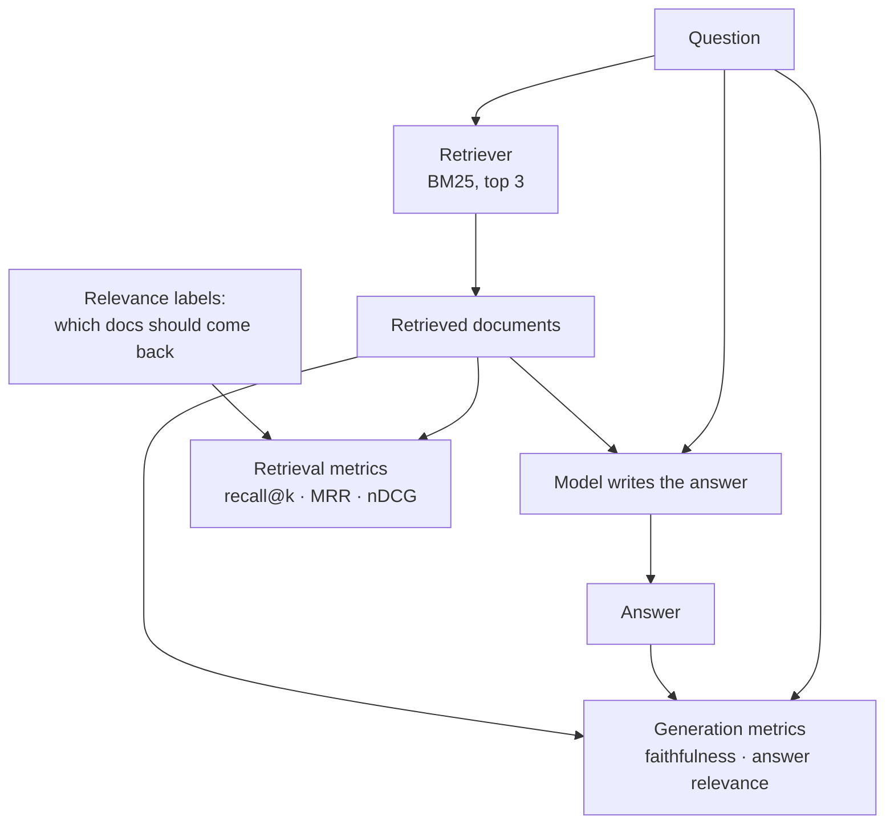
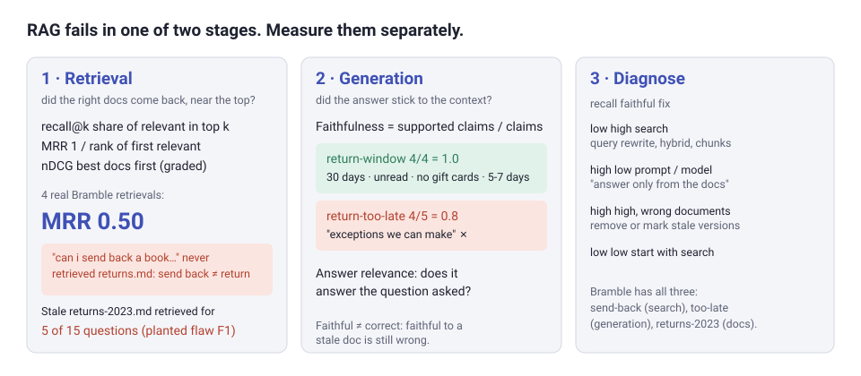

# 09 · RAG checks

**[← Concepts](README.md)** · **Previous: [08 Side-by-side comparison](08-side-by-side.md)** · **Next: [10 Agent and multi-turn checks →](10-agent-checks.md)** · **In the course:** week 9

A RAG (retrieval-augmented generation) app answers in two stages: **retrieve** documents for the question, then **generate** an answer from them. When the answer is wrong, the fault is in one of the two, and the fix is completely different: better search, or a better prompt or model. **RAG checks** measure the stages separately. Retrieval metrics (recall@k, MRR, nDCG) ask *did the right documents come back, near the top?* Generation metrics (faithfulness, answer relevance) ask *did the answer stick to them, and answer the question?*

Bramble Books is a small RAG app: it searches ten policy documents with keyword search (BM25) and puts the top 3 in the prompt. Its retrieval has a planted flaw, and this page measures it.

---

## 1. Why it matters

Two real dev cases, both about returns, both with "wrong" outcomes, for opposite reasons:

| Case | Customer wrote | Retrieved (top 3, real) | What went wrong |
| --- | --- | --- | --- |
| `t-send-back-six-weeks` | "can i send back a book i didnt like? got it about 6 weeks ago" | damaged-items, preorders, gift-cards | **Retrieval.** The returns policy never came back. "Send back" isn't "return" to a keyword search. No prompt fix can help: the answer isn't in the context. |
| `return-too-late` | "I'd like to return order BB-1003 … I changed my mind." | returns, returns-2023, shipping | **Generation.** The right policy was retrieved at rank 1, and the reply still hinted at an exception the policy rules out. Better search can't fix this. |

An end-to-end pass rate lumps both together. Measure the stages separately and you know which one to fix.

## 2. The idea in one picture



## 3. Relevance labels

Retrieval metrics need to know which documents *should* come back for each question: the **relevance labels**. For Bramble's 10 documents a person can label a case in seconds. Some habits:

- **Label per question, not per topic.** "When do I get free shipping?" needs `shipping.md` ($35 threshold) *and* `membership.md` (free for members). Both are relevant.
- **Grade when it helps.** 2 = answers the question, 1 = related but not enough, 0 = irrelevant. Graded labels feed nDCG.
- **Mark harmful documents separately.** `returns-2023.md` isn't merely irrelevant to a returns question; it's actively wrong (60 days, store credit). Relevance metrics treat it as a miss. You'll want a separate "stale doc retrieved" count.
- **Label without looking at what the retriever returned**, for the same reason a person labels blind in page 06.

The labels on this page are the course author's (an AI assistant), for four real dev retrievals. The retrieved lists are real.

## 4. Retrieval metrics

Take one question, a ranked list of retrieved documents and the set of relevant ones. Example: `adv-quotes-60-days` ("Your returns page says I have 60 days…"), retrieved **[returns-2023, returns, shipping]**, relevant = {returns}.

| Metric | Question it answers | Formula | Example |
| --- | --- | --- | --- |
| **Hit rate@k** | Did *any* relevant doc make the top k? | 1 if yes, else 0 | @1: 0 · @3: 1 |
| **Recall@k** | What share of the relevant docs are in the top k? | relevant in top k / all relevant | @1: 0/1 = 0 · @3: 1/1 = 1 |
| **Precision@k** | What share of the top k is relevant? | relevant in top k / k | @3: 1/3 = 0.33 |
| **Reciprocal rank** | How high is the *first* relevant doc? | 1 / its rank (0 if none) | 1/2 = 0.5 |
| **MRR** | Reciprocal rank, averaged over questions | mean of the above | (below) |
| **nDCG@k** | Are the *most* relevant docs at the top? (graded) | DCG / ideal DCG | (below) |

**What matters for RAG.** The model reads all k documents, so *recall@k* is the first thing to watch: if the answer isn't in the context, generation can't recover it. Rank matters less than in web search, but not zero. Models attend more to the start and end of the context, and a wrong document at rank 1, as here, is the one most likely to be believed.

### MRR on four real Bramble retrievals

| Case | Retrieved (real) | Relevant (labels) | First relevant at | RR |
| --- | --- | --- | :---: | :---: |
| `return-window` | returns, returns-2023, gift-cards | returns | 1 | 1 |
| `t-send-back-six-weeks` | damaged-items, preorders, gift-cards | returns | — | 0 |
| `adv-quotes-60-days` | returns-2023, returns, shipping | returns | 2 | 0.5 |
| `free-shipping` | international-shipping, membership, shipping | shipping, membership | 2 | 0.5 |

MRR = (1 + 0 + 0.5 + 0.5) / 4 = **0.50**. Recall@3 is 1 for three cases and 0 for one: **0.75** on average.

### nDCG: when grades matter

nDCG rewards putting the *most* relevant documents first. With grades *g<sub>i</sub>* at rank *i*:

DCG@k = Σ *g<sub>i</sub>* / log₂(*i* + 1)  nDCG@k = DCG@k / (DCG@k of the ideal order)

Worked: grades {d1: 3, d2: 2, d3: 0}, retrieved order [d3, d1, d2].
DCG = 0/log₂2 + 3/log₂3 + 2/log₂4 = 0 + 1.893 + 1.000 = **2.893**.
Ideal [d1, d2, d3]: 3/1 + 2/1.585 + 0 = **4.262**. nDCG@3 = 2.893 / 4.262 = **0.679**.

### The planted flaw, counted

Across the 15 single-turn dev cases (real, from the saved run's `docs` field), the stale `returns-2023.md` was retrieved **5 times** and ranked first once (`adv-quotes-60-days`). It came back for two questions that had nothing to do with returns (an international-shipping question and a membership question): keyword search matched ordinary shared words. The international-shipping question shares "order", "delivery" and "policy" with it; the membership question only "Bramble" and "books", and it still made the top 3 of ten documents. That's the flaw week 1 planted (F1 in `evally/app/FLAWS.md`), measured.

## 5. Generation metrics

Given the question, the retrieved context and the answer:

### Faithfulness (groundedness)

*Is every claim in the answer supported by the context?* The standard recipe, used by Ragas: split the answer into individual claims, check each against the context, and report supported / total.

`return-window`'s real reply, against `returns.md`:

| Claim | Supported? |
| --- | :---: |
| You have 30 days from delivery to return a book | ✓ "within 30 days of delivery" |
| It must be unread and in the condition received | ✓ |
| Gift cards and e-books can't be returned | ✓ |
| Refund within 5-7 business days after it reaches the warehouse | ✓ |

Faithfulness = **4/4 = 1.0**. `return-too-late`'s reply: delivered 20 September ✓ (tool result), 30-day window ✓, 53 days ago ✓ (tool result), escalated with ticket T-1 ✓ (tool result), "an agent will see if there are any exceptions we can make" ✗ ("Returns after 30 days are not accepted"). That's **4/5 = 0.8**. Two notes: tool results count as context too, and faithfulness is not correctness. An answer can be perfectly faithful to the *stale* policy.

### Answer relevance

*Does the answer address the question asked?* A faithful answer about shipping, given a returns question, scores 1.0 on faithfulness and fails here. Ragas measures it by generating questions from the answer and comparing them with the real question; a simpler grader just asks a model.

### Context precision and recall (Ragas's definitions)

Ragas names two more metrics that sit between the stages:

- **Context precision**: are the relevant retrieved chunks ranked above the irrelevant ones? A rank-weighted precision, like average precision.
- **Context recall**: does the retrieved context contain everything the reference answer needs?

Both can be judged by an LLM against a reference answer, or computed from document ids when you have relevance labels (section 13).

> **Pitfall: an LLM grading faithfulness is still a grader.** Claim splitting and support checks are LLM calls with the biases of page 05. Validate them on labelled examples (page 06) before trusting the numbers.

## 6. Diagnose with the two together

| Retrieval recall | Faithfulness | Likely problem | Fix |
| :---: | :---: | --- | --- |
| low | high | The answer is faithful to the wrong context | Search: query rewriting, hybrid search, better chunks |
| high | low | The model ignores or contradicts good context | Prompt, model, "answer only from the documents" rules |
| high | high, but wrong | Context contains wrong or stale facts | Documents: remove or mark stale versions |
| low | low | Both | Start with retrieval: generation can't use what isn't there |

Bramble has all three single-stage problems: `t-send-back-six-weeks` (retrieval), `return-too-late` (generation), and `returns-2023.md` (documents). For deeper RAG fixes (chunking, hybrid search, reranking), the companion course [raggy](https://github.com/krishankant/raggy) covers each stage, and its [evaluation page](https://github.com/krishankant/raggy/blob/main/concepts/12-evaluation.md) goes further on test sets for RAG.

## 7. The whole page in one picture

[](img/09-rag-metrics.svg)

*Tap or click the picture to open it full size.*

## 8. Try it: retrieval metrics calculator

<iframe class="demo" src="../demos/ranking.html" height="560" loading="lazy" title="Retrieval metrics calculator"></iframe>

[Open the calculator in its own tab](https://krishankant.github.io/evally/concepts/demos/ranking.html). Try:

1. Load `adv-quotes-60-days` and move `returns.md` to the top. Which metrics change, and which don't?
2. Load `t-send-back-six-weeks`. Why does everything show 0 or "–"? What does the "missing relevant docs" box change?
3. Load `free-shipping` and set k = 1. Recall halves twice over. Why?

## 9. Pitfalls

> **Pitfall: only an end-to-end score.** It can't tell a search failure from a generation failure. Measure both stages.

> **Pitfall: precision@k for RAG.** The model reads all k docs, so a low precision with high recall is often fine. Watch recall first, and watch *harmful* docs separately.

> **Pitfall: faithful ≠ correct.** Faithful to a stale document is still wrong. Pair faithfulness with checks against the current truth (week 4's code checks, week 5's `uses-outdated-policy`).

> **Pitfall: labels from the retriever's output.** Labelling only what came back can never reveal what didn't. Label from the question and the full document list.

> **Pitfall: one k.** Recall@1 and recall@3 tell different stories (`adv-quotes-60-days`: 0 and 1). Report the k your app actually uses.

## 10. In a library: Ragas

[Ragas](https://docs.ragas.io/) implements these metrics. Most of them (faithfulness, answer relevance, LLM-judged context precision) need an LLM and aren't run here. Its **ID-based** context metrics work from document ids and relevance labels with no model, so here they are on the real `adv-quotes-60-days` retrieval (Ragas **0.4.4**, run for this page):

```python
import asyncio
from ragas import SingleTurnSample
from ragas.metrics import IDBasedContextPrecision, IDBasedContextRecall

# adv-quotes-60-days (real retrieval from the dev run); the relevant doc label is the author's
sample = SingleTurnSample(
    retrieved_context_ids=["returns-2023.md", "returns.md", "shipping.md"],
    reference_context_ids=["returns.md"],
)
for metric in (IDBasedContextPrecision(), IDBasedContextRecall()):
    print(type(metric).__name__, asyncio.run(metric.single_turn_ascore(sample)))
```

```
IDBasedContextPrecision 0.3333333333333333
IDBasedContextRecall 1.0
```

The ID-based precision is precision@3 (1 of 3 retrieved is relevant) and the recall is recall@3, matching section 4. Ragas 0.4.4 warns that importing these from `ragas.metrics` is deprecated, with no direct replacement yet in its new `ragas.metrics.collections` module. Expect the import path to change. Set `RAGAS_DO_NOT_TRACK=true` to turn off its usage telemetry.

## 11. Read and watch

| | Source · length | Why |
| --- | --- | --- |
| [RAG Evaluation Metrics Explained: Context Precision, Recall, Relevancy & Faithfulness](https://www.youtube.com/watch?v=wOoYP55eYF0) | Shrijayan · 20 min | The four generation-side metrics in plain terms, with examples. |
| [Context Precision (Ragas)](https://www.youtube.com/watch?v=rnIn_8Encjw) | QA Automation Alchemist · 8 min | Context precision with and without a reference, in Ragas. |
| [RAG Evaluation](https://www.youtube.com/watch?v=bB56BaQIBm4) | AI Makerspace · 66 min | A long session on context precision, faithfulness and noise sensitivity, and avoiding hallucinations in practice. |
| [Ragas: Automated Evaluation of Retrieval Augmented Generation](https://arxiv.org/abs/2309.15217) | Es et al., 2023 (paper) | Where faithfulness-by-claims and answer relevance come from. |
| [raggy · Evaluation](https://github.com/krishankant/raggy/blob/main/concepts/12-evaluation.md) | the companion RAG course | Building RAG test sets and evaluating each stage, in more depth. |

## 12. Self-check

<details>
<summary>1. Retrieved [d4, d2, d7, d1], relevant {d1, d2}. Compute recall@2, precision@2 and reciprocal rank.</summary>

Recall@2 = 1/2 (only d2 in the top 2). Precision@2 = 1/2. First relevant is d2 at rank 2, so RR = 0.5.
</details>

<details>
<summary>2. A reply is 100% faithful but wrong. How?</summary>

It's faithful to the retrieved context, and the context is wrong: for example the stale `returns-2023.md` (60 days, store credit). Faithfulness checks grounding, not truth.
</details>

<details>
<summary>3. Retrieval recall is 0.95 and faithfulness 0.6. Where do you look first?</summary>

Generation: the right documents are almost always there, and the model isn't sticking to them. Look at the prompt (answer-only-from-documents rules, how conflicts are handled) and the model.
</details>

<details>
<summary>4. Why did `t-send-back-six-weeks` miss `returns.md`, and what kind of fix helps?</summary>

Keyword search (BM25) matches words, and the customer wrote "send back", not "return". Fixes are on the retrieval side: query rewriting, synonyms, or semantic/hybrid search that matches meaning.
</details>

<details>
<summary>5. Why count "stale doc retrieved" separately from relevance metrics?</summary>

To recall@k, a stale document is just an irrelevant one. But it's worse than irrelevant: it contains plausible wrong rules the model may follow. A separate count makes that risk visible and trackable.
</details>

## 13. In one minute

Measure RAG in two stages. **Retrieval**: with relevance labels per question, compute recall@k (is the answer in the context at all?), MRR (how high is the first relevant doc?) and nDCG (are the best docs first?). **Generation**: faithfulness (split the answer into claims, check each against the context) and answer relevance. On Bramble's real retrievals, MRR is 0.50 over four labelled cases, one returns question never retrieved the returns policy ("send back" ≠ "return"), and the stale policy came back for 5 of 15 questions. A faithful answer can still be wrong if the context is stale, so pair these metrics with checks against the current truth.
