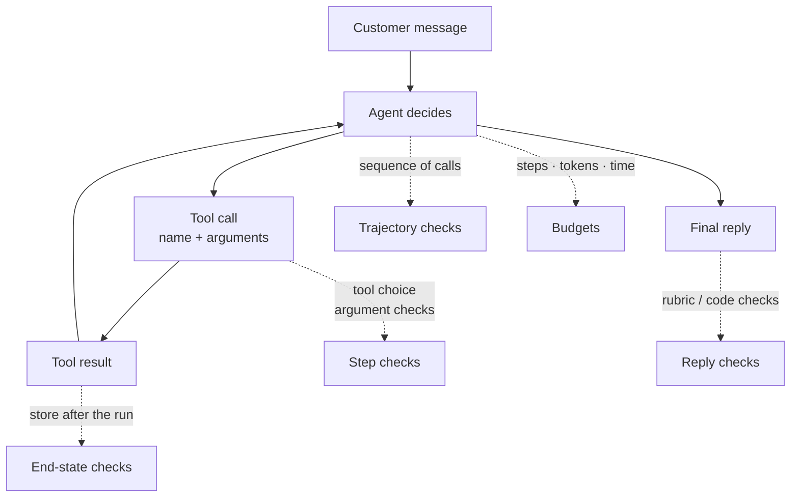
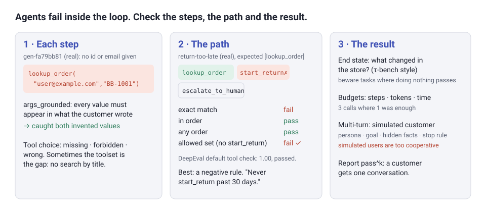

# 10 · Agent and multi-turn checks

**[← Concepts](README.md)** · **Previous: [09 RAG checks](09-rag-checks.md)** · **Next: [11 Safety checks →](11-safety-checks.md)** · **In the course:** week 10

An **agent** doesn't just answer: it decides which tools to call, with which arguments, in what order, reads the results and keeps going, and some of those calls change things (start a return, issue a refund). A **multi-turn** conversation adds the customer's side: questions, missing details, follow-ups. Grading only the final reply misses most of what can go wrong. This page covers the checks that look inside: tool choice, arguments, the whole **trajectory**, the **end state**, budgets, and how to test conversations with a **simulated customer**.

Bramble's assistant is a small agent: four tools (`lookup_order`, `check_stock`, `start_return`, `escalate_to_human`) and a loop that keeps calling them until it answers.

---

## 1. Why it matters

Two real dev runs whose final replies tell you little:

**`gen-fa79bb81`**: *"i bought a book yesteray and now i want retun it but i cant find the button on my account page…"* The customer gave no order id and no email. The agent called:

```
lookup_order {"email": "user@example.com", "order_id": "BB-1001"}  ->  No order found for that order id and email.
```

Both arguments are **invented**. Here the lookup failed harmlessly, but against a real store an invented id can match someone else's order. A grader reading only the reply would see a polite answer about returns. Week 4's `args_grounded` check caught it by comparing the arguments with everything the customer wrote.

**`return-too-late`**: a return 53 days after delivery. The agent called `lookup_order` (fine), then `start_return` (which failed with "returns are only accepted within 30 days"), then `escalate_to_human`. The reply reads well. The path contains a write action the policy already ruled out.

## 2. The idea in one picture



## 3. Tool choice

Three ways to get the tool wrong:

| Failure | Bramble example | Check |
| --- | --- | --- |
| **Missing call**: should have used a tool, didn't | A stock question answered without `check_stock` | `tool_called` |
| **Forbidden call**: used a tool it shouldn't have | `start_return` on a 53-day-old order | `tool_not_called` (for that case) |
| **Wrong tool** | `escalate_to_human` when `lookup_order` would answer it | expected tool list |

Sometimes a "missing call" check finds a gap in the **toolset**, not the agent. `t-clockmaker-stock` asks "Do you have The Clockmaker's Apprentice in stock?" and the agent didn't call `check_stock`. It couldn't: the tool only accepts an ISBN, and there's no way to search by title. So the agent asked the customer for the ISBN. The check is right that the customer's need wasn't met. The fix is a title-search tool, not a better prompt. (And the book sits in the north warehouse, where planted flaw F2 makes `check_stock` time out anyway.)

## 4. Arguments

A call to the right tool with wrong arguments is often worse than no call. Week 4 built three checks, from strict to loose:

| Check | Passes when | Use for |
| --- | --- | --- |
| `tool_args` (exact) | Each argument equals the expected value | Cases where you know the answer (`order_id = "BB-1003"`) |
| `args_shape` | Arguments match a pattern (`BB-\d{4}`, an email) | Format errors, swapped fields |
| `args_grounded` | Every argument value appears in something the customer wrote (or an earlier tool result) | **Invented values**, the `gen-fa79bb81` failure |

`args_grounded` is the one that generalises: it needs no expected value, only the conversation, so it runs on every case, including production traffic (page 13).

## 5. Trajectories

A **trajectory** is the sequence of tool calls. Comparing it with an expected sequence can be done four ways, from strict to loose. `return-too-late`, expected `[lookup_order]`, actual `[lookup_order, start_return, escalate_to_human]` (real):

| Match mode | Rule | `return-too-late` |
| --- | --- | :---: |
| **Exact** | Same calls, same order, nothing extra | ✗ |
| **In order** | Expected calls appear in this order; extras allowed | ✓ |
| **Any order** | Expected calls all appear, any order; extras allowed | ✓ |
| **Superset / subset** | Actual ⊇ expected (or ⊆ allowed set) | ✓ / ✗ against allowed {lookup_order, escalate_to_human} |

Which one fits?

- **Exact** for scripted, compliance-heavy flows, where every extra call is a cost or a risk. Brittle: two valid paths fail one of them.
- **In order** when order matters (look up *before* refunding) but harmless extras are fine.
- **Any order** for gathering steps whose order doesn't matter.
- **An allowed set** (subset match) is often the most useful: "only these tools may be called here". `start_return` isn't in the allowed set for a too-late return, so the check fails for exactly the right reason.

Usually the best check is a **negative rule**, not a full expected path: "never call `start_return` when the order is past 30 days". It tolerates every harmless variation and fails only on the thing that matters.

## 6. End state vs path

For tasks that change something, check **what changed**, not only how:

- **End-state checks** compare the store after the run with what it should be: one return record for BB-1001, no return for BB-1003, no refund issued. That's how [τ-bench](https://arxiv.org/abs/2406.12045) scores agents, against an annotated goal state of the database. It accepts any valid path.
- **Path checks** catch what end state can't: a refund issued and then reversed leaves the right end state and a real risk. So does reading another customer's order.

> **Pitfall: tasks where doing nothing passes.** If the goal state for a task is "nothing changes" and you check only the end state, an agent that does nothing scores 100%. An audit of agent benchmarks found exactly this kind of hole: "TAU-bench counts empty responses as successful" on some tasks, and such issues can misstate performance by up to 100% in relative terms ([Zhu et al., 2025](https://arxiv.org/abs/2507.02825)). Pair end-state checks with a check that the customer actually got what they needed.

## 7. Budgets and recovery

Agents can loop, retry and wander. Put limits on every run and report them:

| Budget | Why |
| --- | --- |
| Steps / tool calls per conversation | Catches loops and flailing; `return-too-late` used 3 calls where 1 was enough |
| Tokens and cost | Each step re-sends the whole history (page 14) |
| Wall-clock time | A customer waiting 40 s has already left |

And check **recovery**: what does the agent do when a tool fails? In `return-too-late`, `start_return` returned an error and the agent escalated with a correct summary. That's a reasonable recovery from a step that shouldn't have happened. For planted flaw F2 (stock times out for north-warehouse books), the right behaviour is to say so and offer an alternative, not to retry forever or invent a stock level.

## 8. Multi-turn conversations

Some failures only exist across turns: the agent asks for details and then forgets them, contradicts itself, or gives up after the second question. Two ways to evaluate:

**Scripted turns.** `return-two-turns` (real) is a fixed two-turn conversation: "I want to return a book, it was a duplicate gift" → the agent asks for the order id and email → "Order BB-1001, email alice@example.com" → `lookup_order` then `start_return`, return R-BB-1001 started. Cheap and repeatable, but the script can't react: if the agent asks a different question, turn 2 no longer makes sense.

**A simulated customer.** A second model plays the customer from a brief:

```
Persona:   Alice, polite, a bit vague, types fast with typos.
Goal:      return order BB-1001 (a duplicate gift) and get a refund to her card.
Knows:     order BB-1001, email alice@example.com. Shares them only when asked.
Stop when: the return is started, she's told it can't be done, or after 8 turns.
```

Then grade the **whole conversation**: was the goal met (end state: a return record exists), were the rules followed (no invented ids, policy-correct answers), and how many turns did it take? Grade per turn as well when you need to know *where* it went wrong.

> **Pitfall: the simulated customer is too nice.** LLM-simulated users tend to be more cooperative, clearer and more patient than real ones, so agents look better in simulation than in production ([Lost in Simulation, 2026](https://arxiv.org/abs/2601.17087)). Give personas real friction: wrong details, topic changes, impatience. Keep a set of real transcripts (page 13) as the reality check.

Simulation multiplies the run-to-run randomness of page 07: two models vary instead of one. Run each scenario several times and report pass^k: a customer gets one conversation, not the best of five.

## 9. The whole page in one picture

[](img/10-trajectory.svg)

*Tap or click the picture to open it full size.*

## 10. Pitfalls

> **Pitfall: grading only the final reply.** `gen-fa79bb81` invented an email and an order id behind a polite reply. Check the calls.

> **Pitfall: exact-match trajectories everywhere.** They fail every valid alternative path, so people stop reading the failures. Prefer allowed sets and negative rules.

> **Pitfall: only end state, or only path.** End state misses risky detours; path misses whether the job got done. Use both where it matters.

> **Pitfall: no budget.** An agent that eventually succeeds after 30 tool calls passes a goal check and fails your users and your bill.

> **Pitfall: blaming the agent for the toolset.** When the right call is impossible (no title search), the fix is a new tool. Error analysis should say which.

## 11. In a library: DeepEval tool correctness

[DeepEval](https://deepeval.com/docs/metrics-tool-correctness)'s `ToolCorrectnessMetric` compares called tools with expected ones. Here it is on the real `return-too-late` calls (DeepEval **4.3.2**, run for this page):

```python
from deepeval.metrics import ToolCorrectnessMetric
from deepeval.test_case import LLMTestCase, ToolCall, ToolCallParams

# return-too-late: the real tool calls from the dev run
called = [ToolCall(name="lookup_order", input_parameters={"email": "chen@example.com", "order_id": "BB-1003"}),
          ToolCall(name="start_return", input_parameters={"email": "chen@example.com", "order_id": "BB-1003",
                                                          "reason": "Changed my mind"}),
          ToolCall(name="escalate_to_human")]
expected = [ToolCall(name="lookup_order", input_parameters={"email": "chen@example.com", "order_id": "BB-1003"})]
case = LLMTestCase(input="I'd like to return order BB-1003, email chen@example.com. I changed my mind.",
                   actual_output="(the reply)", tools_called=called, expected_tools=expected)

variants = {"names only": {},
            "names + arguments": {"evaluation_params": [ToolCallParams.INPUT_PARAMETERS]},
            "exact match": {"should_exact_match": True}}
for label, kwargs in variants.items():
    metric = ToolCorrectnessMetric(include_reason=False, async_mode=False, **kwargs)  # no reason = no LLM needed
    metric.measure(case)
    print(f"{label:18} score {metric.score:.2f}  passed {metric.is_successful()}")
```

```
names only         score 1.00  passed True
names + arguments  score 1.00  passed True
exact match        score 0.00  passed False
```

By default DeepEval checks that the expected tools were called, and the failed, policy-breaking `start_return` doesn't count against it: **1.00, passed**. Only exact match fails it, and exact match would also fail a harmless extra call. Neither expresses "never call `start_return` here"; that's a one-line custom check (week 4's `tool_not_called`).

Two practical notes. DeepEval 4.3.2 builds its default OpenAI judge even for this deterministic metric, so it needs `OPENAI_API_KEY` to be set; a placeholder works because no call is made (evally's `deepeval_side.py` does exactly this). And set `DEEPEVAL_TELEMETRY_OPT_OUT=YES`.

## 12. Read and watch

| | Source · length | Why |
| --- | --- | --- |
| [How to Evaluate Tool-Calling Agents](https://www.youtube.com/watch?v=JytjrbDaI44) | Arize AI · 14 min | The two ways tool use breaks (wrong tool, wrong arguments) and how to evaluate each: sections 3-4. |
| [How to evaluate agent trajectories with AgentEvals](https://www.youtube.com/watch?v=FCKjETgr54U) | LangChain · 12 min | Why the final answer isn't enough, and trajectory match modes in practice: section 5. |
| [LLM as a judge & other ways to evaluate agents](https://www.youtube.com/watch?v=ABVDjdPMccE) | Data Science Dojo · 6 min | Planning, reflection and trajectory checks with both LLM judges and code. |
| [τ-bench](https://arxiv.org/abs/2406.12045) | Yao et al., 2024 (paper) | Simulated users, end-state scoring and pass^k for agents. |
| [Establishing Best Practices for Building Rigorous Agentic Benchmarks](https://arxiv.org/abs/2507.02825) | Zhu et al., 2025 (paper) | How agent evals go wrong, including the do-nothing agent. |

## 13. Self-check

<details>
<summary>1. Expected [lookup_order, start_return]; actual [lookup_order, check_stock, start_return]. Which match modes pass?</summary>

Exact: ✗ (an extra call). In order: ✓. Any order: ✓. Allowed-set {lookup_order, start_return}: ✗ (check_stock isn't allowed).
</details>

<details>
<summary>2. Why does `args_grounded` generalise better than `tool_args`?</summary>

`tool_args` needs the right answer for each case. `args_grounded` only needs the conversation: any argument value that appears nowhere in what the customer wrote (or in an earlier tool result) is suspect. It runs on any case, including live traffic.
</details>

<details>
<summary>3. An agent passes every end-state check but issued and then cancelled a refund along the way. Why care, and what check catches it?</summary>

A refund issued even briefly can cost money, trigger emails or race with other systems. A path check catches it: a forbidden-call rule ("no refund before a successful lookup") or an allowed-set trajectory check.
</details>

<details>
<summary>4. Your agent passes 9 of 10 simulated-customer scenarios but fails often in production. Name two likely reasons.</summary>

Simulated customers are too cooperative (clear, patient, give details on request), and the scenarios don't cover real traffic's variety. Add friction to personas and use real transcripts as scenarios. Also check pass^k: one success per scenario may hide flakiness.
</details>

<details>
<summary>5. `t-clockmaker-stock` fails its `tool_called check_stock` check. Is the agent wrong?</summary>

Not really: `check_stock` needs an ISBN and there's no title search, so the agent couldn't call it with what the customer gave. The check correctly flags an unmet need, and the fix is a new tool. Error analysis should separate agent mistakes from toolset gaps.
</details>

## 14. In one minute

Agents fail inside the loop, so check inside it: the right tools (missing, forbidden, wrong), the right arguments (exact, shape, and above all *grounded*: no invented values, the `gen-fa79bb81` failure), the trajectory (prefer allowed sets and negative rules over exact paths), the end state (what changed in the store, as τ-bench does, but beware tasks where doing nothing passes), and budgets (steps, tokens, time). DeepEval's default tool check scores `return-too-late` 1.00 despite a policy-breaking call, a reminder to write the rule you actually care about. For multi-turn, script the cheap cases and simulate customers with real friction, grade the whole conversation, and report pass^k.
