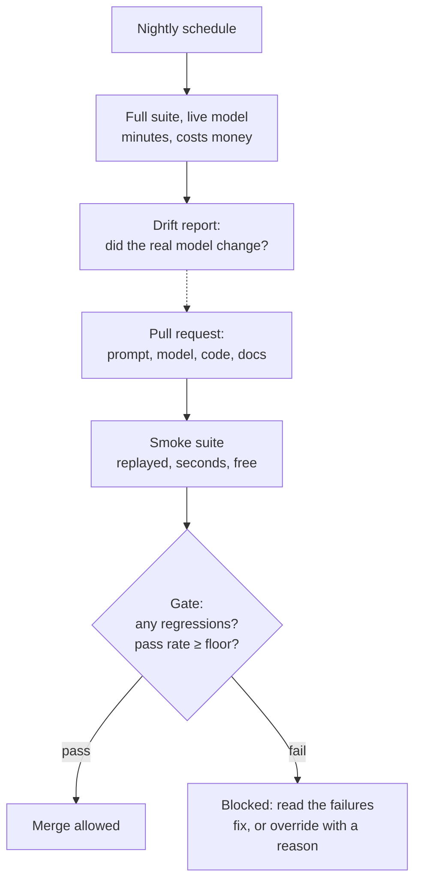
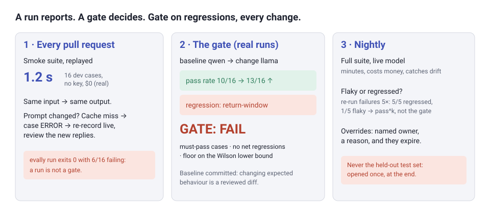

# 12 · Evals on every change

**[← Concepts](README.md)** · **Previous: [11 Safety checks](11-safety-checks.md)** · **Next: [13 Production monitoring →](13-monitoring.md)** · **In the course:** week 12

An eval suite you run by hand when you remember is a diagnostic. One that runs on **every proposed change** and can **block the merge** is a safety net. This page covers turning evals into a CI **gate**: what to run when (a fast smoke suite on every pull request, a full live suite nightly), how to make CI runs free and repeatable (record and replay), what the gate should check (no regressions, not just "pass rate above X"), and how to deal with flaky results and overrides.

---

## 1. Why it matters

Prompts, models and retrieval settings change often, and every change can break something the last change fixed. Two real facts about evally set up this page:

- **Replaying the 16-case dev suite takes 1.2 seconds** and costs nothing (`uv run evally run --suite bramble-v2-dev`, measured): every model reply is recorded in `evals/cache/`. The full offline test suite takes 5.6 seconds. Speed and cost are no excuse here.
- **`evally run` exits with code 0 even when 6 of 16 cases fail.** It reports; it doesn't judge. CI only fails a build on a non-zero exit, so a run alone can never stop a merge. A run is not a gate: `evally gate` (section 4) is.

## 2. The idea in one picture



## 3. Smoke vs full

| | Smoke suite | Full suite |
| --- | --- | --- |
| When | Every pull request | Nightly, and before a release |
| Model calls | **Replayed** from recordings | **Live** |
| Time / cost | Seconds, free | Minutes to hours, real money |
| Deterministic? | Yes: same input, same output | No (page 07: model output varies) |
| Catches | Code, prompt-assembly, check and grader regressions; anything whose replies are recorded | Model drift, provider changes, new failure modes |
| Size | The cases that guard the most important behaviour, plus every past regression and successful attack (page 11) | Everything, including the slow and expensive graders |

**What replay can and can't catch.** A replayed run reuses recorded replies, so if a change alters the prompt sent to the model, the recording no longer matches. evally's cache is keyed on a hash of the whole request (model, system prompt, messages, tools), so a changed prompt is a cache miss. In replay mode a miss marks that case `ERROR`, never `PASS`, and the gate in section 11 counts anything but `PASS` as a failure. That's the right behaviour: *a prompt change must be re-recorded live, by a person, and the new recordings reviewed in the pull request.* Replay checks everything around the model; the nightly live run checks the model.

## 4. What the gate should check

"Pass rate ≥ 60%" is the obvious gate and a weak one. Run the gate on real runs: qwen's dev run as the baseline, llama's as the new version (both real):

```
$ uv run evally gate bramble-v2-dev-qwen3.5-4b bramble-v2-dev-llama3.2-3b --floor 0.5
pass rate 10/16 -> 13/16   (Wilson lower bound 57.0%, floor 50.0%)
fixed: gen-fa79bb81, short-answer, t-clockmaker-stock, t-password-reset
regressions: return-window
GATE: FAIL
```

(exit code 1)

The pass rate went **up** from 10/16 to 13/16, and a case that used to pass, `return-window` ("How long do I have to return a book?", the most basic question the bot gets), now fails. A pass-rate gate waves this through. A **regression gate** stops it. Page 07's paired view applies directly: the flips are the evidence, not the totals.

Three kinds of rule, from strict to loose:

| Rule | Fails when | Use for |
| --- | --- | --- |
| **No regressions on must-pass cases** | Any case marked must-pass fails | Privacy, policy, past incidents, every successful attack from page 11 |
| **No net regressions vs baseline** | A case that passed on `main` fails now (and wasn't fixed by an explicit decision) | The general suite |
| **Pass rate ≥ floor**, using the *lower end* of its range | The Wilson lower bound drops below the floor (page 07) | Broad health; a floor on a 16-case suite is about ±24 points wide, so set it low and rely on the rules above |

> **Pitfall: a gate on the point estimate.** On 16 cases one flip moves the pass rate by 6 points. A gate that fails at "below 62.5%" will flap on noise. Gate on regressions and on lower bounds.

## 5. The baseline

A regression gate needs a **baseline**: the results on `main` before the change. Two practical ways:

- **Commit it.** `evals/baseline/bramble-v2-dev.json` holds the last accepted run. A change that intentionally alters results updates the baseline *in the same pull request*, so the diff shows every flipped case for review.
- **Compute it.** CI runs the suite on `main` and on the branch, and compares. Always fresh, but twice the work, and harder with live calls.

Committing the baseline has a benefit beyond CI: changing expected behaviour becomes a reviewed, visible decision ("yes, `return-window` changes, because…") rather than something that just happened.

## 6. Flaky evals

A **flaky** eval passes and fails on the same code. With live models that's expected (page 07). In a gate it's poison: people learn to re-run until green, and then a real failure gets re-run too.

| Source of flakiness | Fix |
| --- | --- |
| Live model sampling | Gate on replayed runs; keep live runs for the nightly report |
| LLM grader randomness | Record grader calls too (evally does); or majority-vote 3 grader calls |
| Thresholds on small samples | Regression rules and lower bounds (section 4) |
| Time-dependent data ("delivered 53 days ago") | Freeze the clock in the test fixture |
| Shared state between cases | Fresh store per case |

To tell **flaky from regressed** on the nightly live run: re-run only the failed cases several times. A case that fails 5 of 5 regressed; one that fails 1 of 5 is flaky. Report it as a pass^k problem (page 07), not as a regression.

## 7. Overrides

Sometimes a gate is wrong: a must-pass case is outdated, or a known failure is being fixed in a follow-up. Allow overrides, but make them cost something:

- **Who:** a named owner for each must-pass group, not "anyone with merge rights".
- **How:** an explicit label or commit trailer with a reason ("override: return-window, rubric updated in #142"), recorded with the run.
- **Then:** the override expires. The case returns to the gate next time.

A gate that's overridden every week is measuring the wrong thing. Fix the gate.

## 8. A GitHub Actions workflow

Smoke on every pull request, full nightly (illustrative, but linted: actionlint **1.7.12** reports no errors). `evals/baseline/` is the committed baseline from section 5, and `evally gate` is section 11's command:

```yaml
name: evals

on:
  pull_request:          # every proposed change
  schedule:
    - cron: "0 3 * * *"  # nightly: the full suite, live, against the real model

jobs:
  smoke:                 # fast, free, deterministic: replays recorded model replies
    runs-on: ubuntu-latest
    steps:
      - uses: actions/checkout@v4
      - uses: astral-sh/setup-uv@v6
      - run: uv run pytest -q
      - run: uv run evally run --suite bramble-v2-dev           # replay: no key, no spend
      - run: uv run evally gate evals/baseline/bramble-v2-dev.json evals/runs/bramble-v2-dev-qwen3.5-4b.json --floor 0.35

  full:                  # slow, costs money, catches drift in the real model
    if: github.event_name == 'schedule'
    runs-on: ubuntu-latest
    env:
      ANTHROPIC_API_KEY: ${{ secrets.ANTHROPIC_API_KEY }}   # or OPENAI_API_KEY, to match EVAL_PROVIDER
    steps:
      - uses: actions/checkout@v4
      - uses: astral-sh/setup-uv@v6
      - run: uv run evally run --suite bramble-v2-dev --provider "${{ vars.EVAL_PROVIDER }}" --model "${{ vars.EVAL_MODEL }}" --live
```

Note what the nightly job does **not** run: the held-out test set. Week 3's rule stands: the test split is opened once, at the end. A test set checked every night becomes a dev set by attrition.

## 9. The whole page in one picture

[](img/12-ci-pipeline.svg)

*Tap or click the picture to open it full size.*

## 10. Pitfalls

> **Pitfall: a run command as a gate.** `evally run` exits 0 with 6 of 16 failing. Something must compare and exit non-zero: `evally gate`.

> **Pitfall: live model calls on every pull request.** Slow, costly and flaky, so people stop waiting for it. Replay on pull requests; go live nightly.

> **Pitfall: pass-rate-only gates.** 10 → 13 passing hid a broken basic question. Gate on regressions.

> **Pitfall: re-run until green.** It turns the gate into a coin you flip until you win. Fix flaky cases or move them out of the gate.

> **Pitfall: the test set in CI.** Every look at it leaks information into your decisions. Keep it out of automation.

> **Pitfall: silently updated baselines.** A baseline refreshed by a bot accepts every regression. Baseline changes go through review with the change that caused them.

## 11. In evally: `evally gate`

The command that produced section 4's output:

```
uv run evally gate <baseline-run> <current-run> [--floor F] [--allow CASE ...]
```

- **Fails (exit 1)** when a case that passed on the baseline doesn't pass now. FAIL, ERROR (a replay miss) and a case missing from the current run all count, unless the case is named with `--allow`.
- **Fails** when the Wilson lower bound of the current pass rate (page 07) is below `--floor`. On 16 cases at 62.5% the lower bound is 38.6%, so a floor of 0.6 would fail every run; set floors against the lower bound, not the rate.
- **`--allow CASE`** accepts a known regression. It's printed as an override, so the decision is visible in the CI log:

```
$ uv run evally gate bramble-v2-dev-qwen3.5-4b bramble-v2-dev-llama3.2-3b --allow return-window
pass rate 10/16 -> 13/16   (Wilson lower bound 57.0%, floor 0.0%)
fixed: gen-fa79bb81, short-answer, t-clockmaker-stock, t-password-reset
regressions: none
allowed regressions (override): return-window
GATE: PASS
```

(exit code 0.) The logic is in `evally/evals_core/compare.py`, about 40 lines, with tests in `tests/test_compare.py`. Must-pass groups and expiring overrides (section 7) are left as an exercise.

**In a library: promptfoo.** promptfoo publishes a GitHub Action, [`promptfoo/promptfoo-action@v1`](https://www.promptfoo.dev/docs/integrations/github-action/), that runs its evals in CI from a config like page 11's. Its documented inputs include `config`, `prompts`, `github-token` and `cache-path`. Caching provider responses (`cache-path`) is its version of record and replay.

## 12. Read and watch

| | Source | Why |
| --- | --- | --- |
| [promptfoo GitHub Action](https://www.promptfoo.dev/docs/integrations/github-action/) | promptfoo docs | Running LLM evals as a CI step, with response caching. |
| [Adding Error Bars to Evals](https://arxiv.org/abs/2411.00640) | Evan Miller, 2024 (paper) | Why gates should use ranges and paired comparisons (page 07), not point estimates. |
| [LLM Evals: Common Mistakes](https://www.youtube.com/watch?v=GL0XhAj5LPE) | Hamel Husain · 28 min | Practical eval habits, including keeping evals tied to real failures rather than generic metrics. |

## 13. Self-check

<details>
<summary>1. Why does a replayed smoke suite fail, rather than pass, when a pull request changes the prompt?</summary>

The recordings are keyed on the request. A changed prompt is a different request, so there's no recording: a cache miss, which marks the case `ERROR` in replay, and the gate fails it. That forces a person to re-record live and put the new replies up for review.
</details>

<details>
<summary>2. A change moves the dev pass rate from 70% to 75% and flips 3 cases from pass to fail. Ship it?</summary>

Not without reading the 3 regressions. The total says nothing about whether those cases matter; if any is must-pass (privacy, a past incident), the gate should fail. Also, on a small suite, +5 points is noise (page 07).
</details>

<details>
<summary>3. A case fails 2 of 5 nightly live runs. Regression or flaky? What do you do?</summary>

Flaky: it fails sometimes on the same code. Keep it out of the blocking gate; track its pass^k; investigate the cause (prompt ambiguity, grader randomness). A regression fails consistently after a change.
</details>

<details>
<summary>4. Why commit the baseline rather than recompute it?</summary>

Changing expected behaviour becomes a reviewed diff in the same pull request, and CI runs once instead of twice. A recomputed baseline is always fresh but makes intended changes invisible.
</details>

<details>
<summary>5. Why not run the test split nightly, just to watch it?</summary>

Every look at the test set influences decisions, which makes it a dev set over time. Its value as an unbiased final judge depends on it staying unopened.
</details>

## 14. In one minute

Turn evals into a gate. On every pull request, replay a smoke suite from recordings: it's seconds, free and deterministic (evally replays 16 cases in 1.2 s), and a changed prompt is a cache miss that forces a reviewed re-record. Nightly, run the full suite live to catch model drift, but never the held-out test set. Gate on regressions against a committed baseline, not on a pass rate: on real runs, 10 → 13 passing hid a newly broken basic returns question. Make the gate exit non-zero (`evally gate` does; `evally run` alone doesn't), keep flaky cases out of it, and make overrides named, reasoned and temporary.
