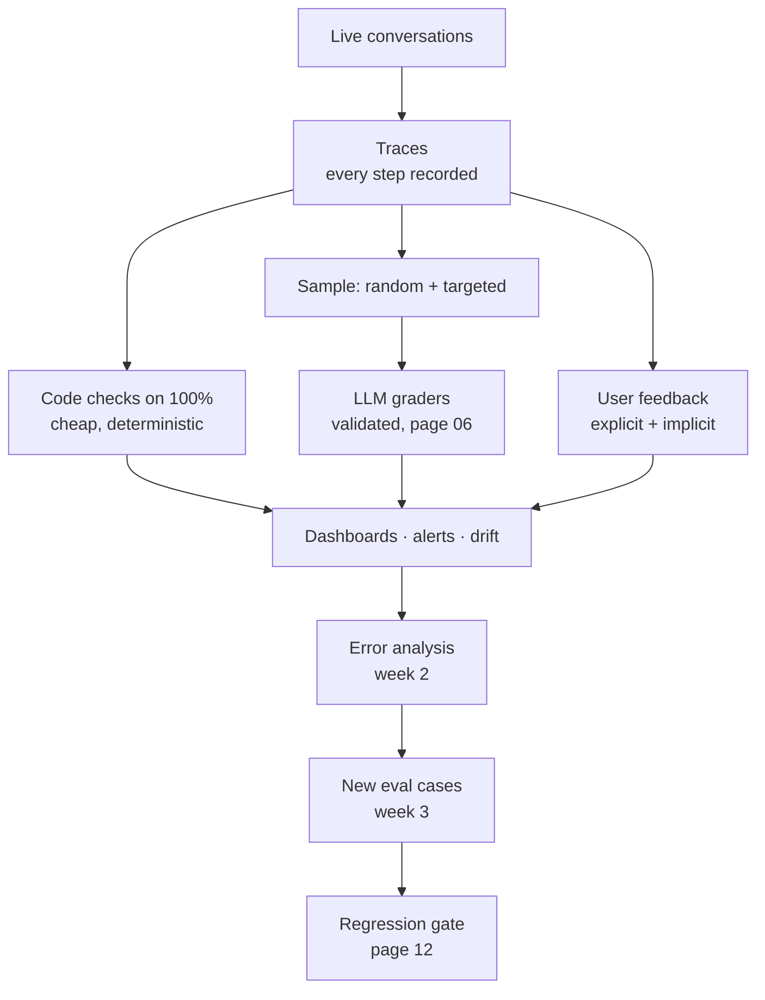
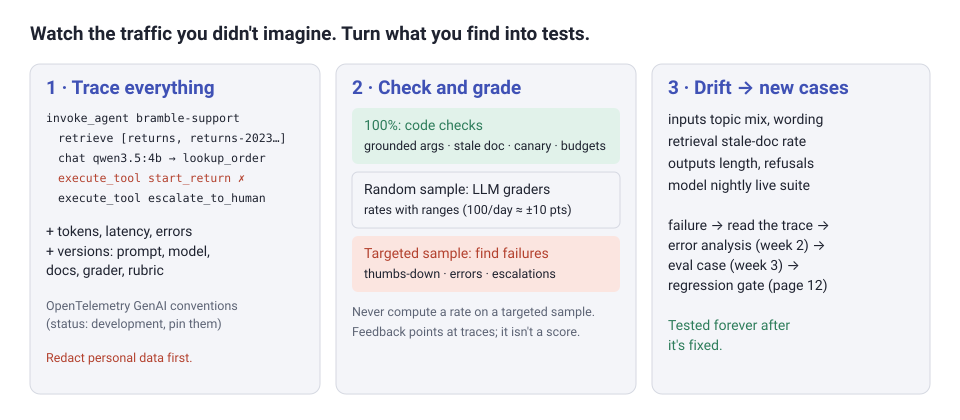

# 13 · Production monitoring

**[← Concepts](README.md)** · **Previous: [12 Evals on every change](12-ci-gates.md)** · **Next: 14 Cost and speed →** *(coming)* · **In the course:** week 13

Offline evals test the conversations you thought of. **Production monitoring** watches the ones you didn't: it records every conversation as a **trace**, runs cheap checks on all of them, grades a **sample** with the expensive graders, listens to user **feedback**, and watches for **drift**: the traffic, the documents or the model changing under you. Its most important output isn't a dashboard. It's new eval cases, so that tomorrow's offline suite covers today's failures.

---

## 1. Why it matters

Bramble's dev suite has 16 cases. On page 07 that bought a pass rate to about ±24 points, on conversations a course author wrote or generated. Real customers will ask about things no case covers, in words no case uses ("can i send back a book…" already beat the retriever on page 09). They'll arrive in bursts when a policy changes. And the model behind the API may change without notice.

Offline evals answer *is this version good on the cases we have?* Monitoring answers *is the live system behaving, on the traffic we actually get, today?* You need both, and they feed each other.

## 2. The idea in one picture



## 3. Traces and spans

A **trace** is the full record of one conversation: every model call, every retrieval, every tool call, with inputs, outputs, timing and tokens. Each step is a **span**. evally has recorded traces since week 2. This is part of the real trace for `return-too-late`, abridged:

```json
[
  {"kind": "retrieve", "data": {"docs": ["returns.md", "returns-2023.md", "shipping.md"]}},
  {"kind": "model",    "data": {"tool_calls": ["lookup_order"], "stop_reason": "tool_use"}},
  {"kind": "tool",     "data": {"name": "lookup_order", "arguments": {"order_id": "BB-1003", "...": "..."},
                                "result": "{\"status\": \"delivered\", \"delivered\": \"2026-09-20\", ...}", "is_error": false}},
  {"kind": "model",    "data": {"tool_calls": ["start_return"], "stop_reason": "tool_use"}},
  {"kind": "tool",     "data": {"name": "start_return", "result": "Delivered 53 days ago; returns are only accepted within 30 days.",
                                "is_error": true}},
  {"kind": "model",    "data": {"tool_calls": ["escalate_to_human"], "stop_reason": "tool_use"}},
  {"kind": "tool",     "data": {"name": "escalate_to_human", "result": "{\"ticket\": \"T-1\", ...}", "is_error": false}},
  {"kind": "model",    "data": {"text": "I've looked up your order BB-1003 ...", "stop_reason": "end_turn"}}
]
```

Everything pages 09-11 check is in there: what was retrieved (the stale policy at rank 2), each tool call and its arguments, the failed `start_return`. **What to record on every trace:**

| Record | Why |
| --- | --- |
| Every step: retrievals, model calls, tool calls with arguments and results | Pages 09-11 grade these, not just the reply |
| Tokens, latency per step | Cost and speed (page 14) |
| **Versions**: prompt, model, retriever settings, document set, grader and rubric | You can't compare two weeks without knowing what changed |
| A conversation id and the customer's turns | Multi-turn grading (page 10); joining feedback to the trace |
| Errors and fallbacks | The cheapest failure signal there is |

**A standard format.** OpenTelemetry's **GenAI semantic conventions** name these spans and attributes so any tracing tool can read them: a `chat {model}` span per model call with `gen_ai.provider.name`, `gen_ai.request.model`, `gen_ai.usage.input_tokens` and `gen_ai.usage.output_tokens`; an `execute_tool {tool}` span with `gen_ai.tool.name` and `gen_ai.tool.call.arguments`. The conventions now live in their [own repository](https://github.com/open-telemetry/semantic-conventions-genai) and are marked **development**: names can still change, so pin the version you emit (section 12).

> **Pitfall: personal data in traces.** Traces hold what customers typed: emails, order ids, addresses. Decide what to redact or hash before storing, who can read traces, and how long they're kept. The section 12 example drops the email from the traced arguments for this reason.

## 4. Sampling live traffic for grading

LLM graders cost money (page 14), so you grade a **sample**. Two kinds, for two purposes:

| Sample | How | Gives you |
| --- | --- | --- |
| **Random** | A fixed share of all conversations (say 1-5%) | Unbiased pass rates with ranges (page 07). 100 graded conversations a day is about ±10 points per day; pool a week for tighter numbers |
| **Targeted** | Conversations with a signal: negative feedback, an error, an escalation, a tool failure, unusual length, a topic you haven't seen | Failures, fast. Not a rate: it's biased by design |

Keep them separate. A pass rate computed on a targeted sample is meaningless (you picked the bad ones), and a random sample at 2% finds rare failures slowly.

Stratify the random sample by topic when traffic is uneven: if returns are 40% of traffic and privacy questions 1%, a plain 2% sample sees almost no privacy questions.

## 5. Online graders

| Check | Run on | Examples from this course |
| --- | --- | --- |
| **Code checks** | **Every** conversation | `args_grounded` (no invented ids, page 10), stale doc retrieved (page 09), canary token (page 11), step and token budgets, fallback reply rate |
| **LLM graders** | The sample | `goes-beyond-policy`, `unsupported-claims` (page 05), faithfulness (page 09), refusal rubric (page 11) |
| **People** | A small slice of the sample, every week | Labels that keep checking the graders (page 06) |

The graders themselves need watching. Pin the grader model and rubric version and log them with every verdict; re-check agreement with people on fresh labels whenever either changes, and periodically even when nothing changed.

## 6. User feedback

| Signal | Example | Strengths | Biases |
| --- | --- | --- | --- |
| **Explicit** | Thumbs up/down, a 1-5 rating, a comment | Direct, cheap to collect | Rare (a few % of conversations), skewed to angry and delighted users |
| **Implicit** | The customer rephrases the same question; asks for a human; abandons mid-flow; contacts support again the same day | Present on every conversation | Ambiguous: a short conversation may mean "solved" or "gave up" |

Treat feedback as a **pointer**, not a metric. A thumbs-down tells you which trace to read (targeted sample), not how good the system is. Rates of thumbs-down move with UI changes and who bothers to click.

## 7. Drift

Something changes and the numbers move. Watch four places:

| What drifts | Bramble example | Detect with |
| --- | --- | --- |
| **Inputs**: topics, wording, languages | A new policy starts a wave of "60 days?" questions | Topic mix per week vs the previous weeks |
| **Retrieval** | A doc edit makes `returns-2023.md` win more queries | Stale-doc rate, recall on a fixed probe set |
| **Outputs** | Replies get longer, refusals rise | Length, refusal rate, fallback rate, tool-error rate |
| **The model** | The provider updates the model behind the same name | The nightly live suite (page 12): same cases, new answers |

Compare each week with a baseline window, with ranges (page 07): a refusal rate moving from 4% to 6% on 300 conversations is noise; on 30,000 it's a change. Alert on changes in the cheap 100% signals; investigate with traces.

## 8. Close the loop

Monitoring that only produces charts decays. The valuable path is:

1. A signal (alert, targeted sample, feedback) points at a trace.
2. Someone reads it: week 2's error analysis, now on live data.
3. If it's a new failure, it becomes an **eval case** (week 3), with the real customer message and the expected behaviour, and goes into the regression set (page 12).
4. The fix ships through the gate, and the cheap check that would have caught it runs on 100% from now on.

This is the course's whole loop, running continuously. Every production failure should be tested for exactly once more after it's fixed: forever.

## 9. Tools

You can build all of this by hand (evally's trace JSON is enough for the first months). Dedicated tools add storage, search, sampling queues, annotation screens and dashboards:

- **[Langfuse](https://langfuse.com/docs)**: open source; tracing, LLM-graded evaluations on production traces, prompt management, datasets.
- **[Phoenix](https://arize.com/docs/phoenix)** (Arize): open source; built on OpenTelemetry and its GenAI conventions, with tracing, evaluation and experiment views.

Both accept OpenTelemetry traces, which is the practical reason to emit the standard attributes: you can change tools without re-instrumenting the app.

## 10. The whole page in one picture

[](img/13-monitoring-loop.svg)

*Tap or click the picture to open it full size.*

## 11. Pitfalls

> **Pitfall: dashboards without reading.** A pass-rate line going down tells you to look, not what's wrong. Read traces.

> **Pitfall: rates from targeted samples.** You chose the bad ones. Rates come from random samples only.

> **Pitfall: no versions on traces.** Without the prompt, model and rubric version on every trace, a change in the numbers can't be attributed to anything.

> **Pitfall: thumbs-down rate as quality.** It measures who clicks, and changes when the button moves.

> **Pitfall: unpinned graders.** If the grader model updates silently, your quality chart moves while the app stays the same.

> **Pitfall: failures that never become cases.** A fixed bug without a regression case comes back.

## 12. In code: an OpenTelemetry trace

The standard spans for `return-too-late`, emitted with the OpenTelemetry Python SDK (**1.45.2**, run for this page). A tiny exporter prints each finished span:

```python
import json
from opentelemetry import trace
from opentelemetry.sdk.trace import TracerProvider
from opentelemetry.sdk.trace.export import SimpleSpanProcessor, SpanExporter, SpanExportResult

class Print(SpanExporter):                      # print a compact view of each finished span
    def export(self, spans):
        for s in spans:
            print(s.name, json.dumps(dict(s.attributes)))
        return SpanExportResult.SUCCESS

provider = TracerProvider()
provider.add_span_processor(SimpleSpanProcessor(Print()))
tracer = provider.get_tracer("bramble")

# return-too-late, real values from the dev run (one model call and one tool call shown)
with tracer.start_as_current_span("invoke_agent bramble-support",
                                  attributes={"gen_ai.operation.name": "invoke_agent",
                                              "gen_ai.conversation.id": "return-too-late"}):
    with tracer.start_as_current_span("chat qwen3.5:4b") as span:
        span.set_attributes({"gen_ai.operation.name": "chat", "gen_ai.provider.name": "ollama",
                             "gen_ai.request.model": "qwen3.5:4b",
                             "gen_ai.response.finish_reasons": ["tool_calls"]})
    with tracer.start_as_current_span("execute_tool start_return") as span:
        span.set_attributes({"gen_ai.operation.name": "execute_tool", "gen_ai.tool.name": "start_return",
                             "gen_ai.tool.call.arguments": json.dumps({"order_id": "BB-1003", "reason": "Changed my mind"}),
                             "error.type": "tool_error"})
```

```
chat qwen3.5:4b {"gen_ai.operation.name": "chat", "gen_ai.provider.name": "ollama", "gen_ai.request.model": "qwen3.5:4b", "gen_ai.response.finish_reasons": ["tool_calls"]}
execute_tool start_return {"gen_ai.operation.name": "execute_tool", "gen_ai.tool.name": "start_return", "gen_ai.tool.call.arguments": "{\"order_id\": \"BB-1003\", \"reason\": \"Changed my mind\"}", "error.type": "tool_error"}
invoke_agent bramble-support {"gen_ai.operation.name": "invoke_agent", "gen_ai.conversation.id": "return-too-late"}
```

Child spans finish first, so they print first. In production you'd swap the print exporter for an OTLP exporter pointed at Langfuse, Phoenix or any OpenTelemetry backend. Many provider SDKs and frameworks have instrumentation packages that emit these spans for you.

## 13. Read and watch

| | Source · length | Why |
| --- | --- | --- |
| [Your AI Product Needs Evals](https://hamel.dev/blog/posts/evals/) | Hamel Husain (blog) | The loop on section 8: look at real traces, turn failures into tests. |
| [10 min Walkthrough of Langfuse](https://www.youtube.com/watch?v=2E8iTvGo9Hs) | Langfuse · 10 min | Tracing, evaluation, prompt management and datasets in one tool. |
| [Langfuse Walkthrough: agent tracing and evals](https://www.youtube.com/watch?v=THfB4p2xCFY) | Langfuse · 15 min | A co-founder's end-to-end demo of observability and evals for agents. |
| [Langfuse, OpenLIT, and Phoenix: Observability for the GenAI Era](https://www.youtube.com/watch?v=EPfMHVltAxI) | PyCon Italia 2025 · 29 min | Three open-source tools compared, including Phoenix. |
| [OpenTelemetry GenAI semantic conventions](https://github.com/open-telemetry/semantic-conventions-genai) | OpenTelemetry | The standard span and attribute names (status: development). |

## 14. Self-check

<details>
<summary>1. You grade 100 random conversations a day. Roughly how precise is a daily pass rate, and how do you tighten it?</summary>

About ±10 points at a 50% rate (page 07: *n* = 97 gives ±10). Pool a week (700 conversations, about ±4 points), or raise the sample if decisions are daily.
</details>

<details>
<summary>2. Why keep random and targeted samples separate?</summary>

A targeted sample is chosen for signs of failure, so its pass rate is biased low by design. Rates need a random sample; targeted samples are for finding failures fast.
</details>

<details>
<summary>3. Which Bramble checks can run on 100% of traffic, and why those?</summary>

Code checks: `args_grounded`, stale-doc retrieved, canary tokens, budgets, fallback and tool-error rates. They're free, instant and deterministic. LLM graders cost money per call, so they run on a sample.
</details>

<details>
<summary>4. Every eval number dropped this week and nothing was deployed. What do you check?</summary>

Drift: the topic mix of inputs, document changes (retrieval), the model behind the API (nightly live suite), and the graders themselves (did the grader model or rubric change?). Versions on traces make this a lookup.
</details>

<details>
<summary>5. What should happen to a failure found in production, after it's fixed?</summary>

It becomes an eval case with the real message and expected behaviour, joins the regression set that gates every change, and, if a cheap code check could catch it, that check runs on all traffic.
</details>

## 15. In one minute

Trace everything: each retrieval, model call and tool call, with tokens, timing and the versions of everything that can change, using the OpenTelemetry GenAI conventions so any tool can read it (they're still marked development: pin them). Run cheap code checks on 100% of traffic, LLM graders on a random sample for rates and a targeted sample for failures, and treat feedback as a pointer, not a score. Watch inputs, retrieval, outputs and the model for drift, with ranges. Most of all, close the loop: every production failure becomes an eval case, so it's tested forever after it's fixed.
