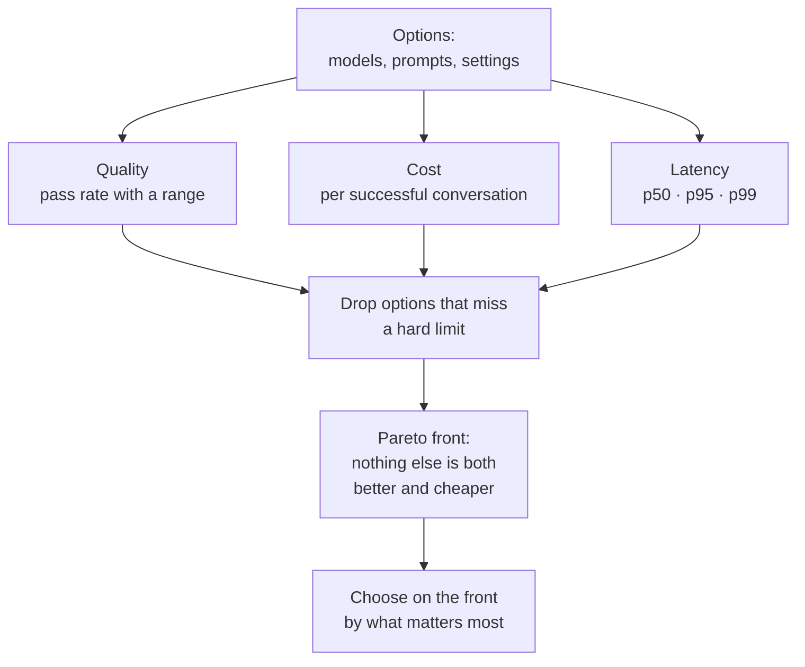
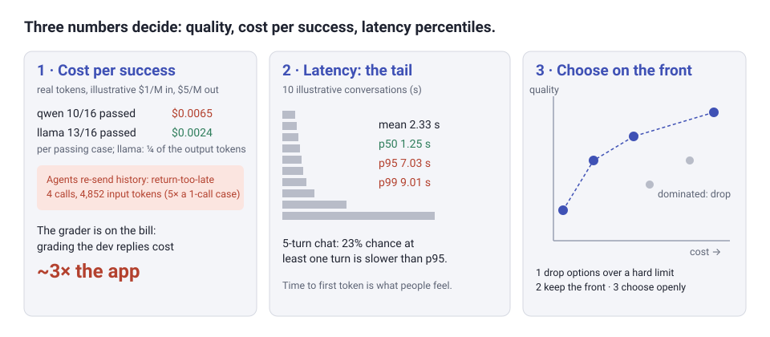

# 14 · Cost and speed

**[← Concepts](README.md)** · **Previous: [13 Production monitoring](13-monitoring.md)** · **Next: 15 Capstone →** *(coming)* · **In the course:** week 14

Quality is one of three numbers that decide which version ships. The other two are **cost** (tokens × price, per conversation and per *successful* conversation) and **speed** (latency, read as percentiles, never as an average). This page shows how to measure each, why the grader's own cost belongs in the bill, and how to choose between options with a **Pareto front** instead of a single blended score.

---

## 1. Why it matters

An eval that only measures quality will pick the biggest, slowest, most expensive option every time, because it usually wins a little. And sometimes quality and cost don't even pull in opposite directions. On the 16 Bramble dev cases (real token counts from the saved runs):

| App model | Passed | Input tokens | Output tokens |
| --- | :---: | ---: | ---: |
| qwen3.5:4b | 10 / 16 | 28,609 | 7,311 |
| llama3.2:3b | 13 / 16 | 20,880 | 1,983 |

llama passed more cases with about a quarter of the output tokens. (Page 07's caution applies: 13 vs 10 on 16 cases isn't proof of better quality, but the token gap is large and consistent.) Both run locally for free, so the course's own bill is $0, but the same choice on a hosted model is a real budget decision.

## 2. The idea in one picture



## 3. Cost per call, and why agents cost more than you think

cost = input tokens × input price + output tokens × output price

Prices are per million tokens and output usually costs several times more than input. evally's `prices.py` holds the price of each model it has run, with the date it was copied from the provider. A model that isn't listed prints **"cost unknown"**, never a guess, and that rule is worth copying.

**Agents re-send the history.** Every model call in a tool loop sends the whole conversation so far, including earlier tool results. `return-too-late` made **4 model calls and used 4,852 input tokens** (real), about five times the 964 that the 9 single-call dev cases averaged. The cost of an agent grows with its number of steps, which is one more reason for step budgets (page 10).

**Worked, with illustrative prices** of $1 per million input and $5 per million output tokens (not any real model's price):

| | Input cost | Output cost | Cost for 16 cases | Passed | **Cost per passing case** |
| --- | ---: | ---: | ---: | :---: | ---: |
| qwen | 28,609 × $1/M = $0.0286 | 7,311 × $5/M = $0.0366 | $0.0652 | 10 | **$0.0065** |
| llama | 20,880 × $1/M = $0.0209 | 1,983 × $5/M = $0.0099 | $0.0308 | 13 | **$0.0024** |

**Cost per successful conversation** is the number to compare: a cheap model that fails twice as often isn't cheap if every failure becomes a support ticket.

## 4. The grader is on the bill too

Week 5's binary grader read the 16 dev replies against 3 rubrics: **84,459 input and 24,390 output tokens** for 48 verdicts (real). At the same illustrative prices that's $0.0845 + $0.1220 = **$0.21**, about **three times** the $0.065 the app spent producing those replies. G-Eval used 4,315 and 9,098 output tokens on its two demo cases, against roughly 500 for our grader.

Graders are paid per verdict, per rubric, per run. A nightly suite with 5 rubrics on 500 cases is 2,500 grader calls a night. Grade on a sample in production (page 13), cache grader calls (evally records them), and use code checks wherever they can do the job.

## 5. Latency: read percentiles, not averages

Two numbers matter to a person waiting:

- **Time to first token** (TTFT): how long before anything appears. With streaming, this is what people feel.
- **Total time**: until the answer is complete. For an agent, the sum of every model call and tool call.

Latency is skewed: most requests are quick and a few are very slow. The **average** blends them into a number that describes nobody. Ten illustrative conversations, in seconds:

0.8 · 0.9 · 1.0 · 1.1 · 1.2 · 1.3 · 1.5 · 2.0 · 4.0 · 9.5

| | Value | Meaning |
| --- | ---: | --- |
| Mean | 2.33 s | Slower than 8 of the 10 conversations |
| **p50** (median) | 1.25 s | Half are faster than this |
| **p95** | 7.03 s | 1 in 20 waits longer than this |
| **p99** | 9.01 s | 1 in 100 waits longer |

(Percentiles by linear interpolation, numpy's default; section 12.) Watch the tail. In a 5-turn conversation, the chance that *at least one* turn is slower than the p95 is 1 − 0.95⁵ ≈ **23%**. Rare per request becomes common per customer.

> **Pitfall: p99 from ten samples.** A percentile from a handful of measurements is mostly noise; p99 needs hundreds of requests to mean anything. Collect latency from real traffic (page 13), not from one eval run.

## 6. Choosing: quality per dollar and the Pareto front

**Quality per dollar** (pass rate ÷ cost) is tempting, but a ratio rewards the cheapest option even when its quality is unacceptable: a model that's nearly free and nearly useless has a superb ratio. Use it only between options that all meet your quality floor.

The **Pareto front** is the better tool. Option A *dominates* B when A is at least as good on every axis (quality, cost, latency) and strictly better on one. The front is everything nobody dominates. Every option off the front is beaten outright by another and can be dropped without debate. Choosing *along* the front is a real trade-off, and that's a product decision, not an eval result:

1. Remove options that break a hard limit (p95 over 5 s, quality under the floor).
2. Draw the front of what's left.
3. Pick on the front by what matters most for this product.

## 7. Levers, and re-evaluating each

| Lever | Typical effect | Re-check |
| --- | --- | --- |
| **Smaller or cheaper model** | Much cheaper, faster | Quality on the full suite, with ranges (page 07) |
| **Routing / cascades**: easy requests to a small model, hard ones to a big one ([FrugalGPT](https://arxiv.org/abs/2305.05176), [RouteLLM](https://arxiv.org/abs/2406.18665)) | Big savings when most traffic is easy | Quality *per route*: the router's mistakes send hard questions to the weak model |
| **Caching**: provider prompt/prefix caching for the repeated system prompt and docs; exact-match response caching for repeated questions | Cheaper input, lower TTFT | Stale answers after a policy change |
| **Fewer retrieved docs** (smaller *k*) | Fewer input tokens | Retrieval recall (page 09) |
| **Shorter replies** (Bramble's flaw F5: replies run long) | Fewer output tokens, faster | Helpfulness rubric; `max_words` checks |
| **Fewer agent steps** | Less re-sent history | Trajectory and end-state checks (page 10) |

Every lever trades something. Treat each as a change that goes through the gate (page 12), with its quality, cost and latency measured together.

## 8. The whole page in one picture

[](img/14-pareto.svg)

*Tap or click the picture to open it full size.*

## 9. Try it: Pareto picker

<iframe class="demo" src="../demos/pareto.html" height="620" loading="lazy" title="Pareto picker"></iframe>

[Open the Pareto picker in its own tab](https://krishankant.github.io/evally/concepts/demos/pareto.html). The six options are illustrative. Try:

1. Which options are off the front, and which option beats each of them?
2. Set the latency limit to 3 s. What happens to the front and the pick?
3. Set the quality floor to 0.8. Now which option has the best quality per dollar, and why is that more meaningful than before?

## 10. Pitfalls

> **Pitfall: cost per call instead of per success.** A cheap model that fails more can cost more per solved problem.

> **Pitfall: average latency.** It describes no real request. Report p50 and p95 (and p99 with enough traffic).

> **Pitfall: forgetting the grader.** On week 5's numbers, grading cost three times the app. Budget it.

> **Pitfall: guessed prices.** Copy prices from the provider with the date, and print "unknown" rather than guess. Prices change.

> **Pitfall: one blended score.** A weighted mix of quality, cost and latency hides the trade-off in the weights. Show the front and decide in the open.

> **Pitfall: optimising without re-evaluating.** Every cost lever can cost quality. Measure all three after each change.

## 11. Measure it in your traces

None of this needs a special tool if traces record, per step, the model, tokens in and out, time to first token and total time (page 13). evally records tokens per case and per call; it doesn't record latency yet, which is why this page's latency numbers are illustrative. Add timing to the trace before relying on latency numbers.

## 12. In code: percentiles with numpy

The table in section 5 (numpy **2.5.5**, run for this page):

```python
import numpy as np

# illustrative end-to-end latencies (seconds) for 10 conversations
latency = np.array([0.8, 0.9, 1.0, 1.1, 1.2, 1.3, 1.5, 2.0, 4.0, 9.5])
print(f"mean {latency.mean():.2f}s")
for q in (50, 95, 99):
    print(f"p{q}  {np.percentile(latency, q):.3f}s")
```

```
mean 2.33s
p50  1.250s
p95  7.025s
p99  9.005s
```

The demo's `percentile()` uses the same linear interpolation and gives the same values (checked in `tests/demos/check-pareto.js`). Other methods (nearest rank, for example) give slightly different tails on small samples, so state which one you use.

## 13. Read and watch

| | Source · length | Why |
| --- | --- | --- |
| [Latency is a distribution, not a number](https://www.youtube.com/watch?v=co2LZv0n4U4) | NobodyBuilds · 2 min | Percentiles, and why rare slowness hits your heaviest users most: section 5's tail point. |
| [What are P50, P95, P99?](https://www.youtube.com/watch?v=9rlGSahksLQ) | Kamran Ahmed · 1.5 min | Why averages fall short, in 90 seconds. |
| [FrugalGPT](https://arxiv.org/abs/2305.05176) | Chen, Zaharia & Zou, 2023 (paper) | Cascades: try cheap models first and escalate only when needed. |
| [RouteLLM](https://arxiv.org/abs/2406.18665) | Ong et al., 2024 (paper) | Learning which requests need the strong model, from preference data. |

## 14. Self-check

<details>
<summary>1. Model X costs $0.002 per conversation and solves 60%; model Y costs $0.004 and solves 90%. Which is cheaper per solved conversation?</summary>

X: 0.002 / 0.6 ≈ $0.0033. Y: 0.004 / 0.9 ≈ $0.0044. X is cheaper per success, but if each failure becomes a $3 support ticket, Y's 30 points fewer failures save far more than the $0.001 difference.
</details>

<details>
<summary>2. Why can an agent with a 5-step loop cost much more than 5 times one call?</summary>

Each step re-sends the whole history, including previous tool results, so input tokens grow with every step: step 5 pays for steps 1-4 again. Total input grows roughly with the square of the number of steps.
</details>

<details>
<summary>3. A team reports "average latency 1.9 s". What do you ask for, and why?</summary>

p50, p95 and p99 (with how many requests). The average hides the tail; a 1.9 s average can include 1 in 20 users waiting 8 s.
</details>

<details>
<summary>4. Option A: quality 0.82, $3. Option B: 0.80, $3.50. Option C: 0.70, $0.40. Which are on the Pareto front?</summary>

A and C. B is dominated by A (worse quality, higher cost). A and C trade quality for cost; choosing between them is a product decision.
</details>

<details>
<summary>5. Why include grader cost in an eval budget?</summary>

Graders run per rubric, per case, per run. In week 5, grading the dev replies cost about three times what producing them did. At scale it can dominate the bill unless you sample, cache and prefer code checks.
</details>

## 15. In one minute

Decide with three numbers, not one: quality (with a range), cost per *successful* conversation (tokens × dated prices, including agent steps that re-send the history and the grader's own calls), and latency as percentiles (p50, p95, p99; the average describes nobody, and the tail compounds across turns). On Bramble's dev set, llama passed more cases with a quarter of qwen's output tokens, and grading the replies cost about three times producing them. Drop options that break a hard limit, draw the Pareto front of the rest, and choose along it in the open. Every lever (smaller model, routing, caching, fewer docs, shorter replies) goes back through the gate.
