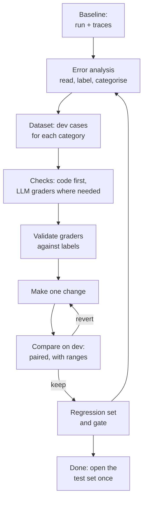
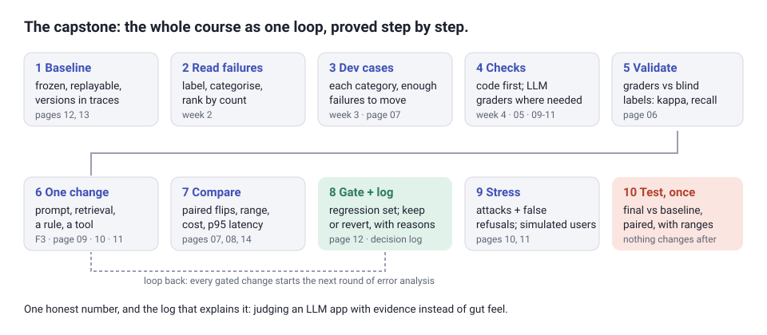

# 15 · Capstone

**[← Concepts](README.md)** · **Previous: [14 Cost and speed](14-cost-and-speed.md)** · **In the course:** week 15

The capstone is the whole course as one project: take the Bramble Books assistant from its baseline to the best version you can make, and **prove** each step with evidence, using everything from weeks 1-14. It ends with one honest number: the held-out test set, opened once. This page is the brief: the loop, the milestones so far, the steps, a decision log template, and the checklist your write-up is graded against.

---

## 1. Where the course has got to (real)

| Week | What it added | Measured |
| :---: | --- | --- |
| 1 | The app, 10 cases, five code checks | 9 / 10 on `qwen3.5:4b`, and a vibe check that missed what the cases caught |
| 2 | Traces and error analysis | 10 of 18 realistic conversations fail, across six failure categories |
| 3 | A real dataset with a dev/test split | `bramble-v1`: dev 11 / 16, test 4 / 10 |
| 4 | Precise code checks | `bramble-v2`: dev 10 / 16 (an invented order id now caught), test 5 / 10 |
| 5 | LLM graders and their biases | Grader fails 1 / 1 / 0 of 16 per rubric; padding wins 6-0; a judge preferred its own model 10-0 |
| 6-14 | Concept pages | Agreement with labels, ranges and paired tests, rankings, RAG, agent, safety, CI, monitoring and cost checks |

And the known problems still in the app: the stale returns policy is retrieved for 5 of 15 questions (page 09), "send back" doesn't find the returns policy, the agent invents ids when none are given (page 10), it hints at exceptions the policy forbids (page 05), the privacy rule depends on the model alone (page 11), and the system prompt is thin (flaw F3).

## 2. The loop



## 3. The steps

Each step names the page that covers it and the artefact it leaves behind.

1. **Freeze the baseline.** Record a full dev run of the current app (replayable), with its version in the trace (pages 12, 13). *Artefact:* `evals/runs/baseline-*.json`.
2. **Re-read the failures.** Error analysis on the baseline traces: label, categorise, rank (week 2). Include the known problems in section 1. *Artefact:* a ranked category list with counts.
3. **Make the dev set fit the failures.** Every top category has dev cases, with enough failures in each to show a change (page 07: a measurement that can't move can't decide). Never touch the test split. *Artefact:* dataset diff.
4. **Check with code first.** Grounded arguments, stale-doc retrieved, forbidden tool calls, canary tokens (pages 09-11). *Artefact:* new checks with a pass and a fail example each.
5. **Add LLM graders only where code can't see.** One rubric per category (page 05). *Artefact:* rubric files.
6. **Validate each grader** against labels you write blind, with kappa and the recall of "fail" (page 06). Fix rubric gaps the disagreements reveal. *Artefact:* agreement table per rubric.
7. **Change one thing at a time.** A better system prompt (F3), retrieval that copes with "send back" or drops the stale doc, a rule against inventing ids, authorisation for third-party requests. *Artefact:* one commit per change.
8. **Compare each change on dev**, paired against the previous version: flips, McNemar, a paired range (page 07). Also check cost per success and latency (page 14). Keep or revert, and log why (section 4). *Artefact:* a decision log entry.
9. **Gate it.** Every fixed failure joins the regression set; CI fails on regressions (page 12). *Artefact:* baseline update in the same commit as the change.
10. **Stress it.** Re-run safety attacks and a simulated-customer set (pages 10, 11); report attack success with false refusals. *Artefact:* safety table.
11. **Finish: open the test set once.** Run the final version and the baseline on the held-out test split, paired, with ranges. That's the number you report. No changes after you've looked. *Artefact:* the final table.

## 4. The decision log

One entry per change, written *before* you look at the comparison where you can (what you expect), and completed after:

```markdown
## Change 4: system prompt gets privacy and conflicting-document rules (F3)

Why:        two privacy cases depend on the model alone (page 11); stale-policy answers (page 09).
Expect:     adv-third-party-order passes for the right reason; uses-outdated-policy fails drop.
Dev result: flips 4 better / 0 worse; McNemar p = 0.125; paired range +0 to +38 points.
Graders:    rubric versions unchanged (goes-beyond-policy v2, kappa 0.71 on 40 labels).
Cost:       +210 input tokens per call (+9%); p95 latency unchanged.
Safety:     attack success 6/40 → 2/40; false refusals 1/30 → 1/30.
Decision:   keep. Regression cases added: adv-third-party-order (with email given).
```

*(The numbers in this template are illustrative.)* The log is what makes the final result believable: each step is small, measured and explained, and the reasons for reverting count as much as the reasons for keeping.

## 5. Rules for an honest result

- **The test split is opened once**, at the end, for the final version and the baseline. If you change anything after looking, the test set has become a dev set; say so in the write-up.
- **Report ranges and *n***, always (page 07). 16 dev cases can't show a 5-point gain; say what they can show.
- **Report graders with their agreement numbers** (page 06). A pass rate from an unvalidated grader is an opinion.
- **Report cost and latency next to quality** (page 14).
- **Report what didn't work.** Reverted changes are results.

## 6. The whole page in one picture

[](img/15-whole-loop.svg)

*Tap or click the picture to open it full size.*

## 7. Write-up checklist

Your capstone write-up is complete when a reader can check each line:

| ✓ | Item | Page |
| :---: | --- | :---: |
| ☐ | Baseline run frozen, replayable, versions recorded | 12, 13 |
| ☐ | Failure categories with counts, from reading traces | week 2 |
| ☐ | Dev cases cover each top category, with enough failures to move | week 3, 07 |
| ☐ | Code checks used wherever they can decide | week 4, 09-11 |
| ☐ | Each LLM grader validated: kappa, recall of "fail", the labels it's based on | 05, 06 |
| ☐ | Every change compared paired on dev, with a range | 07 |
| ☐ | Comparisons between versions done blind and in both orders, if side-by-side | 08 |
| ☐ | Retrieval and generation measured separately | 09 |
| ☐ | Agent checks: grounded arguments, forbidden calls, budgets | 10 |
| ☐ | Safety: attack success and false refusals, both | 11 |
| ☐ | Regression gate in place; every fixed failure is a case | 12 |
| ☐ | Monitoring plan: what's traced, what runs on 100%, what's sampled | 13 |
| ☐ | Cost per successful case and p95 latency for baseline and final | 14 |
| ☐ | Decision log: every change, kept or reverted, with reasons | 15 |
| ☐ | Test split opened once; final vs baseline, paired, with ranges | week 3, 07 |

## 8. Pitfalls

> **Pitfall: many changes at once.** If the pass rate moves you won't know why, and you can't revert half a commit's effect. One change per comparison.

> **Pitfall: tuning to the dev set.** After many rounds, dev results flatter you. That's what the untouched test split is for.

> **Pitfall: graders changing under you.** Change a rubric and every earlier number changes meaning. Version rubrics and re-validate.

> **Pitfall: a final number without the baseline.** "78% on test" means nothing alone. Report the baseline on the same test cases, paired.

> **Pitfall: hiding reverts.** A log with only wins isn't believable. Show what you tried and dropped.

## 9. Self-check

<details>
<summary>1. You've made five changes. Dev went from 10/16 to 15/16. Can you report that as the improvement?</summary>

No. You chose and tuned those changes while looking at dev, so dev now flatters the result. Report the held-out test set, opened once, final vs baseline, paired, with a range. Dev numbers belong in the decision log.
</details>

<details>
<summary>2. A change improves dev 3 flips to 1 but doubles cost per success. Keep it?</summary>

It depends on the product, and the decision must be explicit. First, 3 vs 1 flips isn't evidence (McNemar p = 0.625). Unless there's a stronger reason, a doubled cost for an unproven gain is a revert. Log it either way.
</details>

<details>
<summary>3. Why validate graders before using them to compare changes?</summary>

A grader that disagrees with people makes every comparison noisy or biased. A "gain" could be the grader's taste (length, self-preference) rather than a better app. Page 06's agreement numbers tell you how far to trust it.
</details>

<details>
<summary>4. After opening the test set you notice a bug and fix it. What now?</summary>

Fix it, and say in the write-up that the test set was seen before the fix, so the final test number is optimistic. If you can, collect fresh held-out cases for a clean final check.
</details>

<details>
<summary>5. Which single artefact best convinces a reader the final number is real?</summary>

The decision log, together with the paired final test result: small steps, each measured with ranges, reverts included, and a test set opened once.
</details>

## 10. In one minute

The capstone runs the whole course as one loop on Bramble: freeze a baseline, read the failures, make sure the dev set can show them, check with code first and validated LLM graders second, change one thing at a time, compare each change paired with a range, gate every fixed failure, stress-test safety, and log every decision, kept or reverted. Then open the held-out test set once, final against baseline, paired, with ranges, cost and latency. That one honest number, and the log that explains it, is the skill this course teaches: judging an LLM app with evidence instead of gut feel.
