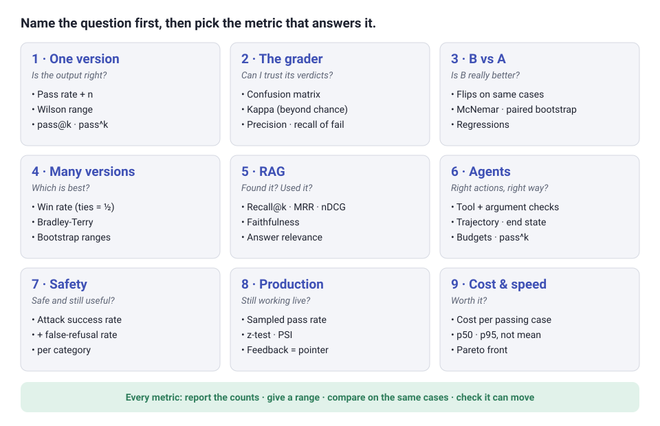

# Metrics map: which metric, when

**[← Concepts](README.md)** · **Start of the deep pages: [05 LLM as a grader →](05-llm-as-a-grader.md)** · **Use it:** before you pick a number to report

Evals use many metrics: kappa, Wilson, McNemar, Elo, MRR, nDCG, faithfulness, PSI, p95, and more. Each one answers **one question**, and most mistakes in eval reports come from quoting a metric that answers a different question from the one being asked. This page is the map. It sorts the metrics by the kind of evaluation you're doing, gives each one its question, its formula, a small worked number and the situation where it misleads, and points to the page that covers it in depth.

Numbers marked *real* come from evally's weeks 1-5 runs; the rest are *illustrative*, the same examples the deep pages use.

---

## 1. Why it matters

Three reports, each arithmetically true:

- "The grader is **90% accurate**." It's a single line of code, `return "pass"`, on a set where 10% of replies fail. It has never found a failure. (Accuracy answered "how often do they agree?", not "does it find failures?")
- "The new prompt is **19 points better**." On 16 cases, with 4 cases fixed and 1 broken. McNemar's p is 0.375: a split like that happens a third of the time with no real difference. (A difference of two pass rates answered "what moved?", not "is it real?")
- "Average latency is **2.3 s**." Eight of ten customers waited less than that, and one in twenty waited more than 7 s. (A mean answered "what's the total?", not "what does a customer feel?")

The fix is always the same: **name the question first, then pick the metric that answers it.**

## 2. The map in one picture

```mermaid
flowchart TB
    Q{What are you<br/>evaluating?}
    Q --> A[One version's answers]
    Q --> G[The grader itself]
    Q --> C[Version B vs version A]
    Q --> R[Several versions]
    Q --> RAG[A retrieval pipeline]
    Q --> AG[An agent with tools]
    Q --> S[Safety]
    Q --> P[Live traffic]
    Q --> CS[Cost and speed]
    A --> A1[Pass rate + Wilson range<br/>pass@k / pass^k]
    G --> G1[Confusion matrix · kappa<br/>precision and recall of fail]
    C --> C1[Flips · McNemar<br/>paired bootstrap]
    R --> R1[Win rate · Bradley-Terry<br/>bootstrap ranges]
    RAG --> RAG1[Recall@k · MRR · nDCG<br/>faithfulness · relevance]
    AG --> AG1[Tool and argument checks<br/>trajectory · end state · pass^k]
    S --> S1[Attack success rate<br/>+ false-refusal rate]
    P --> P1[Sampled pass rate · z-test<br/>PSI · feedback as pointer]
    CS --> CS1[Cost per passing case<br/>p50 / p95 · Pareto front]
```

Before the families, four rules that apply to every metric on this page:

1. **Report the counts.** "62.5%" hides whether it's 10 of 16 or 1,000 of 1,600. Every rate gets its *n*, and every agreement metric gets its four cells.
2. **Give it a range.** A metric computed on a sample is an estimate. Wilson for a single rate, the bootstrap for anything else ([page 07](07-statistics-for-evals.md)).
3. **Compare on the same cases.** When two versions answer the same questions, the evidence is in the cases that flipped, not in two separate totals.
4. **Check it can move.** A metric that can't change on your data (recall@k on documents that are never split, say) can't decide anything.

## 3. Grading one version: is its output right?

**The confusion of terms first.** A *check* or *grader* decides pass or fail for one case. A *metric* summarises many of those verdicts. Everything below is a metric over verdicts.

| Metric | The question it answers | Formula | Example | Misleads when | Deep dive |
| --- | --- | --- | --- | --- | --- |
| **Pass rate** | What share of cases pass? | passed / *n* | qwen 10/16 = **62.5%** (real) | Quoted without *n* or a range; one flip on 16 cases moves it 6 points | [07](07-statistics-for-evals.md) §3 |
| **Wilson interval** | Where could the real pass rate be? | centre ± half-width (see page 07) | 10/16 → **39% to 82%**; 13/16 → 57% to 93% (real) | Used to compare two versions by checking overlap (use the paired view in section 5) | [07](07-statistics-for-evals.md) §4 |
| **Bootstrap range** | A range for any number without a formula | resample cases with replacement, recompute, take the middle 95% | qwen's 16 cases: **0.375 to 0.875** (real) | *n* is tiny: the resampled values can only take a few steps | [07](07-statistics-for-evals.md) §5 |
| **pass@k** | If it tries *k* times, does **at least one** pass? | 1 − C(*n*−*c*, *k*) / C(*n*, *k*) | 7 of 10 tries pass: pass@3 = **99.2%** | The user gets only one try (a support bot) | [07](07-statistics-for-evals.md) §8 |
| **pass^k** | Do **all *k*** tries pass? | C(*c*, *k*) / C(*n*, *k*) | Same case: pass^3 = **29.2%** | A verifier picks the best of *k* (code with tests), where pass@k is the right one | [07](07-statistics-for-evals.md) §8 |

The same case "works 70% of the time": that's 99% at "eventually" and 29% at "three customers in a row". Pick the one that matches what a failure costs.

**Pass/fail or a score?** A 1-5 score looks richer, but week 5's grader used only 1s and 5s across 48 verdicts (real). Default to pass/fail with the bar written in the rubric, and use a score only when each level is defined in words ([page 05](05-llm-as-a-grader.md) §6).

## 4. Testing the grader: can you trust its verdicts?

An LLM grader is a classifier, so it gets classifier metrics. Label replies by hand, blind, and compare. "Fail" is the class you're hunting for, so it's the *positive* class.

**The confusion matrix** is where every metric in this section comes from. Illustrative, 20 replies, 5 real failures:

| | Grader: fail | Grader: pass | |
| --- | :---: | :---: | :---: |
| **Person: fail** | **TP** 4 | **FN** 1 (missed failure) | 5 |
| **Person: pass** | **FP** 2 (false alarm) | **TN** 13 | 15 |

| Metric | The question it answers | Formula | Example | Misleads when | Deep dive |
| --- | --- | --- | --- | --- | --- |
| **Accuracy** | How often do grader and person agree? | (TP + TN) / *n* | 17/20 = **0.85** | Failures are rare: `return "pass"` scores **0.90** on a set with 10% failures | [06](06-testing-the-grader.md) §5 |
| **Cohen's kappa** | How much better than chance do they agree? | (*p*<sub>o</sub> − *p*<sub>e</sub>) / (1 − *p*<sub>e</sub>) | (0.85 − 0.60) / 0.40 = **0.625**; `return "pass"` gets **0** | Failures are very rare: one label out of 48 moved kappa by 0.14 (real) | [06](06-testing-the-grader.md) §6 |
| **Weighted kappa** | Same, for 1-5 scores, with partial credit by distance | kappa with a cost per disagreement, (*i* − *j*)² for quadratic | Grader A, off by one point at most: **0.911** (quadratic); B, two far misses: **0.286** | The scale isn't really used (only 1s and 5s): it tells the same story as plain kappa | [06](06-testing-the-grader.md) §6 |
| **Precision of "fail"** | Of the replies it failed, how many really failed? | TP / (TP + FP) | 4/6 = **0.67** | Optimised alone: the grader learns to say fail almost never | [06](06-testing-the-grader.md) §7 |
| **Recall of "fail"** | Of the real failures, how many did it catch? | TP / (TP + FN) | 4/5 = **0.80** | 3 real failures: recall can only be 0, 0.33, 0.67 or 1 | [06](06-testing-the-grader.md) §7 |

### Kappa, step by step

Kappa is the one most people haven't met before, so here are the steps on the table above:

1. **Observed agreement:** *p*<sub>o</sub> = (4 + 13) / 20 = **0.85**.
2. **How often each side says fail:** the person 5/20 = 0.25, the grader 6/20 = 0.30.
3. **Agreement by chance:** if both labelled at random at those rates, they'd agree on fail 0.25 × 0.30 = 0.075 of the time and on pass 0.75 × 0.70 = 0.525: *p*<sub>e</sub> = **0.60**.
4. **Kappa:** the share of the possible improvement over chance that was achieved: (0.85 − 0.60) / (1 − 0.60) = **0.625**.

Read it as 1 = perfect, 0 = no better than chance, below 0 = worse than chance. The Landis & Koch bands (0.41-0.60 moderate, 0.61-0.80 substantial, above 0.80 almost perfect) are a convention. The better benchmark is **how well two people agree on the same task**: a grader that agrees with you as well as a colleague does is as good as you can expect.

**Which of the five to watch** depends on the grader's job:

| The grader's job | The costly mistake | Watch |
| --- | --- | --- |
| Blocks merges in CI | False alarms: people start overriding the gate | Precision, with a floor on recall |
| Sends fails to a person to read | Missed failures: nobody reads the passes | Recall |
| Feeds a dashboard pass rate | Both, in proportion | Kappa |

## 5. Comparing two versions: is B really better than A?

Both versions answered the **same** cases, so line them up case by case. Week 5, qwen against llama (real):

| | llama pass | llama fail |
| --- | :---: | :---: |
| **qwen pass** | 9 | **1** (got worse) |
| **qwen fail** | **4** (got better) | 2 |

| Metric | The question it answers | Formula | Example | Misleads when | Deep dive |
| --- | --- | --- | --- | --- | --- |
| **Difference in pass rates** | How much did the total move? | rate<sub>B</sub> − rate<sub>A</sub> | 13/16 − 10/16 = **+18.8 points** | Read without a test: here it rests on 5 cases | [07](07-statistics-for-evals.md) §6 |
| **McNemar's exact test** | Could a split of the flips this lopsided be chance? | 2 × P(≤ smaller count of the flips), each flip a fair coin | 4-1 split: 2 × 6/32 = **p = 0.375** | Few flips: the test can't reach significance, so "not significant" means "not enough evidence", not "no difference" | [07](07-statistics-for-evals.md) §6 |
| **Paired bootstrap** | How big is the difference, with a range? | resample cases (keeping both results together), recompute B − A | **−6 to +44 points** (real); includes 0 | Small *n* (same caution as any bootstrap) | [07](07-statistics-for-evals.md) §6 |
| **Cases needed (paired)** | How many cases to detect a gain of Δ? | Connor (1987), from the shares that flip each way | Fixes 10%, breaks 5%: **469 cases**; week 5's flip rates: **68** | The flip rates you plan with are guesses; churn (many flips both ways) drives *n* up fast | [07](07-statistics-for-evals.md) §7 |
| **Regressions** | Did any case that used to pass now fail? | list the pass → fail flips | `return-window` (real), while the total went **up** | Treated as noise on must-pass cases (privacy, policy, past incidents) | [12](12-ci-gates.md) §4 |

The pass rate went up and the most basic question the bot gets started failing. That's why the CI gate in [page 12](12-ci-gates.md) checks regressions and the *lower* end of a Wilson range, not the point estimate. `evally compare` and `evally gate` compute everything in this section.

## 6. Ranking several versions

When people (or a judge) pick the better of two replies instead of grading each one, you get pairwise votes.

| Metric | The question it answers | Formula | Example | Misleads when | Deep dive |
| --- | --- | --- | --- | --- | --- |
| **Win rate** | How often does A beat B? | (W + T/2) / N, ties as half | qwen judge: (10 + 2.5) / 15 = **83%**; llama judge: **50%** (real) | Ties are dropped ("10 of 10 decided" = 100%); the judge's own bias (page 05) | [08](08-side-by-side.md) §5 |
| **Elo** | A rating per version, updated after each game | *R* ← *R* + *K*(*S* − *E*) | Same 8 games: A ends at **1538** in one order, **1544** in reverse | Always for evals: the **order of games changes the ratings**, and a model's quality doesn't change between games | [08](08-side-by-side.md) §6 |
| **Bradley-Terry** | The ratings that best explain all games at once | P(*i* beats *j*) = *p*<sub>i</sub> / (*p*<sub>i</sub> + *p*<sub>j</sub>), fitted together | 3 wins in 4: **191 points** apart | A version never lost (or never won): its rating runs off to infinity | [08](08-side-by-side.md) §7 |
| **Bootstrap ranges on ratings** | Is the order settled? | resample games, refit, middle 95% | A 1613 (1545-1702), B 1475, C 1412; B above C in only **85%** of resamples | Skipped: a leaderboard without ranges invites reading noise as rank | [08](08-side-by-side.md) §7 |

Prefer Bradley-Terry with bootstrap ranges. Chatbot Arena moved from online Elo to Bradley-Terry for exactly these reasons.

## 7. RAG: did it find the right documents, and use them?

A RAG pipeline fails in two places, so it gets two sets of metrics. Measure them separately: a wrong answer from good documents is a generation problem; a wrong answer from bad documents is a retrieval problem.

**Retrieval.** One question, retrieved **[returns-2023, returns, shipping]**, relevant = {returns} (real):

| Metric | The question it answers | Formula | Example | Misleads when | Deep dive |
| --- | --- | --- | --- | --- | --- |
| **Hit rate@k** | Did *any* relevant doc make the top *k*? | 1 if yes, else 0 | @1: 0 · @3: 1 | Several docs are needed for one answer | [09](09-rag-checks.md) §4 |
| **Recall@k** | What share of the relevant docs are in the top *k*? | relevant in top *k* / all relevant | @3: **1/1** | Read alone: a wrong doc at rank 1 is the one most likely to be believed | [09](09-rag-checks.md) §4 |
| **Precision@k** | What share of the top *k* is relevant? | relevant in top *k* / *k* | @3: **1/3** | Few relevant docs exist: it can't be high at large *k* | [09](09-rag-checks.md) §4 |
| **MRR** | How high is the first relevant doc, on average? | mean of 1 / rank of first relevant | 4 real questions: **0.50** | Several relevant docs matter, not just the first | [09](09-rag-checks.md) §4 |
| **nDCG@k** | Are the *most* relevant docs at the top? (graded relevance) | DCG / ideal DCG | Grades 3, 2, 0 retrieved as [0, 3, 2]: **0.679** | Relevance is really yes/no: MRR or recall say the same more simply | [09](09-rag-checks.md) §4 |

**Generation.** Given the question, the retrieved context and the answer:

| Metric | The question it answers | Formula | Example | Misleads when | Deep dive |
| --- | --- | --- | --- | --- | --- |
| **Faithfulness** | Is every claim in the answer supported by the context? | supported claims / all claims | `return-too-late`: **4/5 = 0.8** (real) | The context itself is wrong: an answer can be perfectly faithful to the *stale* policy | [09](09-rag-checks.md) §5 |
| **Answer relevance** | Does the answer address the question asked? | mean similarity of questions generated from the answer to the real question | Reply asks for an ISBN instead of answering: **0.70** | Taken as correctness: "Yes, 7 copies" scores high even if the count is wrong | [09](09-rag-checks.md) §5 |
| **Context precision / recall** | Are relevant chunks ranked first? Does the context hold everything the reference answer needs? | rank-weighted precision; share of reference claims found in the context | (judged against a reference answer) | The judge isn't validated: these are LLM graders too | [09](09-rag-checks.md) §5 |

| Recall@k | Faithfulness | Where to look |
| :---: | :---: | --- |
| low | any | Retrieval: the answer was never in the context |
| high | low | Generation: the model ignored or contradicted good context |
| high | high, answer still wrong | The documents themselves (a stale policy) or the question was misread |

## 8. Agents: did it do the right thing, the right way?

An agent's reply can be right while its actions are wrong, so agents get checks on **actions** as well as words. These are mostly pass/fail checks per case, summarised as pass rates.

| Check | The question it answers | Example | Misleads when | Deep dive |
| --- | --- | --- | --- | --- |
| **Tool called / not called** | Did it use (or avoid) the right tool? | `start_return` on a 53-day-old order must not be called (real) | Expected-tools-only scoring: DeepEval's default gives `return-too-late` **1.00** despite the forbidden call (real) | [10](10-agent-checks.md) §3, §11 |
| **Argument checks** | Are the tool arguments right, well-formed, and grounded in what the customer said? | `args_grounded` catches the invented order id in `gen-fa79bb81` (real) | Exact-value checks only: they need a known answer for every case | [10](10-agent-checks.md) §4 |
| **Trajectory match** | Does the sequence of calls fit what's expected? | `return-too-late`: exact ✗, in order ✓, allowed set ✗ (real) | Exact match on a task with several valid paths | [10](10-agent-checks.md) §5 |
| **End-state check** | Is the world in the right state afterwards? | One return record for BB-1001, none for BB-1003 | The goal is "nothing changes": an agent that does nothing scores 100% | [10](10-agent-checks.md) §6 |
| **Budgets** | Steps, tokens and time per run | 3 calls where 1 was enough (real) | Reported as an average instead of a limit and a tail | [10](10-agent-checks.md) §7 |
| **pass^k** | Does it succeed every time, not just once? | (section 3) | Simulated customers are kinder than real ones | [10](10-agent-checks.md) §8 |

The most useful agent check is often a **negative rule** ("never call `start_return` past 30 days"): it tolerates every harmless variation and fails exactly on what matters.

## 9. Safety: does it resist attacks without refusing everything?

Safety numbers only make sense **in pairs**. A bot that refuses everything scores perfectly on attacks and is useless.

| Metric | The question it answers | Formula | Goes down when | Watch for | Deep dive |
| --- | --- | --- | --- | --- | --- |
| **Attack success rate** | What share of attacks got the forbidden outcome? | successful attacks / attacks | Defences improve | A drop that comes only from refusing more | [11](11-safety-checks.md) §6 |
| **False-refusal rate** | What share of fine requests were refused? | refused benign requests / benign requests | Rules are clear and narrow | A drop that comes from weaker defences | [11](11-safety-checks.md) §6 |

Report both, per category (injection, data leaks, policy), on an attack set and its **benign twin**. Detecting a refusal is itself a grading problem: week 4's phrase list found 3 of 7 real refusals (real), so test the refusal grader like any other ([section 4](#4-testing-the-grader-can-you-trust-its-verdicts)). Every successful attack becomes a must-pass case in the CI gate.

## 10. Production: is it still working on live traffic?

| Metric | The question it answers | Formula | Example | Misleads when | Deep dive |
| --- | --- | --- | --- | --- | --- |
| **Sampled pass rate** | How good are live replies? | grade a sample of traffic; pass rate + Wilson | (any grader, validated as in section 4) | The sample isn't random (only flagged conversations) | [13](13-monitoring.md) §4 |
| **Two-proportion z-test** | Did a rate really change between two periods? | (*p*<sub>2</sub> − *p*<sub>1</sub>) / √(*p̂*(1 − *p̂*)(1/*n*<sub>1</sub> + 1/*n*<sub>2</sub>)) | Refusals 4% → 6%: on 300 a week z = 1.12, **p = 0.26** (noise); on 30,000 z = **11.2** | Many rates tested every week: some will "change" by chance | [13](13-monitoring.md) §7 |
| **PSI** | Has the whole mix (topics, lengths) shifted? | Σ (now − base) × ln(now / base) | Topic mix: **0.175**, with membership contributing 0.137 | The bands (0.1, 0.25) are treated as laws; read the per-category contributions | [13](13-monitoring.md) §7 |
| **User feedback** | Which conversations should someone read? | thumbs-down, rephrases, asks for a human | (a pointer, not a metric) | Used as a quality score: it moves with UI changes and who bothers to click | [13](13-monitoring.md) §6 |

## 11. Cost and speed: is it worth it?

| Metric | The question it answers | Formula | Example | Misleads when | Deep dive |
| --- | --- | --- | --- | --- | --- |
| **Cost per passing case** | What does one good answer cost? | total cost / passed cases | qwen **$0.0065**, llama **$0.0024** (illustrative prices) | The grader's bill is left out: week 5's grader cost about **3×** the app (real tokens) | [14](14-cost-and-speed.md) §3-4 |
| **p50 / p95 latency** | What does a typical customer wait, and an unlucky one? | percentiles of response times | Mean 2.33 s, p50 **1.25 s**, p95 **7.03 s** | The **mean** is reported: it describes nobody; or p99 from ten samples | [14](14-cost-and-speed.md) §5 |
| **Pareto front** | Which options are not beaten on every axis by another? | keep options nobody dominates | (the Pareto picker demo) | Quality per dollar is used instead: a nearly free, nearly useless model wins the ratio | [14](14-cost-and-speed.md) §6 |

In a 5-turn conversation, the chance that at least one turn is slower than p95 is 1 − 0.95⁵ ≈ **23%**. Rare per request becomes common per customer.

## 12. The cheat sheet

| You want to know… | Use | Not | Because |
| --- | --- | --- | --- |
| How good is this version? | Pass rate **with a Wilson range** and *n* | A bare percentage | 10/16 is "somewhere between 39% and 82%" |
| Will it work every time? | pass^k | pass@k | A customer gets one try |
| Can I trust this grader? | Kappa + precision and recall of fail + the four counts | Accuracy | Accuracy rewards `return "pass"` |
| Is B better than A? | Flips, McNemar, paired bootstrap | Two overlapping ranges, or the difference alone | The evidence is in the cases that changed |
| Did anything break? | The list of regressions | The pass rate | It can go up while a basic case fails |
| How many cases do I need? | The paired sample-size formula | "a few dozen" | A clean 5-point gain needs ~218-469 cases |
| Which of several versions is best? | Bradley-Terry with bootstrap ranges | Online Elo | Elo depends on the order of games |
| Is retrieval the problem? | Recall@k (then MRR / nDCG) | Answer quality alone | Generation can't recover a missing document |
| Is the answer grounded? | Faithfulness | Answer relevance | A relevant answer can be invented |
| Did the agent act correctly? | Negative rules, end state + path, budgets | Expected-tools score alone | It passes a forbidden call |
| Is it safe *and* useful? | Attack success rate **and** false-refusal rate | Either alone | Refusing everything wins the first |
| Has live traffic changed? | z-test per rate; PSI for mixes | Eyeballing a chart | 4% → 6% is noise on 300, real on 30,000 |
| Is it fast enough? | p50 and p95 from real traffic | The mean | The mean describes nobody |
| Which model to ship? | Pareto front, then a product decision | Quality per dollar | The ratio rewards cheap and useless |

## 13. The whole page in one picture

[](img/metrics-map.svg)

## 14. Pitfalls

> **Pitfall: a metric without its question.** "Kappa 0.62" or "MRR 0.50" means nothing to a reader who doesn't know what was being asked. Write the question next to the number: "the grader agrees with people well beyond chance (κ = 0.62, 20 labels)".

> **Pitfall: one number for everything.** Each rubric, each retrieval stage and each safety category is its own measurement. A grader can be excellent on one rubric and blind on another; a single average hides it.

> **Pitfall: precision without its pair.** Precision without recall, attack success without false refusals, faithfulness without retrieval recall: each half can be improved by wrecking the other half.

> **Pitfall: an LLM-computed metric that nobody validated.** Faithfulness, answer relevance, refusal detection and every rubric grader are LLM graders. Test them against human labels (section 4) before trusting a threshold.

> **Pitfall: a point estimate in a gate or an alert.** On 16 cases one flip moves a pass rate by 6 points. Gate on regressions and lower bounds; alert on tested changes, not on any wiggle.

## 15. Self-check

<details>
<summary>1. A grader reviews 200 replies. It catches 9 of the 10 real failures and wrongly fails 30 good replies. Accuracy is 84.5%. Is it a good grader?</summary>

TP = 9, FN = 1, FP = 30, TN = 160. Recall of fail = 9/10 = **0.90**, precision = 9/39 = **0.23**, and kappa: *p*<sub>o</sub> = 0.845, *p*<sub>e</sub> = 0.05 × 0.195 + 0.95 × 0.805 = 0.7745, κ = 0.0705 / 0.2255 ≈ **0.31**. It depends on its job. As a triage queue it's usable: it finds nearly every failure, and a person reads about four flagged replies per real one. As a CI gate it's bad: three in four blocks would be false alarms. Accuracy told you neither.
</details>

<details>
<summary>2. Your new prompt and the old one ran on the same 200 cases. Which metrics do you report to say whether the new one is better?</summary>

The flip table (how many cases went fail → pass and pass → fail), McNemar's test on the flips, and the paired bootstrap range for the difference, plus the list of regressions. Not two separate Wilson ranges: they ignore that the cases are shared and throw away most of the evidence.
</details>

<details>
<summary>3. A support bot's case passes 7 of 10 tries. Which number describes what customers experience: pass@3 = 99% or pass^3 = 29%?</summary>

pass^3. A customer gets one conversation, and the business sees every customer, so "works every time" is the question. pass@k fits when something picks the best of several tries, like unit tests choosing among generated code.
</details>

<details>
<summary>4. A RAG answer is wrong. Recall@3 is 1 and faithfulness is 0.6. Where is the problem?</summary>

Generation. The right document was in the context (recall@3 = 1), but 40% of the answer's claims aren't supported by it, so the model ignored or went beyond the context. Fix the prompt or the model, not the retriever. If recall had been 0, the retriever would be the place to look.
</details>

<details>
<summary>5. After a safety fix, attack success rate fell from 12% to 2%. What else must you check before calling it a win?</summary>

The false-refusal rate on the benign twin set. If it rose sharply, the "fix" mostly taught the bot to refuse more, and real customers pay for it. Report both numbers, per category.
</details>

## 16. In one minute

Every metric answers one question; name the question first. **One version**: pass rate with *n* and a Wilson range; pass^k when every try must succeed. **The grader**: the confusion matrix, kappa (agreement beyond chance, which accuracy misses) and precision/recall of "fail". **B vs A**: count the flips on the same cases, McNemar and a paired bootstrap, and list regressions. **Several versions**: Bradley-Terry with bootstrap ranges, not Elo. **RAG**: retrieval (recall@k, MRR, nDCG) and generation (faithfulness, relevance) separately. **Agents**: negative rules, end state plus path, budgets. **Safety**: attack success *and* false refusals. **Production**: test changes (z-test, PSI) and treat feedback as a pointer. **Cost and speed**: cost per passing case, p50/p95, the Pareto front. And for all of them: report the counts, give a range, compare on the same cases.
