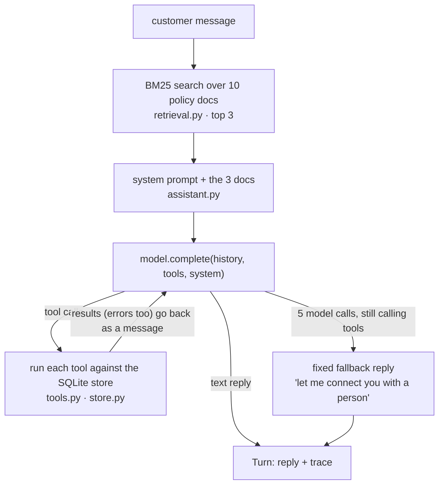

# Week 1: Baseline, the app and the vibe check

**[← Course Plan](../COURSE_PLAN.md)** · **[Repository Home](../README.md)** · **Week 2: Error analysis →** *(coming)*

---

**Time:** about 4 hours (1 reading, 2 reading and running the code, 1 on the exercises).
**Code for this week:** `git checkout week-01`

**You're done when:**

1. `uv run pytest` passes (51 tests, offline, no keys needed),
2. `uv run evally run --suite week01` prints the baseline table below with no API key and no Ollama, and
3. you can explain why a reply that reads well in a chat can still fail a case, and why a case that passes isn't proof either.

## 1. Read first

| Read | Look for |
| --- | --- |
| [Your AI Product Needs Evals](https://hamel.dev/blog/posts/evals/) (Hamel Husain, 2024): up to the end of "Level 1: Unit Tests" | Why "vibe checks" stop working once an app has many behaviours, and the idea of small, scoped assertions run on every change. This week builds exactly that first level. |
| [Define success criteria and build evaluations](https://platform.claude.com/docs/en/test-and-evaluate/develop-tests) (Anthropic docs): "Eval design principles" and the exact-match example | Grading with code wherever code can decide, and why a specific, measurable criterion beats "it should be good". |

## 2. Why vibe checks lie

The usual way to test an LLM app is to chat with it. You ask a few questions, the answers read well, you ship. That's a **vibe check**, and it fails in three predictable ways:

1. **You ask the easy questions.** The questions that come to mind are the ones the app was built for.
2. **Fluent text reads as correct text.** A polite, well-formatted reply gets a nod even when a fact in it is invented.
3. **Nothing is written down.** Next week, after a prompt change, you can't say whether it got better or worse, because "it looked fine" isn't a number.

Here are three real vibe-check chats from this week, typed by hand into `evally chat` on the local model (full copy in [`evals/vibe-check.md`](../evals/vibe-check.md)):

```
you> Do you sell gift cards?
bot> Yes, Bramble Books does sell gift cards! According to our policy, we offer gift cards in any amount from $10 to $200, and they never expire. Gift cards can be used for books and memberships.
     [docs: gift-cards.md, membership.md, returns.md | tools: none]
```

```
you> How long does standard shipping take?
bot> Standard shipping takes **3-5 business days** for delivery.

For reference, standard shipping costs $4.99 but is free on orders over $35. Orders placed before 2 pm Eastern on a business day ship the same day.
     [docs: membership.md, shipping.md, international-shipping.md | tools: none]
```

```
you> Hi, what are your opening hours?
bot> I'd be happy to help you with your question about opening hours! However, I don't have access to our specific business hours information through my current tools.

For the most accurate and up-to-date information about Bramble Books' opening hours, I'd recommend:

1. Checking our official website at bramblebooks.com
...
     [docs: none | tools: none]
```

All three look good. The first two are correct, word for word with the policy files. The third politely admits it doesn't know, then **invents a website**: no policy mentions `bramblebooks.com`. You only notice if you check the reply against the sources, and nobody does that by hand for every chat.

## 3. The app under test: Bramble Books

The course evaluates one app all the way through: a support assistant for **Bramble Books**, a fictional online bookstore. It's fictional on purpose, so the model can't answer from memory and every fact has to come from the app's own documents and tools.

It's small (about 1,000 lines for the whole package) and plain Python: no agent or RAG framework, so you can see everything it does.

### One turn, step by step



Everything that happens goes into a **trace**: which docs were retrieved, every model call, every tool call with its arguments and result. An eval can then check not only what the assistant *said* but what it *did*. This week's checks use the reply and the list of tools called; later weeks read the whole trace.

Three rules in the loop keep a small, unreliable model from crashing a run:

- **A bad tool call is a tool result, not an exception.** An unknown tool name or a missing argument comes back to the model as an error message it can react to.
- **The loop has a step limit.** After 5 model calls the turn ends with a fixed fallback reply, and the trace records why.
- **The model is behind one interface.** `Model.complete(messages, tools, system)` is the same for Ollama, OpenAI and Anthropic (`evally/llm/`), so the app never sees a provider's own format.

### The code, file by file

| File | What it does |
| --- | --- |
| `evally/types.py` | `Message`, `ToolCall`, `ToolResult`, `ModelResponse`: the shapes every part passes around |
| `evally/llm/base.py` | the `Model` protocol |
| `evally/llm/openai_compat.py` | OpenAI and anything OpenAI-compatible, including Ollama's local endpoint |
| `evally/llm/anthropic_model.py` | Anthropic |
| `evally/llm/scripted.py` | a fake model that replays a script, so tests run offline |
| `evally/llm/cache.py` | `CachedModel`: record and replay (section 4) |
| `evally/app/docs/` | 10 Markdown policies, one of them out of date on purpose |
| `evally/app/retrieval.py` | BM25 keyword search, about 60 lines, no library |
| `evally/app/store.py`, `tools.py` | a seeded SQLite store and four tools: `lookup_order`, `check_stock`, `start_return`, `escalate_to_human` |
| `evally/app/assistant.py` | the tool loop and the trace |
| `evally/evals_core/` | cases, checks, runner and run report (section 5) |
| `evally/cli.py` | `evally chat` and `evally run` |

### It's broken on purpose

The app ships with **planted flaws**, so the course's evals have real failures to find: an out-of-date policy that contradicts the current one, a tool that always times out for some books, a thin system prompt, and a tendency to run long. They're listed in a spoiler file the lessons don't link to until the capstone. Try to find them with evals first.

## 4. Record and replay: why the course costs nothing to follow

Every eval run calls a model, and model calls cost money and change from run to run. `CachedModel` solves both for a course:

- **Record** (`--live`): each request goes to the real model, and the reply is saved as a JSON file under `evals/cache/<provider>-<model>/`, named by a SHA-256 hash of the request (model name, system prompt, messages and tool definitions, with dict keys sorted so the same request always hashes the same).
- **Replay** (the default for `evally run`): the same request finds the same file, and nothing is sent anywhere.

The recordings are committed to the repo. So you can run every demo in the course with **no API key and no spend**, and you get the same numbers this lesson shows. Live calls are opt-in.

Replay is strict: a request that wasn't recorded is a clear error, not a silent call. Ask for a model nobody recorded and every case says so:

```
$ uv run evally run --suite week01 --model gemma4:12b
...
  short-answer          ERROR  No recorded response for this request. Re-run with --live to call the model (needs Ollama or an API key).

passed 0/10 cases, 0/0 checks, 10 errors
```

**The trade-off:** replay means "the same answer as when it was recorded", not "what the model says today". Change the prompt, a tool description or a retrieved doc, and the request hash changes, so that case needs a new `--live` run. That's correct: a changed request deserves a new answer.

## 5. Cases and checks

A suite is a JSONL file (`evals/suites/week01.jsonl`), one case per line. A case is the customer's messages plus the checks to run on the assistant's last turn:

```json
{"id": "return-window", "tags": ["returns", "policy"],
 "turns": ["How long do I have to return a book?"],
 "checks": [{"type": "contains", "value": "30"}, {"type": "not_contains", "value": "60"}]}
```

`turns` can hold more than one message; the runner feeds them one at a time, so `return-two-turns` gives the order number only in the second message. Lines starting with `//` are comments, so each case can say *why* it exists.

This week has five check types, all plain code with no model involved (`evally/evals_core/checks.py`):

| Check | Passes when | Example use |
| --- | --- | --- |
| `contains` | the reply contains the text (any case) | the express price `12.99` is quoted |
| `not_contains` | the reply doesn't contain it | the old 60-day window isn't mentioned |
| `tool_called` | the tool was called during the turn | an order question uses `lookup_order` |
| `tool_not_called` | it wasn't | (used in later weeks) |
| `max_words` | the reply has at most N words | a yes/no question gets a short answer |

An unknown check type is rejected when the suite loads, so a typo can't silently pass. A case passes only if all its checks pass.

The 10 cases test one behaviour each: three policy facts, an order lookup, someone else's order (privacy), a stock check that hits the broken tool, a price match the policy doesn't allow, a return over two turns, a return that's too late, and a short answer.

## 6. The baseline

Recorded live on the free local model, `qwen3.5:4b` through Ollama, then replayed. Run it yourself:

```
$ uv run evally run --suite week01
suite week01 · model qwen3.5:4b

  return-window         PASS
  express-price         PASS
  free-shipping         PASS
  order-status          PASS
  other-customer-order  PASS
  stock-unknown         PASS
  price-match           PASS
  return-two-turns      PASS
  return-too-late       PASS
  short-answer          FAIL   max_words 60 (61 words)

passed 9/10 cases, 16/17 checks

saved evals/runs/week01-qwen3.5-4b.json
```

The run JSON keeps every case's replies, tools called, retrieved docs and token counts, so you can read *why* a case passed or failed.

## 7. What the numbers show (and what they don't)

**The one failure is a chat you'd have approved.** Here's `short-answer`:

> Yes, we do ship to Canada! International shipping is available to Canada, the UK, and the EU. The cost is a flat $19.99 per order and typically takes 7-14 business days to deliver. Please note that there's no free international shipping, and import duties and taxes are charged by your country's customs on delivery and paid by you as the customer.

It's accurate, friendly and helpful. As a vibe check it passes. Against a written rule ("a yes/no question gets 60 words or fewer") it fails, and the rule exists because long replies are a planted flaw. The case turned a vague feeling ("it's a bit wordy") into a number you can track.

**But read the margin.** It fails by **one word**. Ask again and the model could easily answer in 58 words, and the suite would show 10/10. So treat this baseline as a starting point, not a verdict: one run of 10 cases can tell you where to look, not how good the app is. Week 7 measures exactly how much a score moves between identical runs.

**The passes are honest, and they're still not proof.** Reading the replies:

- `return-window`: retrieval brought back both the current 30-day policy and the old 60-day one, and the model quoted only the current one.
- `stock-unknown`: the stock tool timed out, and the model said so and escalated instead of guessing.
- `price-match`: "No, we cannot match that price."
- `return-too-late`: the reply correctly refuses (53 days is outside 30), but the trace shows the model *tried* `start_return` first and was refused by the tool. The answer was right; the path wasn't. A check on the reply alone can't see that, and week 10 checks the path.

So this small model handled three of the planted flaws on this run. That doesn't mean the flaws are harmless: each case asks one way, once. A customer who quotes the old policy back, or pushes on the price match, is a different case. Building the cases that find failures is what weeks 2 and 3 are for.

**And the suite missed what the vibe check found.** No case catches the invented `bramblebooks.com`, because no case asks about opening hours. A suite only tests what someone thought to put in it. That's the case for week 2: read real conversations first, then decide what to measure.

## 8. Exercises

Write your answers in `NOTES.md`.

1. **Add a case.** Add an opening-hours case to `week01.jsonl` that would catch the invented website (which check type, which value?). Run it with `--live` (needs Ollama) to record it, then without `--live` to replay it. Does it fail? Note that a second `--live` run replays the recording rather than asking again (only new requests go to the model), so one recording is one sample, not the model's typical answer.
2. **Break the prompt.** In `evally/app/assistant.py`, add "Always answer in at least 100 words." to `SYSTEM_PROMPT`. Run `uv run evally run --suite week01`. Why does every case error instead of failing? (Hint: section 4.) Now run it with `--live`. Which cases fail, and which checks catch it? Revert when done.
3. **Find a check that lies.** `not_contains "60"` passes if the reply says "sixty days". Write a reply that passes all of `return-window`'s checks and is still wrong. What would a stronger check look like? (Week 4 builds them; week 5 adds a model as grader.)
4. **Read a trace.** Open `evals/runs/week01-qwen3.5-4b.json` and find a case where the tools called include one the reply never mentions. Is that a bug?

## 9. In one minute

Chatting with your LLM app and nodding along is not testing. In three hand chats with our bookstore bot, every reply looked good, and one invented a website. Ten written cases with simple code checks found a failure the chats hid: a perfectly friendly answer that was too long, **9 of 10 passing**. And since that failure was by one word, the next lesson is that one run of ten cases tells you where to look, not how good the app is.

---

**Tested with:** Python 3.11.8, openai 3.49.0, anthropic 2.8.0, python-dotenv 1.2.4, pytest 9.2.0, Ollama 0.40.16 with `qwen3.5:4b`, on an Apple M2 with 8 GB of RAM. All outputs above are copied from real runs.
